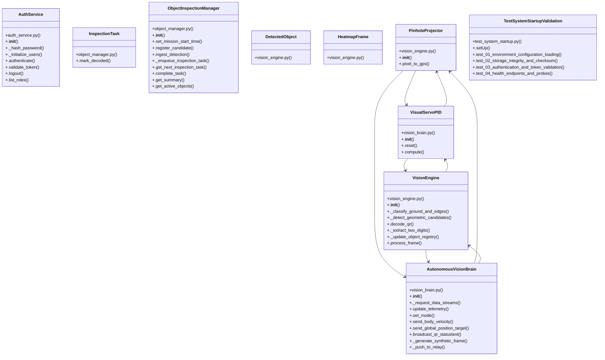

# 256 Token Pbkdf2

> 103 nodes

## Key Concepts

- [.run()](file:///C:/Antigravityyyyy/pydrone/Skycon_upgrade/vision_brain/vision_brain.py#L435) (26 connections)
- [VisionEngine](file:///C:/Antigravityyyyy/pydrone/Skycon_upgrade/backend/vision_engine.py#L147) (22 connections)
- [PinholeProjector](file:///C:/Antigravityyyyy/pydrone/Skycon_upgrade/backend/vision_engine.py#L93) (17 connections)
- [AutonomousVisionBrain](file:///C:/Antigravityyyyy/pydrone/Skycon_upgrade/vision_brain/vision_brain.py#L136) (14 connections)
- [items](file:///C:/Antigravityyyyy/pydrone/Skycon_upgrade/frontend/src/components/GroundStation/PreFlightChecklist.tsx#L16) (12 connections)
- [ObjectInspectionManager](file:///C:/Antigravityyyyy/pydrone/Skycon_upgrade/backend/object_manager.py#L61) (11 connections)
- [AuthService](file:///C:/Antigravityyyyy/pydrone/Skycon_upgrade/backend/auth_service.py#L17) (9 connections)
- [.process_frame()](file:///C:/Antigravityyyyy/pydrone/Skycon_upgrade/backend/vision_engine.py#L570) (9 connections)
- [._update_object_registry()](file:///C:/Antigravityyyyy/pydrone/Skycon_upgrade/backend/vision_engine.py#L444) (8 connections)
- [VisualServoPID](file:///C:/Antigravityyyyy/pydrone/Skycon_upgrade/vision_brain/vision_brain.py#L74) (8 connections)
- [.ingest_detection()](file:///C:/Antigravityyyyy/pydrone/Skycon_upgrade/backend/object_manager.py#L124) (7 connections)
- [TestSystemStartupValidation](file:///C:/Antigravityyyyy/pydrone/Skycon_upgrade/tests/validation/test_system_startup.py#L28) (7 connections)
- [._initialize_users()](file:///C:/Antigravityyyyy/pydrone/Skycon_upgrade/backend/auth_service.py#L44) (5 connections)
- [.authenticate()](file:///C:/Antigravityyyyy/pydrone/Skycon_upgrade/backend/auth_service.py#L55) (5 connections)
- [vision_engine.py](file:///C:/Antigravityyyyy/pydrone/Skycon_upgrade/backend/vision_engine.py#L1) (5 connections)
- [.decode_qr()](file:///C:/Antigravityyyyy/pydrone/Skycon_upgrade/backend/vision_engine.py#L361) (5 connections)
- [next](file:///C:/Antigravityyyyy/pydrone/Skycon_upgrade/frontend/src/features/dashboard/TacticalLeafletMap.tsx#L387) (5 connections)
- [main()](file:///C:/Antigravityyyyy/pydrone/Skycon_upgrade/vision_brain/vision_brain.py#L668) (5 connections)
- [._hash_password()](file:///C:/Antigravityyyyy/pydrone/Skycon_upgrade/backend/auth_service.py#L34) (4 connections)
- [.validate_token()](file:///C:/Antigravityyyyy/pydrone/Skycon_upgrade/backend/auth_service.py#L76) (4 connections)
- [._enqueue_inspection_task()](file:///C:/Antigravityyyyy/pydrone/Skycon_upgrade/backend/object_manager.py#L191) (4 connections)
- [.complete_task()](file:///C:/Antigravityyyyy/pydrone/Skycon_upgrade/backend/object_manager.py#L244) (4 connections)
- [._init_capture()](file:///C:/Antigravityyyyy/pydrone/Skycon_upgrade/backend/v4l2_capture.py#L105) (4 connections)
- [._apply_v4l2_ctl_parameters()](file:///C:/Antigravityyyyy/pydrone/Skycon_upgrade/backend/v4l2_capture.py#L151) (4 connections)
- [.test_03_authentication_and_token_validation()](file:///C:/Antigravityyyyy/pydrone/Skycon_upgrade/tests/validation/test_system_startup.py#L62) (4 connections)
- *... and 78 more nodes in this community*

## Class Diagram

## Relationships

- [[Get Status Sync]] (8 shared connections)
- [[Test Suites & MAVLink Simulation]] (8 shared connections)
- [[Sync Cloud Hardware]] (6 shared connections)
- [[Coordinate Validator Coverage]] (3 shared connections)
- [[Currentrole List Roles]] (2 shared connections)
- [[Diagnostic Section Report]] (1 shared connections)
- [[Get Acknowledgementmanager Diagnostics]] (1 shared connections)
- [[Prearm Pre Arm]] (1 shared connections)
- [[Community Autonomous Telemetry]] (1 shared connections)
- [[Tactical Leaflet Map Ground Station]] (1 shared connections)
- [[Flight Phase Boundaries]] (1 shared connections)

## Source Files

- [backend\auth_service.py](file:///C:/Antigravityyyyy/pydrone/Skycon_upgrade/backend/auth_service.py)
- [backend\object_manager.py](file:///C:/Antigravityyyyy/pydrone/Skycon_upgrade/backend/object_manager.py)
- [backend\v4l2_capture.py](file:///C:/Antigravityyyyy/pydrone/Skycon_upgrade/backend/v4l2_capture.py)
- [backend\vision_engine.py](file:///C:/Antigravityyyyy/pydrone/Skycon_upgrade/backend/vision_engine.py)
- [frontend\src\components\GroundStation\PreFlightChecklist.tsx](file:///C:/Antigravityyyyy/pydrone/Skycon_upgrade/frontend/src/components/GroundStation/PreFlightChecklist.tsx)
- [frontend\src\features\dashboard\TacticalLeafletMap.tsx](file:///C:/Antigravityyyyy/pydrone/Skycon_upgrade/frontend/src/features/dashboard/TacticalLeafletMap.tsx)
- [scripts\diagnostic_engine.py](file:///C:/Antigravityyyyy/pydrone/Skycon_upgrade/scripts/diagnostic_engine.py)
- [tests\validation\test_system_startup.py](file:///C:/Antigravityyyyy/pydrone/Skycon_upgrade/tests/validation/test_system_startup.py)
- [vision_brain\vision_brain.py](file:///C:/Antigravityyyyy/pydrone/Skycon_upgrade/vision_brain/vision_brain.py)

## Audit Trail

- EXTRACTED: 258 (72%)
- INFERRED: 101 (28%)
- AMBIGUOUS: 0 (0%)

---

*Part of the graphify knowledge wiki. See [[index]] to navigate.*