# CameraIntrinsics3D

> God node · 82 connections · [backend\georeferencing.py](file:///C:/Antigravityyyyy/pydrone/Skycon_upgrade/backend/georeferencing.py#L48)

## Call Trace Diagram

```mermaid
sequenceDiagram
    participant P0 as CameraIntrinsics3D
    participant P1 as CompanionVisionNode
    participant P2 as Georeferencer
    participant P3 as TestPhase4VisionPerception
    participant P4 as Verifies canonical REST endpoints for camera, QR, timesync, and mapping.
    participant P5 as ================================================================================
    participant P6 as Verifies camera states and bounded drop-oldest buffer behavior.
    participant P7 as Verifies brightness, contrast, and Laplacian blur detection.
    participant P8 as Verifies corrupted or non-image payloads are safely rejected without crashing.
    participant P9 as Verifies strict validation of exactly two decimal digits (^\\d{2}$).
    participant P10 as Verifies temporal multi-frame confirmation requiring 3 frames.
    participant P11 as Verifies candidate expires if observations stall before confirmation.
    participant P12 as Verifies multi-clock mapping between phone capture, companion mono, and Pixhawk
    participant P13 as Verifies 3D ground projection, attitude compensation, and honest quality tiers.
    participant P14 as Verifies explicit separation of Layer A (Coverage), Layer B (Obstacles), and Lay
    participant P15 as Verifies candidate QR or disqualified payload does NOT trigger RTL.
    participant P16 as Dedicated mobile-first Drone Core entry point.
    participant P17 as TestMilestone2EdgeVisionAndGeoreferencing
    participant P18 as SKYCON Compatibility Shim: drone_core Redirects all legacy imports to the unifi
    participant P19 as Verifies full CompanionVisionNode processing loop with synthetic video and mock
    participant P20 as Gracefully halts all child threads, capture devices, and communication ports.
    participant P21 as _MockMavlinkConsts
    participant P22 as _MockMavutil
    participant P23 as Production Onboard Vision & Georeferencing Service (companion_vision_node.py) M
    participant P24 as Unified onboard companion computer service orchestrating edge vision,     dynam
    participant P25 as Starts MAVLink listener, video ingest pipeline, and processing loops.
    participant P26 as Connects to Pixhawk TELEM1 via pymavlink and starts background telemetry thread.
    participant P27 as Dispatches MAV_CMD_SET_MESSAGE_INTERVAL to request high-rate streaming.
    participant P28 as Continuously reads incoming MAVLink packets and feeds the sync buffer.
    participant P29 as Pushes baseline flight telemetry states into sync buffer for bench test executio
    participant P30 as Switches reconnaissance lifecycle stage (STAGE_A vs STAGE_B).
    participant P31 as Enables or disables automatic braking on detection.
    participant P32 as Returns comprehensive companion node health and status metrics.
    participant P33 as Processes a single video frame:         1. Time-synchronized telemetry lookup a
    participant P34 as Posts detection JSON to GCS backend REST endpoint with non-blocking timeout.
    participant P35 as Continuous production processing loop.
    participant P36 as Comprehensive Automated Verification Test Suite for Milestone 2 Edge Vision, Ge
    participant P37 as Vector 1: Target at exact optical center with nadir attitude gives zero displace
    participant P38 as Vector 2: Target at (829.77, 218.69) with yaw=0° gives dN=1.00m, dE=1.00m.
    participant P39 as Vector 3: Pitch=-10° with yaw=90° compensates for forward tilt.
    participant P40 as Verifies circular heading interpolation across North.
    participant P41 as Verifies atomic .tmp serialization and SHA-256 validation.
    participant P42 as AdversarialGeoreferencingTests
    participant P43 as .__init__()
    participant P44 as Verifies numerical stability when radial/tangential distortion coefficients are
    participant P45 as SKYCON System — Production Flask WSGI Application & Canonical REST API Hub Stan
    participant P46 as Standardized response envelope across all API endpoints.
    participant P47 as Queues operator commands on cloud backend for retrieval by companion agent.
    participant P48 as Returns local MAVLink telemetry, or falls back to cloud-synced companion data.
    participant P49 as Streams MJPEG feed from mounted smartphone or synthetic test generator.
    participant P50 as Lightweight health probe endpoint for hosting containers & PythonAnywhere.
    participant P51 as Generates an exhaustive audit of Pi 4 hardware, power, UART, RC, camera, and net
    participant P52 as Exports timestamped hardware diagnostic report to disk.
    participant P53 as Returns the current status of outbound 4G/Cloud synchronization.
    participant P54 as Manually triggers an outbound synchronization cycle to PythonAnywhere cloud.
    participant P55 as Cloud receiver endpoint for PythonAnywhere GCS to ingest companion telemetry.
    participant P56 as Cloud receiver endpoint for PythonAnywhere GCS to ingest companion events.
    participant P57 as Returns network link health, active hotspot, and failover status.
    participant P58 as Lists configured mobile hotspot profiles with priorities (zero secrets).
    participant P59 as Configures or updates a mobile hotspot profile with priority.
    participant P60 as Deletes a configured hotspot profile.
    participant P61 as Triggers an immediate network probe and OS reconnection attempt.
    participant P62 as Validates an individual coordinate against geofence and safety invariants.
    participant P63 as Ingests versioned coordinate package, validates all coordinates independently on
    participant P64 as Returns the latest validated coordinate package.
    participant P65 as Returns real-time local cell coverage matrix and scan metrics.
    participant P66 as Resets local cell coverage tracker for a new sortie.
    participant P67 as Directly serve bundled JS/CSS Vite assets.
    participant P68 as geomapping_project()
    participant P69 as .test_optical_distortion_undistortion_stability()
    participant P70 as .test_08_attitude_compensated_georeferencing()
    participant P71 as Adversarial Stress Test Suite: 3D Georeferencing Projection Math (georeferencing
    participant P72 as Mathematical oracle: assert absolutely no NaN or Inf in any scalar or tuple fiel
    participant P73 as Stress tests roll +/-22 deg (ANGLE_MAX), pitch +/-22 deg, compound 30 deg, altit
    participant P74 as Tests continuity when yaw transitions across True North (359.9 -> 0.1 deg) and n
    participant P75 as Verifies georeferencing behavior at equator, southern hemisphere, polar bounds,
    participant P76 as Verifies mathematical linearity of ground offsets with altitude and bilateral ro
    participant P77 as .setUp()
    participant P78 as .setUp()
    participant P79 as LocalPersistenceManager
    participant P80 as HeatmapEngine
    participant P81 as CapturedFrame
    participant P82 as SmartphoneStreamPipeline
    participant P83 as GeoreferenceResult
    participant P84 as TelemetrySyncBuffer
    participant P85 as WeChatQRDetector
    participant P86 as QRDetectionResult
    participant P87 as TelemetrySnapshot
    participant P88 as V4L2CapturePipeline
    participant P89 as SmartphoneCameraConfig
    participant P90 as BrakeController
    participant P91 as V4L2Config
    participant P92 as GeoreferencedDetectionRecord
    participant P93 as CameraIntrinsics
    participant P94 as .test_companion_vision_node_pipeline_execution()
    participant P95 as main()
    participant P96 as .__init__()
    P0->>+ P1: uses
    P1-->>- P0: return
    P1->>+ P2: uses
    P2-->>- P1: return
    P2->>+ P1: uses
    P1-->>- P2: return
    P2->>+ P3: uses
    P3-->>- P2: return
    P2->>+ P4: uses
    P4-->>- P2: return
    P2->>+ P5: uses
    P5-->>- P2: return
    P2->>+ P6: uses
    P6-->>- P2: return
    P2->>+ P7: uses
    P7-->>- P2: return
    P2->>+ P8: uses
    P8-->>- P2: return
    P2->>+ P9: uses
    P9-->>- P2: return
    P2->>+ P10: uses
    P10-->>- P2: return
    P2->>+ P11: uses
    P11-->>- P2: return
    P2->>+ P12: uses
    P12-->>- P2: return
    P2->>+ P13: uses
    P13-->>- P2: return
    P2->>+ P14: uses
    P14-->>- P2: return
    P2->>+ P15: uses
    P15-->>- P2: return
    P2->>+ P16: uses
    P16-->>- P2: return
    P2->>+ P17: uses
    P17-->>- P2: return
    P2->>+ P18: uses
    P18-->>- P2: return
    P2->>+ P19: uses
    P19-->>- P2: return
    P2->>+ P20: uses
    P20-->>- P2: return
    P2->>+ P21: uses
    P21-->>- P2: return
    P2->>+ P22: uses
    P22-->>- P2: return
    P2->>+ P23: uses
    P23-->>- P2: return
    P2->>+ P24: uses
    P24-->>- P2: return
    P2->>+ P25: uses
    P25-->>- P2: return
    P2->>+ P26: uses
    P26-->>- P2: return
    P2->>+ P27: uses
    P27-->>- P2: return
    P2->>+ P28: uses
    P28-->>- P2: return
    P2->>+ P29: uses
    P29-->>- P2: return
    P2->>+ P30: uses
    P30-->>- P2: return
    P2->>+ P31: uses
    P31-->>- P2: return
    P2->>+ P32: uses
    P32-->>- P2: return
    P2->>+ P33: uses
    P33-->>- P2: return
    P2->>+ P34: uses
    P34-->>- P2: return
    P2->>+ P35: uses
    P35-->>- P2: return
    P2->>+ P36: uses
    P36-->>- P2: return
    P2->>+ P37: uses
    P37-->>- P2: return
    P2->>+ P38: uses
    P38-->>- P2: return
    P2->>+ P39: uses
    P39-->>- P2: return
    P2->>+ P40: uses
    P40-->>- P2: return
    P2->>+ P41: uses
    P41-->>- P2: return
    P2->>+ P42: uses
    P42-->>- P2: return
    P2->>+ P43: calls
    P43-->>- P2: return
    P2->>+ P44: uses
    P44-->>- P2: return
    P2->>+ P45: uses
    P45-->>- P2: return
    P2->>+ P46: uses
    P46-->>- P2: return
    P2->>+ P47: uses
    P47-->>- P2: return
    P2->>+ P48: uses
    P48-->>- P2: return
    P2->>+ P49: uses
    P49-->>- P2: return
    P2->>+ P50: uses
    P50-->>- P2: return
    P2->>+ P51: uses
    P51-->>- P2: return
    P2->>+ P52: uses
    P52-->>- P2: return
    P2->>+ P53: uses
    P53-->>- P2: return
    P2->>+ P54: uses
    P54-->>- P2: return
    P2->>+ P55: uses
    P55-->>- P2: return
    P2->>+ P56: uses
    P56-->>- P2: return
    P2->>+ P57: uses
    P57-->>- P2: return
    P2->>+ P58: uses
    P58-->>- P2: return
    P2->>+ P59: uses
    P59-->>- P2: return
    P2->>+ P60: uses
    P60-->>- P2: return
    P2->>+ P61: uses
    P61-->>- P2: return
    P2->>+ P62: uses
    P62-->>- P2: return
    P2->>+ P63: uses
    P63-->>- P2: return
    P2->>+ P64: uses
    P64-->>- P2: return
    P2->>+ P65: uses
    P65-->>- P2: return
    P2->>+ P66: uses
    P66-->>- P2: return
    P2->>+ P67: uses
    P67-->>- P2: return
    P2->>+ P68: calls
    P68-->>- P2: return
    P2->>+ P69: calls
    P69-->>- P2: return
    P2->>+ P70: calls
    P70-->>- P2: return
    P2->>+ P71: uses
    P71-->>- P2: return
    P2->>+ P72: uses
    P72-->>- P2: return
    P2->>+ P73: uses
    P73-->>- P2: return
    P2->>+ P74: uses
    P74-->>- P2: return
    P2->>+ P75: uses
    P75-->>- P2: return
    P2->>+ P76: uses
    P76-->>- P2: return
    P2->>+ P77: calls
    P77-->>- P2: return
    P2->>+ P78: calls
    P78-->>- P2: return
    P1->>+ P0: uses
    P0-->>- P1: return
    P1->>+ P79: uses
    P79-->>- P1: return
    P1->>+ P80: uses
    P80-->>- P1: return
    P1->>+ P81: uses
    P81-->>- P1: return
    P1->>+ P82: uses
    P82-->>- P1: return
    P1->>+ P83: uses
    P83-->>- P1: return
    P1->>+ P84: uses
    P84-->>- P1: return
    P1->>+ P85: uses
    P85-->>- P1: return
    P1->>+ P86: uses
    P86-->>- P1: return
    P1->>+ P87: uses
    P87-->>- P1: return
    P1->>+ P88: uses
    P88-->>- P1: return
    P1->>+ P89: uses
    P89-->>- P1: return
    P1->>+ P90: uses
    P90-->>- P1: return
    P1->>+ P91: uses
    P91-->>- P1: return
    P1->>+ P92: uses
    P92-->>- P1: return
    P1->>+ P93: uses
    P93-->>- P1: return
    P1->>+ P17: uses
    P17-->>- P1: return
    P1->>+ P18: uses
    P18-->>- P1: return
    P1->>+ P19: uses
    P19-->>- P1: return
    P1->>+ P36: uses
    P36-->>- P1: return
    P1->>+ P37: uses
    P37-->>- P1: return
    P1->>+ P38: uses
    P38-->>- P1: return
    P1->>+ P39: uses
    P39-->>- P1: return
    P1->>+ P40: uses
    P40-->>- P1: return
    P1->>+ P41: uses
    P41-->>- P1: return
    P1->>+ P94: calls
    P94-->>- P1: return
    P1->>+ P95: calls
    P95-->>- P1: return
    P0->>+ P3: uses
    P3-->>- P0: return
    P0->>+ P4: uses
    P4-->>- P0: return
    P0->>+ P5: uses
    P5-->>- P0: return
    P0->>+ P6: uses
    P6-->>- P0: return
    P0->>+ P7: uses
    P7-->>- P0: return
    P0->>+ P8: uses
    P8-->>- P0: return
    P0->>+ P9: uses
    P9-->>- P0: return
    P0->>+ P10: uses
    P10-->>- P0: return
    P0->>+ P11: uses
    P11-->>- P0: return
    P0->>+ P12: uses
    P12-->>- P0: return
    P0->>+ P13: uses
    P13-->>- P0: return
    P0->>+ P14: uses
    P14-->>- P0: return
    P0->>+ P15: uses
    P15-->>- P0: return
    P0->>+ P16: uses
    P16-->>- P0: return
    P0->>+ P17: uses
    P17-->>- P0: return
    P0->>+ P18: uses
    P18-->>- P0: return
    P0->>+ P19: uses
    P19-->>- P0: return
    P0->>+ P20: uses
    P20-->>- P0: return
    P0->>+ P21: uses
    P21-->>- P0: return
    P0->>+ P22: uses
    P22-->>- P0: return
    P0->>+ P23: uses
    P23-->>- P0: return
    P0->>+ P24: uses
    P24-->>- P0: return
    P0->>+ P25: uses
    P25-->>- P0: return
    P0->>+ P26: uses
    P26-->>- P0: return
    P0->>+ P27: uses
    P27-->>- P0: return
    P0->>+ P28: uses
    P28-->>- P0: return
    P0->>+ P29: uses
    P29-->>- P0: return
    P0->>+ P30: uses
    P30-->>- P0: return
    P0->>+ P31: uses
    P31-->>- P0: return
    P0->>+ P32: uses
    P32-->>- P0: return
    P0->>+ P33: uses
    P33-->>- P0: return
    P0->>+ P34: uses
    P34-->>- P0: return
    P0->>+ P35: uses
    P35-->>- P0: return
    P0->>+ P36: uses
    P36-->>- P0: return
    P0->>+ P37: uses
    P37-->>- P0: return
    P0->>+ P38: uses
    P38-->>- P0: return
    P0->>+ P39: uses
    P39-->>- P0: return
    P0->>+ P40: uses
    P40-->>- P0: return
    P0->>+ P41: uses
    P41-->>- P0: return
    P0->>+ P42: uses
    P42-->>- P0: return
    P0->>+ P43: calls
    P43-->>- P0: return
    P0->>+ P44: uses
    P44-->>- P0: return
    P0->>+ P45: uses
    P45-->>- P0: return
    P0->>+ P46: uses
    P46-->>- P0: return
    P0->>+ P47: uses
    P47-->>- P0: return
    P0->>+ P48: uses
    P48-->>- P0: return
    P0->>+ P49: uses
    P49-->>- P0: return
    P0->>+ P50: uses
    P50-->>- P0: return
    P0->>+ P51: uses
    P51-->>- P0: return
    P0->>+ P52: uses
    P52-->>- P0: return
    P0->>+ P53: uses
    P53-->>- P0: return
    P0->>+ P54: uses
    P54-->>- P0: return
    P0->>+ P55: uses
    P55-->>- P0: return
    P0->>+ P56: uses
    P56-->>- P0: return
    P0->>+ P57: uses
    P57-->>- P0: return
    P0->>+ P58: uses
    P58-->>- P0: return
    P0->>+ P59: uses
    P59-->>- P0: return
    P0->>+ P60: uses
    P60-->>- P0: return
    P0->>+ P61: uses
    P61-->>- P0: return
    P0->>+ P62: uses
    P62-->>- P0: return
    P0->>+ P63: uses
    P63-->>- P0: return
    P0->>+ P64: uses
    P64-->>- P0: return
    P0->>+ P65: uses
    P65-->>- P0: return
    P0->>+ P66: uses
    P66-->>- P0: return
    P0->>+ P67: uses
    P67-->>- P0: return
    P0->>+ P68: calls
    P68-->>- P0: return
    P0->>+ P69: calls
    P69-->>- P0: return
    P0->>+ P70: calls
    P70-->>- P0: return
    P0->>+ P71: uses
    P71-->>- P0: return
    P0->>+ P72: uses
    P72-->>- P0: return
    P0->>+ P73: uses
    P73-->>- P0: return
    P0->>+ P74: uses
    P74-->>- P0: return
    P0->>+ P75: uses
    P75-->>- P0: return
    P0->>+ P76: uses
    P76-->>- P0: return
    P0->>+ P96: calls
    P96-->>- P0: return
    P0->>+ P77: calls
    P77-->>- P0: return
    P0->>+ P78: calls
    P78-->>- P0: return
```

## Connections by Relation

### calls
- [[.__init__()]] `INFERRED`
- [[geomapping_project()]] `INFERRED`
- [[.test_optical_distortion_undistortion_stability()]] `INFERRED`
- [[.test_08_attitude_compensated_georeferencing()]] `INFERRED`
- [[.__init__()]] `EXTRACTED`
- [[.setUp()]] `INFERRED`
- [[.setUp()]] `INFERRED`

### contains
- [[georeferencing.py]] `EXTRACTED`

### method
- [[.__post_init__()]] `EXTRACTED`
- [[.to_dict()]] `EXTRACTED`

### rationale_for
- [[Optical parameters, intrinsic calibration, and mounting extrinsics.]] `EXTRACTED`

### uses
- [[CompanionVisionNode]] `INFERRED`
- [[TestPhase4VisionPerception]] `INFERRED`
- [[Verifies canonical REST endpoints for camera, QR, timesync, and mapping.]] `INFERRED`
- [[================================================================================]] `INFERRED`
- [[Verifies camera states and bounded drop-oldest buffer behavior.]] `INFERRED`
- [[Verifies brightness, contrast, and Laplacian blur detection.]] `INFERRED`
- [[Verifies corrupted or non-image payloads are safely rejected without crashing.]] `INFERRED`
- [[Verifies strict validation of exactly two decimal digits (^\\d{2}$).]] `INFERRED`
- [[Verifies temporal multi-frame confirmation requiring 3 frames.]] `INFERRED`
- [[Verifies candidate expires if observations stall before confirmation.]] `INFERRED`
- [[Verifies multi-clock mapping between phone capture, companion mono, and Pixhawk]] `INFERRED`
- [[Verifies 3D ground projection, attitude compensation, and honest quality tiers.]] `INFERRED`
- [[Verifies explicit separation of Layer A (Coverage), Layer B (Obstacles), and Lay]] `INFERRED`
- [[Verifies candidate QR or disqualified payload does NOT trigger RTL.]] `INFERRED`
- [[Dedicated mobile-first Drone Core entry point.]] `INFERRED`
- [[TestMilestone2EdgeVisionAndGeoreferencing]] `INFERRED`
- [[SKYCON Compatibility Shim: drone_core Redirects all legacy imports to the unifi]] `INFERRED`
- [[Verifies full CompanionVisionNode processing loop with synthetic video and mock]] `INFERRED`
- [[Gracefully halts all child threads, capture devices, and communication ports.]] `INFERRED`
- [[_MockMavlinkConsts]] `INFERRED`

---

*Part of the graphify knowledge wiki. See [[index]] to navigate.*