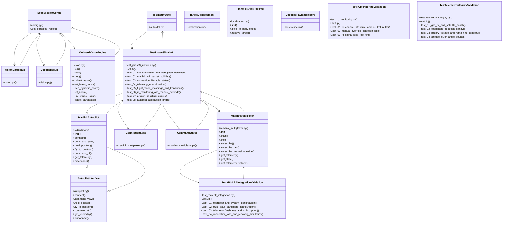

# Command Rtl Position

> 252 nodes

## Key Concepts

- [MavlinkMultiplexer](file:///C:/Antigravityyyyy/pydrone/Skycon_upgrade/backend/mavlink_multiplexer.py#L173) (77 connections)
- [TelemetryState](file:///C:/Antigravityyyyy/pydrone/Skycon_upgrade/backend/autopilot.py#L12) (41 connections)
- [get_telemetry()](file:///C:/Antigravityyyyy/pydrone/Skycon_upgrade/backend/server.py#L323) (40 connections)
- [PinholeTargetResolver](file:///C:/Antigravityyyyy/pydrone/Skycon_upgrade/backend/localization.py#L22) (34 connections)
- [EdgeMissionConfig](file:///C:/Antigravityyyyy/pydrone/Skycon_upgrade/backend/config.py#L37) (31 connections)
- [OnboardVisionEngine](file:///C:/Antigravityyyyy/pydrone/Skycon_upgrade/backend/vision.py#L37) (30 connections)
- [AutopilotInterface](file:///C:/Antigravityyyyy/pydrone/Skycon_upgrade/backend/autopilot.py#L27) (26 connections)
- [MavlinkAutopilot](file:///C:/Antigravityyyyy/pydrone/Skycon_upgrade/backend/autopilot.py#L118) (24 connections)
- [DecodedPayloadRecord](file:///C:/Antigravityyyyy/pydrone/Skycon_upgrade/backend/persistence.py#L23) (19 connections)
- [TargetDisplacement](file:///C:/Antigravityyyyy/pydrone/Skycon_upgrade/backend/localization.py#L12) (18 connections)
- [VisionCandidate](file:///C:/Antigravityyyyy/pydrone/Skycon_upgrade/backend/vision.py#L16) (18 connections)
- [DecodeResult](file:///C:/Antigravityyyyy/pydrone/Skycon_upgrade/backend/vision.py#L30) (18 connections)
- [TestPhase3Mavlink](file:///C:/Antigravityyyyy/pydrone/Skycon_upgrade/tests/test_phase3_mavlink.py#L26) (18 connections)
- [Invokes pinhole projection pipeline to update target coordinates.](file:///C:/Antigravityyyyy/pydrone/Skycon_upgrade/backend/fsm.py#L399) (17 connections)
- [._handle_successful_decode()](file:///C:/Antigravityyyyy/pydrone/Skycon_upgrade/backend/fsm.py#L350) (15 connections)
- [ConnectionState](file:///C:/Antigravityyyyy/pydrone/Skycon_upgrade/backend/mavlink_multiplexer.py#L38) (15 connections)
- [CommandStatus](file:///C:/Antigravityyyyy/pydrone/Skycon_upgrade/backend/mavlink_multiplexer.py#L50) (15 connections)
- [calculate_mavlink_crc()](file:///C:/Antigravityyyyy/pydrone/Skycon_upgrade/backend/mavlink_multiplexer.py#L156) (14 connections)
- [.tick()](file:///C:/Antigravityyyyy/pydrone/Skycon_upgrade/backend/fsm.py#L164) (13 connections)
- [.pack()](file:///C:/Antigravityyyyy/pydrone/Skycon_upgrade/frontend/src/services/packetProtocol.ts#L139) (13 connections)
- [Verifies verified flight command execution through REST API.](file:///C:/Antigravityyyyy/pydrone/Skycon_upgrade/tests/test_phase3_mavlink.py#L216) (13 connections)
- [.transition_to()](file:///C:/Antigravityyyyy/pydrone/Skycon_upgrade/backend/fsm.py#L112) (12 connections)
- [.upload_mission()](file:///C:/Antigravityyyyy/pydrone/Skycon_upgrade/backend/mavlink_multiplexer.py#L1097) (12 connections)
- [.set_mode_verified()](file:///C:/Antigravityyyyy/pydrone/Skycon_upgrade/backend/mavlink_multiplexer.py#L1279) (12 connections)
- [._step_approaching()](file:///C:/Antigravityyyyy/pydrone/Skycon_upgrade/backend/fsm.py#L276) (11 connections)
- *... and 227 more nodes in this community*

## Class Diagram

## Relationships

- [[Test Suites & MAVLink Simulation]] (119 shared connections)
- [[Get Status Sync]] (49 shared connections)
- [[Currentrole List Roles]] (16 shared connections)
- [[Coordinate Validator Coverage]] (16 shared connections)
- [[Flight Phase Boundaries]] (11 shared connections)
- [[Repository Connect Intelligence]] (4 shared connections)
- [[Sync Cloud Hardware]] (3 shared connections)
- [[Get Acknowledgementmanager Diagnostics]] (3 shared connections)
- [[Prearm Pre Arm]] (2 shared connections)
- [[Autonomous Mission & Flight Engine]] (1 shared connections)
- [[Computer Vision & QR Detection]] (1 shared connections)

## Source Files

- [backend\autopilot.py](file:///C:/Antigravityyyyy/pydrone/Skycon_upgrade/backend/autopilot.py)
- [backend\cloud_sync.py](file:///C:/Antigravityyyyy/pydrone/Skycon_upgrade/backend/cloud_sync.py)
- [backend\config.py](file:///C:/Antigravityyyyy/pydrone/Skycon_upgrade/backend/config.py)
- [backend\drone_config.py](file:///C:/Antigravityyyyy/pydrone/Skycon_upgrade/backend/drone_config.py)
- [backend\fsm.py](file:///C:/Antigravityyyyy/pydrone/Skycon_upgrade/backend/fsm.py)
- [backend\localization.py](file:///C:/Antigravityyyyy/pydrone/Skycon_upgrade/backend/localization.py)
- [backend\mavlink_multiplexer.py](file:///C:/Antigravityyyyy/pydrone/Skycon_upgrade/backend/mavlink_multiplexer.py)
- [backend\persistence.py](file:///C:/Antigravityyyyy/pydrone/Skycon_upgrade/backend/persistence.py)
- [backend\server.py](file:///C:/Antigravityyyyy/pydrone/Skycon_upgrade/backend/server.py)
- [backend\vision.py](file:///C:/Antigravityyyyy/pydrone/Skycon_upgrade/backend/vision.py)
- [docs\reports\PHASE_3_TEST_PLAN.md](file:///C:/Antigravityyyyy/pydrone/Skycon_upgrade/docs/reports/PHASE_3_TEST_PLAN.md)
- [frontend\src\services\packetProtocol.ts](file:///C:/Antigravityyyyy/pydrone/Skycon_upgrade/frontend/src/services/packetProtocol.ts)
- [tests\test_phase3_mavlink.py](file:///C:/Antigravityyyyy/pydrone/Skycon_upgrade/tests/test_phase3_mavlink.py)
- [tests\test_phase5_mission_navigation.py](file:///C:/Antigravityyyyy/pydrone/Skycon_upgrade/tests/test_phase5_mission_navigation.py)
- [tests\validation\test_mavlink_integration.py](file:///C:/Antigravityyyyy/pydrone/Skycon_upgrade/tests/validation/test_mavlink_integration.py)
- [tests\validation\test_rc_monitoring.py](file:///C:/Antigravityyyyy/pydrone/Skycon_upgrade/tests/validation/test_rc_monitoring.py)
- [tests\validation\test_telemetry_integrity.py](file:///C:/Antigravityyyyy/pydrone/Skycon_upgrade/tests/validation/test_telemetry_integrity.py)

## Audit Trail

- EXTRACTED: 656 (48%)
- INFERRED: 703 (52%)
- AMBIGUOUS: 0 (0%)

---

*Part of the graphify knowledge wiki. See [[index]] to navigate.*