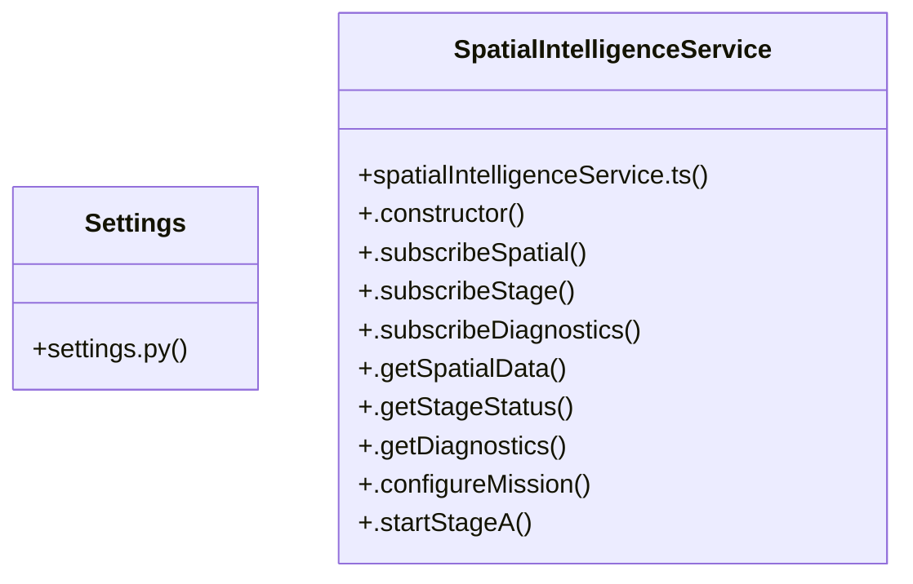

# Community 1

> 474 nodes · cohesion 0.01

## Key Concepts

- [SKYCON Phase 2 Completion Report](file:///C:/Antigravityyyyy/pydrone/Skycon_upgrade/docs/reports/PHASE_2_COMPLETION_REPORT.md#L1) (52 connections)
- [SKYCON HYBRID CONNECTIVITY & OFFLINE AUTONOMY COMPLETION REPORT](file:///C:/Antigravityyyyy/pydrone/Skycon_upgrade/docs/reports/HYBRID_CONNECTIVITY_AND_OFFLINE_AUTONOMY_COMPLETION_REPORT.md#L1) (49 connections)
- [SKYCON Master System Roadmap (Phases 1 — 6)](file:///C:/Antigravityyyyy/pydrone/Skycon_upgrade/docs/reports/SKYCON_UPDATED_MASTER_ROADMAP.md#L1) (49 connections)
- [SKYCON PHASE 6 COMPLETION REPORT](file:///C:/Antigravityyyyy/pydrone/Skycon_upgrade/docs/reports/PHASE_6_COMPLETION_REPORT.md#L1) (44 connections)
- [SKYCON SYSTEM — SETUP, HARDWARE CONNECTION & USER MANUAL](file:///C:/Antigravityyyyy/pydrone/Skycon_upgrade/docs/SKYCON_SETUP_CONNECTION_AND_USER_MANUAL.md#L1) (41 connections)
- [SKYCON Phase 4 Completion Report](file:///C:/Antigravityyyyy/pydrone/Skycon_upgrade/docs/reports/PHASE_4_COMPLETION_REPORT.md#L1) (35 connections)
- [SKYCON Phase 5 Completion Report](file:///C:/Antigravityyyyy/pydrone/Skycon_upgrade/docs/reports/PHASE_5_COMPLETION_REPORT.md#L1) (33 connections)
- [SKYCON Phase 2: Pre-Implementation Architecture, Storage & API Review](file:///C:/Antigravityyyyy/pydrone/Skycon_upgrade/docs/reports/PHASE_2_PRE_IMPLEMENTATION_REPORT.md#L1) (32 connections)
- [SKYCON Phase 6 Pre-Implementation Report](file:///C:/Antigravityyyyy/pydrone/Skycon_upgrade/docs/reports/PHASE_6_PRE_IMPLEMENTATION_REPORT.md#L1) (32 connections)
- [SKYCON HYBRID CONNECTIVITY & OFFLINE AUTONOMY PRE-IMPLEMENTATION REPORT](file:///C:/Antigravityyyyy/pydrone/Skycon_upgrade/docs/reports/HYBRID_CONNECTIVITY_PRE_IMPLEMENTATION_REPORT.md#L1) (28 connections)
- [SKYCON PHASE 7 PRE-VALIDATION AUDIT & READINESS REPORT](file:///C:/Antigravityyyyy/pydrone/Skycon_upgrade/docs/reports/PHASE_7_PRE_VALIDATION_REPORT.md#L1) (28 connections)
- [Dedicated mobile-first Drone Core entry point.](file:///C:/Antigravityyyyy/pydrone/Skycon_upgrade/backend/main.py#L1445) (26 connections)
- [SpatialIntelligenceService](file:///C:/Antigravityyyyy/pydrone/Skycon_upgrade/frontend/src/services/spatialIntelligenceService.ts#L184) (26 connections)
- [SKYCON — RASPBERRY PI MOBILE HOTSPOT CONNECTIVITY & RECONNECTION REPORT](file:///C:/Antigravityyyyy/pydrone/Skycon_upgrade/docs/reports/RASPBERRY_PI_MOBILE_HOTSPOT_CONNECTIVITY_REPORT.md#L1) (24 connections)
- [SKYCON System — Repository Structure Guide](file:///C:/Antigravityyyyy/pydrone/Skycon_upgrade/docs/architecture/REPOSITORY_STRUCTURE.md#L1) (21 connections)
- [SKYCON Phase 5 Pre-Implementation Report](file:///C:/Antigravityyyyy/pydrone/Skycon_upgrade/docs/reports/PHASE_5_PRE_IMPLEMENTATION_REPORT.md#L1) (21 connections)
- [SKYCON — SAFETY GATE VERIFICATION CHECKLIST (GATES A – E)](file:///C:/Antigravityyyyy/pydrone/Skycon_upgrade/docs/testing/SAFETY_GATE_CHECKLIST.md#L1) (19 connections)
- [SKYCON Phase 3 Pre-Implementation Report](file:///C:/Antigravityyyyy/pydrone/Skycon_upgrade/docs/reports/PHASE_3_PRE_IMPLEMENTATION_REPORT.md#L1) (17 connections)
- [Simulates realistic telemetry dynamics at 10 Hz.](file:///C:/Antigravityyyyy/pydrone/Skycon_upgrade/backend/mavlink_multiplexer.py#L1520) (17 connections)
- [SKYCON — CLOUD DEPLOYMENT & SYNCHRONIZATION GUIDE](file:///C:/Antigravityyyyy/pydrone/Skycon_upgrade/docs/deployment/CLOUD_DEPLOYMENT.md#L1) (16 connections)
- [SKYCON Phase 4 Pre-Implementation Report](file:///C:/Antigravityyyyy/pydrone/Skycon_upgrade/docs/reports/PHASE_4_PRE_IMPLEMENTATION_REPORT.md#L1) (16 connections)
- [🛸 SKYCON — Autonomous Drone Rescue & Mission System (ADDC 2026)](file:///C:/Antigravityyyyy/pydrone/Skycon_upgrade/README.md#L1) (16 connections)
- [SKYCON Optical & Sensor Specifications: SPI 100, Pixel Metrics & Target Geometry](file:///C:/Antigravityyyyy/pydrone/Skycon_upgrade/docs/reference/SPI_100_AND_PIXEL_SPECIFICATIONS.md#L1) (15 connections)
- [Dispatches outbound HTTP POST to remote cloud endpoint.](file:///C:/Antigravityyyyy/pydrone/Skycon_upgrade/backend/cloud_sync.py#L256) (14 connections)
- [Marks spatial grid cells within camera optical footprint as SCANNED.](file:///C:/Antigravityyyyy/pydrone/Skycon_upgrade/backend/mission_engine.py#L740) (14 connections)
- *... and 449 more nodes in this community*

## Class Diagram

## Relationships

- [[Community 2]] (949 shared connections)
- [[Community 11]] (44 shared connections)
- [[Community 5]] (28 shared connections)
- [[Community 4]] (26 shared connections)
- [[Community 3]] (12 shared connections)
- [[Community 10]] (11 shared connections)
- [[Community 17]] (4 shared connections)
- [[Community 9]] (1 shared connections)
- [[Community 14]] (1 shared connections)

## Source Files

- [README.md](file:///C:/Antigravityyyyy/pydrone/Skycon_upgrade/README.md)
- [backend\__init__.py](file:///C:/Antigravityyyyy/pydrone/Skycon_upgrade/backend/__init__.py)
- [backend\auth_service.py](file:///C:/Antigravityyyyy/pydrone/Skycon_upgrade/backend/auth_service.py)
- [backend\autopilot.py](file:///C:/Antigravityyyyy/pydrone/Skycon_upgrade/backend/autopilot.py)
- [backend\cloud_sync.py](file:///C:/Antigravityyyyy/pydrone/Skycon_upgrade/backend/cloud_sync.py)
- [backend\config.py](file:///C:/Antigravityyyyy/pydrone/Skycon_upgrade/backend/config.py)
- [backend\coverage_tracker.py](file:///C:/Antigravityyyyy/pydrone/Skycon_upgrade/backend/coverage_tracker.py)
- [backend\drone_config.py](file:///C:/Antigravityyyyy/pydrone/Skycon_upgrade/backend/drone_config.py)
- [backend\georeferencing.py](file:///C:/Antigravityyyyy/pydrone/Skycon_upgrade/backend/georeferencing.py)
- [backend\hardware_verification.py](file:///C:/Antigravityyyyy/pydrone/Skycon_upgrade/backend/hardware_verification.py)
- [backend\localization.py](file:///C:/Antigravityyyyy/pydrone/Skycon_upgrade/backend/localization.py)
- [backend\logging_config.py](file:///C:/Antigravityyyyy/pydrone/Skycon_upgrade/backend/logging_config.py)
- [backend\main.py](file:///C:/Antigravityyyyy/pydrone/Skycon_upgrade/backend/main.py)
- [backend\mavlink_multiplexer.py](file:///C:/Antigravityyyyy/pydrone/Skycon_upgrade/backend/mavlink_multiplexer.py)
- [backend\mission_engine.py](file:///C:/Antigravityyyyy/pydrone/Skycon_upgrade/backend/mission_engine.py)
- [backend\persistence.py](file:///C:/Antigravityyyyy/pydrone/Skycon_upgrade/backend/persistence.py)
- [backend\qr_detector.py](file:///C:/Antigravityyyyy/pydrone/Skycon_upgrade/backend/qr_detector.py)
- [backend\route_validator.py](file:///C:/Antigravityyyyy/pydrone/Skycon_upgrade/backend/route_validator.py)
- [backend\settings.py](file:///C:/Antigravityyyyy/pydrone/Skycon_upgrade/backend/settings.py)
- [backend\simple_json_store.py](file:///C:/Antigravityyyyy/pydrone/Skycon_upgrade/backend/simple_json_store.py)

## Audit Trail

- EXTRACTED: 870 (63%)
- INFERRED: 505 (37%)
- AMBIGUOUS: 0 (0%)

---

*Part of the graphify knowledge wiki. See [[index]] to navigate.*