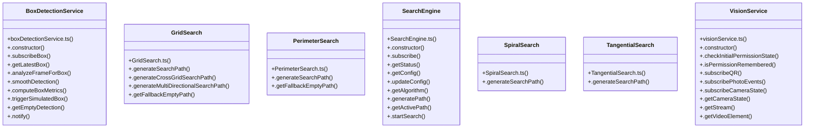

# Community 10

> 131 nodes · cohesion 0.03

## Key Concepts

- [VisionService](file:///C:/Antigravityyyyy/pydrone/Skycon_upgrade/frontend/src/services/visionService.ts#L29) (39 connections)
- [CameraVisionHUD.tsx](file:///C:/Antigravityyyyy/pydrone/Skycon_upgrade/frontend/src/components/Drone/CameraVisionHUD.tsx#L1) (21 connections)
- [SearchEngine](file:///C:/Antigravityyyyy/pydrone/Skycon_upgrade/frontend/src/services/searchEngine/SearchEngine.ts#L49) (21 connections)
- [SAE India Autonomous Drone Mission & Telemetry System — Project Rules & Context](file:///C:/Antigravityyyyy/pydrone/Skycon_upgrade/GEMINI.md#L1) (14 connections)
- [.notify()](file:///C:/Antigravityyyyy/pydrone/Skycon_upgrade/frontend/src/services/searchEngine/SearchEngine.ts#L487) (13 connections)
- [.captureAndAnalyzePhoto()](file:///C:/Antigravityyyyy/pydrone/Skycon_upgrade/frontend/src/services/visionService.ts#L593) (11 connections)
- [.getCameraState()](file:///C:/Antigravityyyyy/pydrone/Skycon_upgrade/frontend/src/services/visionService.ts#L131) (11 connections)
- [.scanLiveFrameEdgeToEdge()](file:///C:/Antigravityyyyy/pydrone/Skycon_upgrade/frontend/src/services/visionService.ts#L407) (11 connections)
- [calculateGroundCoverage()](file:///C:/Antigravityyyyy/pydrone/Skycon_upgrade/frontend/src/services/searchEngine/BaseSearchAlgorithm.ts#L28) (10 connections)
- [BoxDetectionService](file:///C:/Antigravityyyyy/pydrone/Skycon_upgrade/frontend/src/services/boxDetectionService.ts#L10) (10 connections)
- [.generateSearchPath()](file:///C:/Antigravityyyyy/pydrone/Skycon_upgrade/frontend/src/services/searchEngine/GridSearch.ts#L15) (10 connections)
- [.reportDecodedQR()](file:///C:/Antigravityyyyy/pydrone/Skycon_upgrade/frontend/src/services/visionService.ts#L750) (10 connections)
- [.triggerSimulatedDetection()](file:///C:/Antigravityyyyy/pydrone/Skycon_upgrade/frontend/src/services/visionService.ts#L688) (10 connections)
- [BaseSearchAlgorithm.ts](file:///C:/Antigravityyyyy/pydrone/Skycon_upgrade/frontend/src/services/searchEngine/BaseSearchAlgorithm.ts#L1) (9 connections)
- [.generateSearchPath()](file:///C:/Antigravityyyyy/pydrone/Skycon_upgrade/frontend/src/services/searchEngine/PerimeterSearch.ts#L15) (9 connections)
- [.generateSearchPath()](file:///C:/Antigravityyyyy/pydrone/Skycon_upgrade/frontend/src/services/searchEngine/TangentialSearch.ts#L21) (9 connections)
- [.generatePath()](file:///C:/Antigravityyyyy/pydrone/Skycon_upgrade/frontend/src/services/searchEngine/SearchEngine.ts#L183) (8 connections)
- [.notifyCameraState()](file:///C:/Antigravityyyyy/pydrone/Skycon_upgrade/frontend/src/services/visionService.ts#L881) (8 connections)
- [.playQrDetected()](file:///C:/Antigravityyyyy/pydrone/Skycon_upgrade/frontend/src/services/audioService.ts#L49) (7 connections)
- [getDistanceMeters()](file:///C:/Antigravityyyyy/pydrone/Skycon_upgrade/frontend/src/services/searchEngine/BaseSearchAlgorithm.ts#L88) (7 connections)
- [.startCamera()](file:///C:/Antigravityyyyy/pydrone/Skycon_upgrade/frontend/src/services/visionService.ts#L217) (7 connections)
- [metersToLatLng()](file:///C:/Antigravityyyyy/pydrone/Skycon_upgrade/frontend/src/services/searchEngine/BaseSearchAlgorithm.ts#L69) (6 connections)
- [.analyzeFrameForBox()](file:///C:/Antigravityyyyy/pydrone/Skycon_upgrade/frontend/src/services/boxDetectionService.ts#L44) (6 connections)
- [.handleInspectionQRNotFound()](file:///C:/Antigravityyyyy/pydrone/Skycon_upgrade/frontend/src/services/searchEngine/SearchEngine.ts#L448) (6 connections)
- [.updateConfig()](file:///C:/Antigravityyyyy/pydrone/Skycon_upgrade/frontend/src/services/searchEngine/SearchEngine.ts#L148) (6 connections)
- *... and 106 more nodes in this community*

## Class Diagram

## Relationships

- [[Community 35]] (20 shared connections)

## Source Files

- [GEMINI.md](file:///C:/Antigravityyyyy/pydrone/Skycon_upgrade/GEMINI.md)
- [frontend\src\components\Drone\CameraVisionHUD.tsx](file:///C:/Antigravityyyyy/pydrone/Skycon_upgrade/frontend/src/components/Drone/CameraVisionHUD.tsx)
- [frontend\src\components\Mission\MissionMapDrawer.tsx](file:///C:/Antigravityyyyy/pydrone/Skycon_upgrade/frontend/src/components/Mission/MissionMapDrawer.tsx)
- [frontend\src\services\audioService.ts](file:///C:/Antigravityyyyy/pydrone/Skycon_upgrade/frontend/src/services/audioService.ts)
- [frontend\src\services\boxDetectionService.ts](file:///C:/Antigravityyyyy/pydrone/Skycon_upgrade/frontend/src/services/boxDetectionService.ts)
- [frontend\src\services\searchEngine\BaseSearchAlgorithm.ts](file:///C:/Antigravityyyyy/pydrone/Skycon_upgrade/frontend/src/services/searchEngine/BaseSearchAlgorithm.ts)
- [frontend\src\services\searchEngine\GridSearch.ts](file:///C:/Antigravityyyyy/pydrone/Skycon_upgrade/frontend/src/services/searchEngine/GridSearch.ts)
- [frontend\src\services\searchEngine\PerimeterSearch.ts](file:///C:/Antigravityyyyy/pydrone/Skycon_upgrade/frontend/src/services/searchEngine/PerimeterSearch.ts)
- [frontend\src\services\searchEngine\SearchEngine.ts](file:///C:/Antigravityyyyy/pydrone/Skycon_upgrade/frontend/src/services/searchEngine/SearchEngine.ts)
- [frontend\src\services\searchEngine\SpiralSearch.ts](file:///C:/Antigravityyyyy/pydrone/Skycon_upgrade/frontend/src/services/searchEngine/SpiralSearch.ts)
- [frontend\src\services\searchEngine\TangentialSearch.ts](file:///C:/Antigravityyyyy/pydrone/Skycon_upgrade/frontend/src/services/searchEngine/TangentialSearch.ts)
- [frontend\src\services\visionService.ts](file:///C:/Antigravityyyyy/pydrone/Skycon_upgrade/frontend/src/services/visionService.ts)

## Audit Trail

- EXTRACTED: 366 (69%)
- INFERRED: 166 (31%)
- AMBIGUOUS: 0 (0%)

---

*Part of the graphify knowledge wiki. See [[index]] to navigate.*