# Community 11

> 129 nodes · cohesion 0.02

## Key Concepts

- [SKYCON PHASE 7 COMPLETION REPORT](file:///C:/Antigravityyyyy/pydrone/Skycon_upgrade/docs/reports/PHASE_7_COMPLETION_REPORT.md#L1) (31 connections)
- [SKYCON — COMPLETE AUTOMATED TEST RESULTS & VALIDATION MATRIX](file:///C:/Antigravityyyyy/pydrone/Skycon_upgrade/docs/testing/TEST_RESULTS.md#L1) (29 connections)
- [SKYCON — PHYSICAL BENCH TEST PLAN & HARDWARE INTEGRATION](file:///C:/Antigravityyyyy/pydrone/Skycon_upgrade/docs/testing/BENCH_TEST_PLAN.md#L1) (20 connections)
- [SKYCON — ARDUPILOT SITL TEST PLAN & VALIDATION SUITE](file:///C:/Antigravityyyyy/pydrone/Skycon_upgrade/docs/testing/SITL_TEST_PLAN.md#L1) (9 connections)
- [TestCameraPipelineValidation](file:///C:/Antigravityyyyy/pydrone/Skycon_upgrade/tests/validation/test_camera_pipeline.py#L23) (7 connections)
- [TestFlightModesValidation](file:///C:/Antigravityyyyy/pydrone/Skycon_upgrade/tests/validation/test_flight_modes.py#L26) (7 connections)
- [TestTelemetryIntegrityValidation](file:///C:/Antigravityyyyy/pydrone/Skycon_upgrade/tests/validation/test_telemetry_integrity.py#L21) (7 connections)
- [Verify that oldest frames are dropped to ensure zero image backlog.](file:///C:/Antigravityyyyy/pydrone/Skycon_upgrade/tests/validation/test_camera_pipeline.py#L51) (6 connections)
- [TestGeofenceValidation](file:///C:/Antigravityyyyy/pydrone/Skycon_upgrade/tests/validation/test_geofence.py#L21) (6 connections)
- [TestRCMonitoringValidation](file:///C:/Antigravityyyyy/pydrone/Skycon_upgrade/tests/validation/test_rc_monitoring.py#L20) (6 connections)
- [Validates the 21-step operational sequence:         1. Ground Station startup](file:///C:/Antigravityyyyy/pydrone/Skycon_upgrade/tests/validation/test_system_recovery.py#L35) (5 connections)
- [Strictly verify that cloud sync service contains zero flight control authority.](file:///C:/Antigravityyyyy/pydrone/Skycon_upgrade/tests/validation/test_cloud_recovery.py#L46) (4 connections)
- [.test_02_mode_command_and_telemetry_readback()](file:///C:/Antigravityyyyy/pydrone/Skycon_upgrade/tests/validation/test_flight_modes.py#L43) (4 connections)
- [.test_04_emergency_rtl_command()](file:///C:/Antigravityyyyy/pydrone/Skycon_upgrade/tests/validation/test_flight_modes.py#L58) (4 connections)
- [Verify zero or missing RC frames marks RC link as disconnected.](file:///C:/Antigravityyyyy/pydrone/Skycon_upgrade/tests/validation/test_rc_monitoring.py#L43) (4 connections)
- [.test_01_camera_state_reporting()](file:///C:/Antigravityyyyy/pydrone/Skycon_upgrade/tests/validation/test_camera_pipeline.py#L29) (3 connections)
- [.test_03_camera_freshness_latency_guard()](file:///C:/Antigravityyyyy/pydrone/Skycon_upgrade/tests/validation/test_camera_pipeline.py#L50) (3 connections)
- [Scenario 14: Events with identical payload produce identical SHA-256 hashes.](file:///C:/Antigravityyyyy/pydrone/Skycon_upgrade/tests/validation/test_failsafe_monitoring.py#L106) (3 connections)
- [.test_14_duplicate_event_suppression()](file:///C:/Antigravityyyyy/pydrone/Skycon_upgrade/tests/validation/test_failsafe_monitoring.py#L105) (3 connections)
- [Verify emergency RTL commands vehicle mode transition to RTL (6).](file:///C:/Antigravityyyyy/pydrone/Skycon_upgrade/tests/validation/test_flight_modes.py#L59) (3 connections)
- [.test_03_invalid_mode_command_rejection()](file:///C:/Antigravityyyyy/pydrone/Skycon_upgrade/tests/validation/test_flight_modes.py#L53) (3 connections)
- [Verify warning triggered when approaching within 5m braking buffer.](file:///C:/Antigravityyyyy/pydrone/Skycon_upgrade/tests/validation/test_geofence.py#L56) (3 connections)
- [.test_01_circular_geofence_containment()](file:///C:/Antigravityyyyy/pydrone/Skycon_upgrade/tests/validation/test_geofence.py#L27) (3 connections)
- [.test_02_altitude_ceiling_enforcement()](file:///C:/Antigravityyyyy/pydrone/Skycon_upgrade/tests/validation/test_geofence.py#L43) (3 connections)
- [.test_03_braking_buffer_warning()](file:///C:/Antigravityyyyy/pydrone/Skycon_upgrade/tests/validation/test_geofence.py#L55) (3 connections)
- *... and 104 more nodes in this community*

## Class Diagram

```mermaid
classDiagram
    class TestCameraPipelineValidation {
        +test_camera_pipeline.py()
        +.setUp()
        +.test_01_camera_state_reporting()
        +.test_02_frame_push_endpoint()
        +.test_03_camera_freshness_latency_guard()
    }
    class TestFlightModesValidation {
        +test_flight_modes.py()
        +.setUp()
        +.test_01_arducopter_custom_mode_mapping()
        +.test_02_mode_command_and_telemetry_readback()
        +.test_03_invalid_mode_command_rejection()
        +.test_04_emergency_rtl_command()
    }
    class TestGeofenceValidation {
        +test_geofence.py()
        +.setUp()
        +.test_01_circular_geofence_containment()
        +.test_02_altitude_ceiling_enforcement()
        +.test_03_braking_buffer_warning()
    }
    class TestRCMonitoringValidation {
        +test_rc_monitoring.py()
        +.setUp()
        +.test_01_rc_channel_structure_and_neutral_pulse()
        +.test_02_manual_override_detection_logic()
        +.test_03_rc_signal_loss_reporting()
    }
    class TestTelemetryIntegrityValidation {
        +test_telemetry_integrity.py()
        +.setUp()
        +.test_01_gps_fix_and_satellite_health()
        +.test_02_coordinate_geodesic_sanity()
        +.test_03_battery_voltage_and_remaining_capacity()
        +.test_04_attitude_euler_angle_bounds()
    }
```

## Relationships

- [[Community 5]] (10 shared connections)
- [[Community 2]] (7 shared connections)
- [[Community 4]] (1 shared connections)

## Source Files

- [docs\reports\PHASE_7_COMPLETION_REPORT.md](file:///C:/Antigravityyyyy/pydrone/Skycon_upgrade/docs/reports/PHASE_7_COMPLETION_REPORT.md)
- [docs\testing\BENCH_TEST_PLAN.md](file:///C:/Antigravityyyyy/pydrone/Skycon_upgrade/docs/testing/BENCH_TEST_PLAN.md)
- [docs\testing\SITL_TEST_PLAN.md](file:///C:/Antigravityyyyy/pydrone/Skycon_upgrade/docs/testing/SITL_TEST_PLAN.md)
- [docs\testing\TEST_RESULTS.md](file:///C:/Antigravityyyyy/pydrone/Skycon_upgrade/docs/testing/TEST_RESULTS.md)
- [tests\validation\test_camera_pipeline.py](file:///C:/Antigravityyyyy/pydrone/Skycon_upgrade/tests/validation/test_camera_pipeline.py)
- [tests\validation\test_cloud_recovery.py](file:///C:/Antigravityyyyy/pydrone/Skycon_upgrade/tests/validation/test_cloud_recovery.py)
- [tests\validation\test_failsafe_monitoring.py](file:///C:/Antigravityyyyy/pydrone/Skycon_upgrade/tests/validation/test_failsafe_monitoring.py)
- [tests\validation\test_flight_modes.py](file:///C:/Antigravityyyyy/pydrone/Skycon_upgrade/tests/validation/test_flight_modes.py)
- [tests\validation\test_geofence.py](file:///C:/Antigravityyyyy/pydrone/Skycon_upgrade/tests/validation/test_geofence.py)
- [tests\validation\test_qr_workflow.py](file:///C:/Antigravityyyyy/pydrone/Skycon_upgrade/tests/validation/test_qr_workflow.py)
- [tests\validation\test_rc_monitoring.py](file:///C:/Antigravityyyyy/pydrone/Skycon_upgrade/tests/validation/test_rc_monitoring.py)
- [tests\validation\test_system_recovery.py](file:///C:/Antigravityyyyy/pydrone/Skycon_upgrade/tests/validation/test_system_recovery.py)
- [tests\validation\test_telemetry_integrity.py](file:///C:/Antigravityyyyy/pydrone/Skycon_upgrade/tests/validation/test_telemetry_integrity.py)

## Audit Trail

- EXTRACTED: 236 (75%)
- INFERRED: 79 (25%)
- AMBIGUOUS: 0 (0%)

---

*Part of the graphify knowledge wiki. See [[index]] to navigate.*