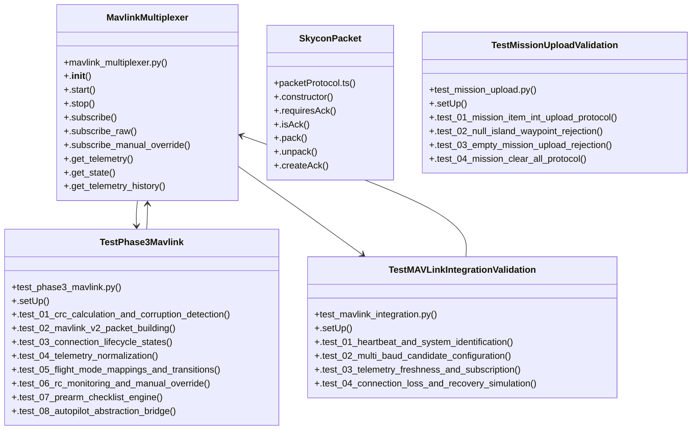

# Community 12

> 120 nodes · cohesion 0.03

## Key Concepts

- [MavlinkMultiplexer](file:///C:/Antigravityyyyy/pydrone/Skycon_upgrade/backend/mavlink_multiplexer.py#L173) (77 connections)
- [TestPhase3Mavlink](file:///C:/Antigravityyyyy/pydrone/Skycon_upgrade/tests/test_phase3_mavlink.py#L26) (18 connections)
- [calculate_mavlink_crc()](file:///C:/Antigravityyyyy/pydrone/Skycon_upgrade/backend/mavlink_multiplexer.py#L156) (14 connections)
- [.pack()](file:///C:/Antigravityyyyy/pydrone/Skycon_upgrade/frontend/src/services/packetProtocol.ts#L139) (13 connections)
- [.upload_mission()](file:///C:/Antigravityyyyy/pydrone/Skycon_upgrade/backend/mavlink_multiplexer.py#L1098) (12 connections)
- [._decode_packet()](file:///C:/Antigravityyyyy/pydrone/Skycon_upgrade/backend/mavlink_multiplexer.py#L621) (10 connections)
- [packetProtocol.ts](file:///C:/Antigravityyyyy/pydrone/Skycon_upgrade/frontend/src/services/packetProtocol.ts#L1) (8 connections)
- [._run_loop()](file:///C:/Antigravityyyyy/pydrone/Skycon_upgrade/backend/mavlink_multiplexer.py#L424) (8 connections)
- [SkyconPacket](file:///C:/Antigravityyyyy/pydrone/Skycon_upgrade/frontend/src/services/packetProtocol.ts#L83) (8 connections)
- [TestMAVLinkIntegrationValidation](file:///C:/Antigravityyyyy/pydrone/Skycon_upgrade/tests/validation/test_mavlink_integration.py#L27) (8 connections)
- [.build_mission_clear_all_packet()](file:///C:/Antigravityyyyy/pydrone/Skycon_upgrade/backend/mavlink_multiplexer.py#L1042) (7 connections)
- [.send_packet()](file:///C:/Antigravityyyyy/pydrone/Skycon_upgrade/backend/mavlink_multiplexer.py#L903) (7 connections)
- [TestMissionUploadValidation](file:///C:/Antigravityyyyy/pydrone/Skycon_upgrade/tests/validation/test_mission_upload.py#L21) (7 connections)
- [.test_06_rc_monitoring_and_manual_override()](file:///C:/Antigravityyyyy/pydrone/Skycon_upgrade/tests/test_phase3_mavlink.py#L134) (7 connections)
- [.build_command_long_packet()](file:///C:/Antigravityyyyy/pydrone/Skycon_upgrade/backend/mavlink_multiplexer.py#L918) (6 connections)
- [.build_mission_count_packet()](file:///C:/Antigravityyyyy/pydrone/Skycon_upgrade/backend/mavlink_multiplexer.py#L1050) (6 connections)
- [.build_mission_item_int_packet()](file:///C:/Antigravityyyyy/pydrone/Skycon_upgrade/backend/mavlink_multiplexer.py#L1058) (6 connections)
- [.evaluate_prearm_checklist()](file:///C:/Antigravityyyyy/pydrone/Skycon_upgrade/backend/mavlink_multiplexer.py#L1192) (6 connections)
- [.get_telemetry()](file:///C:/Antigravityyyyy/pydrone/Skycon_upgrade/backend/mavlink_multiplexer.py#L353) (6 connections)
- [._start_simulation()](file:///C:/Antigravityyyyy/pydrone/Skycon_upgrade/backend/mavlink_multiplexer.py#L565) (6 connections)
- [.test_04_telemetry_normalization()](file:///C:/Antigravityyyyy/pydrone/Skycon_upgrade/tests/test_phase3_mavlink.py#L89) (6 connections)
- [.build_mission_set_current_packet()](file:///C:/Antigravityyyyy/pydrone/Skycon_upgrade/backend/mavlink_multiplexer.py#L1090) (5 connections)
- [.build_param_set_packet()](file:///C:/Antigravityyyyy/pydrone/Skycon_upgrade/backend/mavlink_multiplexer.py#L959) (5 connections)
- [.build_request_data_stream_packet()](file:///C:/Antigravityyyyy/pydrone/Skycon_upgrade/backend/mavlink_multiplexer.py#L1018) (5 connections)
- [._run_mock_simulator()](file:///C:/Antigravityyyyy/pydrone/Skycon_upgrade/backend/mavlink_multiplexer.py#L1520) (5 connections)
- *... and 95 more nodes in this community*

## Class Diagram

## Relationships

- [[Community 5]] (47 shared connections)
- [[Community 11]] (10 shared connections)
- [[Community 2]] (1 shared connections)
- [[Community 3]] (1 shared connections)

## Source Files

- [C:\Antigravityyyyy\pydrone\Skycon_upgrade\backend\mavlink_multiplexer.py](file:///C:/Antigravityyyyy/pydrone/Skycon_upgrade/backend/mavlink_multiplexer.py)
- [backend\mavlink_multiplexer.py](file:///C:/Antigravityyyyy/pydrone/Skycon_upgrade/backend/mavlink_multiplexer.py)
- [frontend\src\services\packetProtocol.ts](file:///C:/Antigravityyyyy/pydrone/Skycon_upgrade/frontend/src/services/packetProtocol.ts)
- [tests\test_phase3_mavlink.py](file:///C:/Antigravityyyyy/pydrone/Skycon_upgrade/tests/test_phase3_mavlink.py)
- [tests\test_phase5_mission_navigation.py](file:///C:/Antigravityyyyy/pydrone/Skycon_upgrade/tests/test_phase5_mission_navigation.py)
- [tests\validation\test_mavlink_integration.py](file:///C:/Antigravityyyyy/pydrone/Skycon_upgrade/tests/validation/test_mavlink_integration.py)
- [tests\validation\test_mission_upload.py](file:///C:/Antigravityyyyy/pydrone/Skycon_upgrade/tests/validation/test_mission_upload.py)

## Audit Trail

- EXTRACTED: 322 (71%)
- INFERRED: 132 (29%)
- AMBIGUOUS: 0 (0%)

---

*Part of the graphify knowledge wiki. See [[index]] to navigate.*