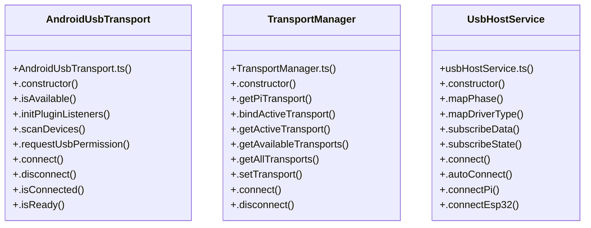

# Community 14

> 105 nodes · cohesion 0.03

## Key Concepts

- [PixhawkConnectionCard.tsx](file:///C:/Antigravityyyyy/pydrone/Skycon_upgrade/frontend/src/components/Drone/PixhawkConnectionCard.tsx#L1) (37 connections)
- [TransportManager](file:///C:/Antigravityyyyy/pydrone/Skycon_upgrade/frontend/src/services/transports/TransportManager.ts#L11) (22 connections)
- [UsbHostService](file:///C:/Antigravityyyyy/pydrone/Skycon_upgrade/frontend/src/services/usbHostService.ts#L7) (20 connections)
- [AndroidUsbTransport](file:///C:/Antigravityyyyy/pydrone/Skycon_upgrade/frontend/src/services/transports/AndroidUsbTransport.ts#L41) (16 connections)
- [.isAvailable()](file:///C:/Antigravityyyyy/pydrone/Skycon_upgrade/frontend/src/services/transports/AndroidUsbTransport.ts#L56) (8 connections)
- [.connectHardware()](file:///C:/Antigravityyyyy/pydrone/Skycon_upgrade/frontend/src/services/mavlinkService.ts#L1247) (7 connections)
- [PixhawkMonitor.tsx](file:///C:/Antigravityyyyy/pydrone/Skycon_upgrade/frontend/src/components/Drone/PixhawkMonitor.tsx#L1) (6 connections)
- [.bindActiveTransport()](file:///C:/Antigravityyyyy/pydrone/Skycon_upgrade/frontend/src/services/transports/TransportManager.ts#L73) (6 connections)
- [.autoConnect()](file:///C:/Antigravityyyyy/pydrone/Skycon_upgrade/frontend/src/services/usbHostService.ts#L103) (5 connections)
- [.connect()](file:///C:/Antigravityyyyy/pydrone/Skycon_upgrade/frontend/src/services/transports/AndroidUsbTransport.ts#L142) (4 connections)
- [.notifyState()](file:///C:/Antigravityyyyy/pydrone/Skycon_upgrade/frontend/src/services/transports/AndroidUsbTransport.ts#L235) (4 connections)
- [.connectPi()](file:///C:/Antigravityyyyy/pydrone/Skycon_upgrade/frontend/src/services/transports/TransportManager.ts#L175) (4 connections)
- [.setTransport()](file:///C:/Antigravityyyyy/pydrone/Skycon_upgrade/frontend/src/services/transports/TransportManager.ts#L98) (4 connections)
- [.disconnect()](file:///C:/Antigravityyyyy/pydrone/Skycon_upgrade/frontend/src/services/transports/AndroidUsbTransport.ts#L185) (3 connections)
- [.initPluginListeners()](file:///C:/Antigravityyyyy/pydrone/Skycon_upgrade/frontend/src/services/transports/AndroidUsbTransport.ts#L60) (3 connections)
- [.isConnected()](file:///C:/Antigravityyyyy/pydrone/Skycon_upgrade/frontend/src/services/transports/AndroidUsbTransport.ts#L197) (3 connections)
- [.isReady()](file:///C:/Antigravityyyyy/pydrone/Skycon_upgrade/frontend/src/services/transports/AndroidUsbTransport.ts#L201) (3 connections)
- [.requestUsbPermission()](file:///C:/Antigravityyyyy/pydrone/Skycon_upgrade/frontend/src/services/transports/AndroidUsbTransport.ts#L123) (3 connections)
- [.scanDevices()](file:///C:/Antigravityyyyy/pydrone/Skycon_upgrade/frontend/src/services/transports/AndroidUsbTransport.ts#L112) (3 connections)
- [handleScan()](file:///C:/Antigravityyyyy/pydrone/Skycon_upgrade/frontend/src/components/Drone/PixhawkConnectionCard.tsx#L129) (3 connections)
- [.constructor()](file:///C:/Antigravityyyyy/pydrone/Skycon_upgrade/frontend/src/services/transports/TransportManager.ts#L23) (3 connections)
- [.getConnectedTransport()](file:///C:/Antigravityyyyy/pydrone/Skycon_upgrade/frontend/src/services/transports/TransportManager.ts#L117) (3 connections)
- [.scanUsbDevices()](file:///C:/Antigravityyyyy/pydrone/Skycon_upgrade/frontend/src/services/transports/TransportManager.ts#L157) (3 connections)
- [.send()](file:///C:/Antigravityyyyy/pydrone/Skycon_upgrade/frontend/src/services/transports/TransportManager.ts#L145) (3 connections)
- [.constructor()](file:///C:/Antigravityyyyy/pydrone/Skycon_upgrade/frontend/src/services/usbHostService.ts#L13) (3 connections)
- *... and 80 more nodes in this community*

## Class Diagram

## Relationships

- No strong cross-community connections detected

## Source Files

- [C:\Antigravityyyyy\pydrone\Skycon_upgrade\frontend\src\services\mavlinkService.ts](file:///C:/Antigravityyyyy/pydrone/Skycon_upgrade/frontend/src/services/mavlinkService.ts)
- [frontend\src\components\Drone\PixhawkConnectionCard.tsx](file:///C:/Antigravityyyyy/pydrone/Skycon_upgrade/frontend/src/components/Drone/PixhawkConnectionCard.tsx)
- [frontend\src\components\Drone\PixhawkMonitor.tsx](file:///C:/Antigravityyyyy/pydrone/Skycon_upgrade/frontend/src/components/Drone/PixhawkMonitor.tsx)
- [frontend\src\services\transports\AndroidUsbTransport.ts](file:///C:/Antigravityyyyy/pydrone/Skycon_upgrade/frontend/src/services/transports/AndroidUsbTransport.ts)
- [frontend\src\services\transports\TransportManager.ts](file:///C:/Antigravityyyyy/pydrone/Skycon_upgrade/frontend/src/services/transports/TransportManager.ts)
- [frontend\src\services\transports\WebUsbTransport.ts](file:///C:/Antigravityyyyy/pydrone/Skycon_upgrade/frontend/src/services/transports/WebUsbTransport.ts)
- [frontend\src\services\usbHostService.ts](file:///C:/Antigravityyyyy/pydrone/Skycon_upgrade/frontend/src/services/usbHostService.ts)

## Audit Trail

- EXTRACTED: 264 (92%)
- INFERRED: 23 (8%)
- AMBIGUOUS: 0 (0%)

---

*Part of the graphify knowledge wiki. See [[index]] to navigate.*