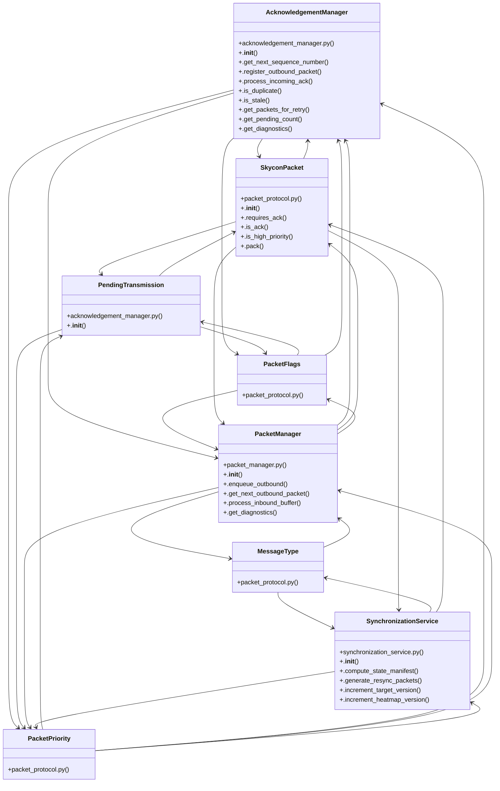

# Community 18

> 81 nodes · cohesion 0.06

## Key Concepts

- [SkyconPacket](file:///C:/Antigravityyyyy/pydrone/Skycon_upgrade/backend/packet_protocol.py#L89) (30 connections)
- [PacketPriority](file:///C:/Antigravityyyyy/pydrone/Skycon_upgrade/backend/packet_protocol.py#L48) (24 connections)
- [AcknowledgementManager](file:///C:/Antigravityyyyy/pydrone/Skycon_upgrade/backend/acknowledgement_manager.py#L46) (21 connections)
- [PacketFlags](file:///C:/Antigravityyyyy/pydrone/Skycon_upgrade/backend/packet_protocol.py#L53) (19 connections)
- [MessageType](file:///C:/Antigravityyyyy/pydrone/Skycon_upgrade/backend/packet_protocol.py#L32) (15 connections)
- [packet_protocol.py](file:///C:/Antigravityyyyy/pydrone/Skycon_upgrade/backend/packet_protocol.py#L1) (13 connections)
- [PacketManager](file:///C:/Antigravityyyyy/pydrone/Skycon_upgrade/backend/packet_manager.py#L32) (12 connections)
- [items](file:///C:/Antigravityyyyy/pydrone/Skycon_upgrade/frontend/src/components/GroundStation/PreFlightChecklist.tsx#L16) (12 connections)
- [Pixhawk 2.4.8 & ArduCopter Pre-Arm Safety Checks & Diagnostic Matrix](file:///C:/Antigravityyyyy/pydrone/Skycon_upgrade/docs/hardware/PRE_ARM_SAFETY_CHECKS.md#L1) (10 connections)
- [.process_inbound_buffer()](file:///C:/Antigravityyyyy/pydrone/Skycon_upgrade/backend/packet_manager.py#L156) (10 connections)
- [SynchronizationService](file:///C:/Antigravityyyyy/pydrone/Skycon_upgrade/backend/synchronization_service.py#L25) (10 connections)
- [PendingTransmission](file:///C:/Antigravityyyyy/pydrone/Skycon_upgrade/backend/acknowledgement_manager.py#L24) (7 connections)
- [main()](file:///C:/Antigravityyyyy/pydrone/Skycon_upgrade/scripts/load_params_to_pixhawk.py#L37) (7 connections)
- [================================================================================](file:///C:/Antigravityyyyy/pydrone/Skycon_upgrade/backend/packet_manager.py#L1) (6 connections)
- [Retrieves the next packet to transmit:         1. Checks for ACK retry retransm](file:///C:/Antigravityyyyy/pydrone/Skycon_upgrade/backend/packet_manager.py#L125) (6 connections)
- [Parses inbound buffer.         Returns: (received_packet, optional_ack_packet_t](file:///C:/Antigravityyyyy/pydrone/Skycon_upgrade/backend/packet_manager.py#L157) (6 connections)
- [Manages dual-priority outbound queues, decimation of routine telemetry,     and](file:///C:/Antigravityyyyy/pydrone/Skycon_upgrade/backend/packet_manager.py#L33) (6 connections)
- [Constructs and enqueues a packet into the appropriate priority queue.         A](file:///C:/Antigravityyyyy/pydrone/Skycon_upgrade/backend/packet_manager.py#L73) (6 connections)
- [.register_outbound_packet()](file:///C:/Antigravityyyyy/pydrone/Skycon_upgrade/backend/acknowledgement_manager.py#L92) (5 connections)
- [acknowledgement_manager.py](file:///C:/Antigravityyyyy/pydrone/Skycon_upgrade/backend/acknowledgement_manager.py#L1) (5 connections)
- [.enqueue_outbound()](file:///C:/Antigravityyyyy/pydrone/Skycon_upgrade/backend/packet_manager.py#L66) (5 connections)
- [.get_next_sequence_number()](file:///C:/Antigravityyyyy/pydrone/Skycon_upgrade/backend/acknowledgement_manager.py#L84) (4 connections)
- [.get_packets_for_retry()](file:///C:/Antigravityyyyy/pydrone/Skycon_upgrade/backend/acknowledgement_manager.py#L148) (4 connections)
- [================================================================================](file:///C:/Antigravityyyyy/pydrone/Skycon_upgrade/backend/acknowledgement_manager.py#L1) (4 connections)
- [Processes peer ACK. Removes matching pending packet.         Returns True if a](file:///C:/Antigravityyyyy/pydrone/Skycon_upgrade/backend/acknowledgement_manager.py#L106) (4 connections)
- *... and 56 more nodes in this community*

## Class Diagram

## Relationships

- [[Community 19]] (87 shared connections)
- [[Community 17]] (20 shared connections)
- [[Community 2]] (2 shared connections)
- [[Community 9]] (1 shared connections)

## Source Files

- [backend\acknowledgement_manager.py](file:///C:/Antigravityyyyy/pydrone/Skycon_upgrade/backend/acknowledgement_manager.py)
- [backend\packet_manager.py](file:///C:/Antigravityyyyy/pydrone/Skycon_upgrade/backend/packet_manager.py)
- [backend\packet_protocol.py](file:///C:/Antigravityyyyy/pydrone/Skycon_upgrade/backend/packet_protocol.py)
- [backend\synchronization_service.py](file:///C:/Antigravityyyyy/pydrone/Skycon_upgrade/backend/synchronization_service.py)
- [docs\hardware\PRE_ARM_SAFETY_CHECKS.md](file:///C:/Antigravityyyyy/pydrone/Skycon_upgrade/docs/hardware/PRE_ARM_SAFETY_CHECKS.md)
- [frontend\src\components\GroundStation\PreFlightChecklist.tsx](file:///C:/Antigravityyyyy/pydrone/Skycon_upgrade/frontend/src/components/GroundStation/PreFlightChecklist.tsx)
- [scripts\load_params_to_pixhawk.py](file:///C:/Antigravityyyyy/pydrone/Skycon_upgrade/scripts/load_params_to_pixhawk.py)

## Audit Trail

- EXTRACTED: 173 (46%)
- INFERRED: 202 (54%)
- AMBIGUOUS: 0 (0%)

---

*Part of the graphify knowledge wiki. See [[index]] to navigate.*