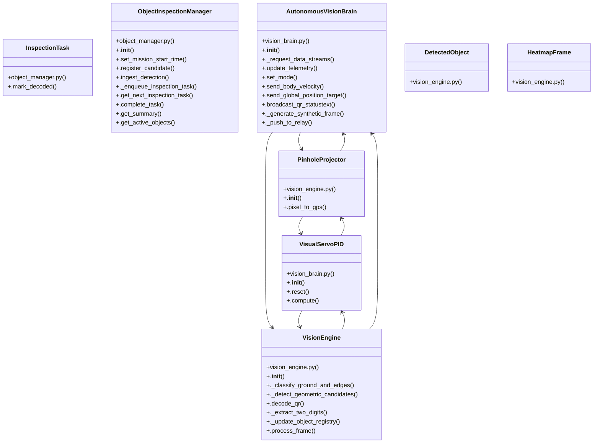

# Community 19

> 76 nodes · cohesion 0.05

## Key Concepts

- [.run()](file:///C:/Antigravityyyyy/pydrone/Skycon_upgrade/vision_brain/vision_brain.py#L435) (26 connections)
- [VisionEngine](file:///C:/Antigravityyyyy/pydrone/Skycon_upgrade/backend/vision_engine.py#L147) (22 connections)
- [PinholeProjector](file:///C:/Antigravityyyyy/pydrone/Skycon_upgrade/backend/vision_engine.py#L93) (17 connections)
- [AutonomousVisionBrain](file:///C:/Antigravityyyyy/pydrone/Skycon_upgrade/vision_brain/vision_brain.py#L136) (14 connections)
- [ObjectInspectionManager](file:///C:/Antigravityyyyy/pydrone/Skycon_upgrade/backend/object_manager.py#L61) (11 connections)
- [.process_frame()](file:///C:/Antigravityyyyy/pydrone/Skycon_upgrade/backend/vision_engine.py#L570) (9 connections)
- [VisualServoPID](file:///C:/Antigravityyyyy/pydrone/Skycon_upgrade/vision_brain/vision_brain.py#L74) (8 connections)
- [.reset()](file:///C:/Antigravityyyyy/pydrone/Skycon_upgrade/vision_brain/vision_brain.py#L97) (8 connections)
- [._update_object_registry()](file:///C:/Antigravityyyyy/pydrone/Skycon_upgrade/backend/vision_engine.py#L444) (8 connections)
- [.ingest_detection()](file:///C:/Antigravityyyyy/pydrone/Skycon_upgrade/backend/object_manager.py#L124) (7 connections)
- [vision_engine.py](file:///C:/Antigravityyyyy/pydrone/Skycon_upgrade/backend/vision_engine.py#L1) (5 connections)
- [next](file:///C:/Antigravityyyyy/pydrone/Skycon_upgrade/frontend/src/features/dashboard/TacticalLeafletMap.tsx#L387) (5 connections)
- [main()](file:///C:/Antigravityyyyy/pydrone/Skycon_upgrade/vision_brain/vision_brain.py#L668) (5 connections)
- [.decode_qr()](file:///C:/Antigravityyyyy/pydrone/Skycon_upgrade/backend/vision_engine.py#L361) (5 connections)
- [.complete_task()](file:///C:/Antigravityyyyy/pydrone/Skycon_upgrade/backend/object_manager.py#L244) (4 connections)
- [._enqueue_inspection_task()](file:///C:/Antigravityyyyy/pydrone/Skycon_upgrade/backend/object_manager.py#L191) (4 connections)
- [._apply_v4l2_ctl_parameters()](file:///C:/Antigravityyyyy/pydrone/Skycon_upgrade/backend/v4l2_capture.py#L151) (4 connections)
- [._init_capture()](file:///C:/Antigravityyyyy/pydrone/Skycon_upgrade/backend/v4l2_capture.py#L105) (4 connections)
- [._generate_synthetic_frame()](file:///C:/Antigravityyyyy/pydrone/Skycon_upgrade/vision_brain/vision_brain.py#L396) (4 connections)
- [.__init__()](file:///C:/Antigravityyyyy/pydrone/Skycon_upgrade/vision_brain/vision_brain.py#L137) (4 connections)
- [object_manager.py](file:///C:/Antigravityyyyy/pydrone/Skycon_upgrade/backend/object_manager.py#L1) (3 connections)
- [InspectionTask](file:///C:/Antigravityyyyy/pydrone/Skycon_upgrade/backend/object_manager.py#L41) (3 connections)
- [.get_active_objects()](file:///C:/Antigravityyyyy/pydrone/Skycon_upgrade/backend/object_manager.py#L291) (3 connections)
- [.get_next_inspection_task()](file:///C:/Antigravityyyyy/pydrone/Skycon_upgrade/backend/object_manager.py#L221) (3 connections)
- [.register_candidate()](file:///C:/Antigravityyyyy/pydrone/Skycon_upgrade/backend/object_manager.py#L90) (3 connections)
- *... and 51 more nodes in this community*

## Class Diagram

## Relationships

- [[Community 14]] (47 shared connections)

## Source Files

- [backend\object_manager.py](file:///C:/Antigravityyyyy/pydrone/Skycon_upgrade/backend/object_manager.py)
- [backend\v4l2_capture.py](file:///C:/Antigravityyyyy/pydrone/Skycon_upgrade/backend/v4l2_capture.py)
- [backend\vision_engine.py](file:///C:/Antigravityyyyy/pydrone/Skycon_upgrade/backend/vision_engine.py)
- [frontend\src\features\dashboard\TacticalLeafletMap.tsx](file:///C:/Antigravityyyyy/pydrone/Skycon_upgrade/frontend/src/features/dashboard/TacticalLeafletMap.tsx)
- [vision_brain\vision_brain.py](file:///C:/Antigravityyyyy/pydrone/Skycon_upgrade/vision_brain/vision_brain.py)

## Audit Trail

- EXTRACTED: 202 (70%)
- INFERRED: 87 (30%)
- AMBIGUOUS: 0 (0%)

---

*Part of the graphify knowledge wiki. See [[index]] to navigate.*