# Community 2

> 472 nodes · cohesion 0.01

## Key Concepts

- [now](file:///C:/Antigravityyyyy/pydrone/Skycon_upgrade/frontend/src/features/dashboard/TacticalLeafletMap.tsx#L375) (137 connections)
- [MAVLinkService](file:///C:/Antigravityyyyy/pydrone/Skycon_upgrade/frontend/src/services/mavlinkService.ts#L268) (108 connections)
- [.playBeep()](file:///C:/Antigravityyyyy/pydrone/Skycon_upgrade/frontend/src/services/audioService.ts#L28) (95 connections)
- [MissionEngine](file:///C:/Antigravityyyyy/pydrone/Skycon_upgrade/frontend/src/services/missionEngine.ts#L105) (51 connections)
- [.logDiagnostic()](file:///C:/Antigravityyyyy/pydrone/Skycon_upgrade/frontend/src/services/mavlinkService.ts#L716) (47 connections)
- [DashboardPage.tsx](file:///C:/Antigravityyyyy/pydrone/Skycon_upgrade/frontend/src/features/dashboard/DashboardPage.tsx#L1) (46 connections)
- [.setFlightMode()](file:///C:/Antigravityyyyy/pydrone/Skycon_upgrade/frontend/src/services/mavlinkService.ts#L3221) (39 connections)
- [.getTelemetry()](file:///C:/Antigravityyyyy/pydrone/Skycon_upgrade/frontend/src/services/mavlinkService.ts#L999) (38 connections)
- [map](file:///C:/Antigravityyyyy/pydrone/Skycon_upgrade/frontend/src/features/dashboard/TacticalLeafletMap.tsx#L252) (35 connections)
- [GroundStationMissionService](file:///C:/Antigravityyyyy/pydrone/Skycon_upgrade/frontend/src/services/groundStationMissionService.ts#L122) (32 connections)
- [GroundStationDashboard.tsx](file:///C:/Antigravityyyyy/pydrone/Skycon_upgrade/frontend/src/components/GroundStation/GroundStationDashboard.tsx#L1) (31 connections)
- [PhoneDroneMissionService](file:///C:/Antigravityyyyy/pydrone/Skycon_upgrade/frontend/src/services/phoneDroneMissionService.ts#L112) (31 connections)
- [.notifyConnection()](file:///C:/Antigravityyyyy/pydrone/Skycon_upgrade/frontend/src/services/mavlinkService.ts#L5317) (30 connections)
- [.notifyTelemetry()](file:///C:/Antigravityyyyy/pydrone/Skycon_upgrade/frontend/src/services/mavlinkService.ts#L5312) (27 connections)
- [.sendArmCommand()](file:///C:/Antigravityyyyy/pydrone/Skycon_upgrade/frontend/src/services/mavlinkService.ts#L2904) (27 connections)
- [CircleTestService](file:///C:/Antigravityyyyy/pydrone/Skycon_upgrade/frontend/src/services/circleTestService.ts#L14) (26 connections)
- [WaypointManager.tsx](file:///C:/Antigravityyyyy/pydrone/Skycon_upgrade/frontend/src/features/dashboard/WaypointManager.tsx#L1) (26 connections)
- [.addStatusMessage()](file:///C:/Antigravityyyyy/pydrone/Skycon_upgrade/frontend/src/services/mavlinkService.ts#L1086) (26 connections)
- [fetchWithFallback()](file:///C:/Antigravityyyyy/pydrone/Skycon_upgrade/frontend/src/services/apiClient.ts#L17) (25 connections)
- [.handleParsedMavlinkMessage()](file:///C:/Antigravityyyyy/pydrone/Skycon_upgrade/frontend/src/services/mavlinkService.ts#L1527) (22 connections)
- [.transitionTo()](file:///C:/Antigravityyyyy/pydrone/Skycon_upgrade/frontend/src/services/missionEngine.ts#L1391) (19 connections)
- [.triggerHaptic()](file:///C:/Antigravityyyyy/pydrone/Skycon_upgrade/frontend/src/services/audioService.ts#L99) (18 connections)
- [.commandRTL()](file:///C:/Antigravityyyyy/pydrone/Skycon_upgrade/frontend/src/services/mavlinkService.ts#L3913) (18 connections)
- [.getHomePoint()](file:///C:/Antigravityyyyy/pydrone/Skycon_upgrade/frontend/src/services/mavlinkService.ts#L1013) (18 connections)
- [.sendDisarmCommand()](file:///C:/Antigravityyyyy/pydrone/Skycon_upgrade/frontend/src/services/mavlinkService.ts#L3073) (18 connections)
- *... and 447 more nodes in this community*

## Class Diagram

```mermaid
classDiagram
    class AdaptiveSearch {
        +AdaptiveSearch.ts()
        +.constructor()
        +.generateSearchPath()
        +.generateTargetInspectionWaypoint()
        +.generateResumeWaypoint()
    }
    class AudioService {
        +audioService.ts()
        +.initCtx()
        +.setMuted()
        +.getMuted()
        +.playBeep()
        +.playQrDetected()
        +.playTargetLock()
        +.playQrSuccess()
        +.playRunnerAck()
        +.playRtlAlert()
    }
    class CircleTestService {
        +circleTestService.ts()
        +.constructor()
        +.getConfig()
        +.getState()
        +.setDiameter()
        +.setAltitude()
        +.setLaps()
        +.setFlightSpeed()
        +.setDirection()
        +.subscribeState()
    }
    class DiagnosticService {
        +diagnosticService.ts()
        +.getLastReport()
        +.isDiagnosticRunning()
        +.runCompleteDiagnostics()
        +.exportReportJSON()
        +.exportReportCSV()
    }
    class GroundStationMissionService {
        +groundStationMissionService.ts()
        +.subscribe()
        +.notify()
        +.getCurrentMission()
        +.clearMission()
        +.deleteMission()
        +.setDrawingTool()
        +.getDrawingTool()
        +.updateMissionAltitude()
        +.subscribeDrawingTool()
    }
    class MAVLinkService {
        +mavlinkService.ts()
        +.cancelPendingStreamRequests()
        +.startGcsHeartbeat()
        +.stopGcsHeartbeat()
        +.sendGcsHeartbeat()
        +.constructor()
        +.ingestCompanionTelemetry()
        +.logDiagnostic()
        +.handleUsbHostStateChange()
        +.startSerialDataCheck()
    }
    class MissionEngine {
        +missionEngine.ts()
        +.constructor()
        +.restoreAutonomousConfig()
        +.persistAutonomousConfig()
        +.restorePersistentState()
        +.persistState()
        +.clearPersistentState()
        +.initListeners()
        +.startFailsafeWatchdog()
        +.handleCriticalFailure()
    }
    class PhoneDroneMissionService {
        +phoneDroneMissionService.ts()
        +.constructor()
        +.initTelemetrySubscription()
        +.initTargetDetectionSubscription()
        +.startContainmentWatchdog()
        +.startHeartbeatWatchdog()
        +.subscribeProgress()
        +.getProgress()
        +.setConfig()
        +.getConfig()
    }
    class RunnerCommService {
        +runnerCommService.ts()
        +.constructor()
        +.initChannel()
        +.subscribeMessages()
        +.subscribeState()
        +.getState()
        +.setSignalStrength()
        +.sendQRToRunner()
        +.sendAckToDrone()
        +.broadcast()
    }
    class WebUsbTransport {
        +WebUsbTransport.ts()
        +.isAvailable()
        +.connect()
        +.startReader()
        +.disconnect()
        +.isConnected()
        +.isReady()
        +.send()
        +.subscribeData()
        +.subscribeState()
    }
```

## Relationships

- [[Community 35]] (3 shared connections)
- [[Community 9]] (2 shared connections)

## Source Files

- [C:\Antigravityyyyy\pydrone\Skycon_upgrade\frontend\src\services\circleTestService.ts](file:///C:/Antigravityyyyy/pydrone/Skycon_upgrade/frontend/src/services/circleTestService.ts)
- [C:\Antigravityyyyy\pydrone\Skycon_upgrade\frontend\src\services\customRouteService.ts](file:///C:/Antigravityyyyy/pydrone/Skycon_upgrade/frontend/src/services/customRouteService.ts)
- [C:\Antigravityyyyy\pydrone\Skycon_upgrade\frontend\src\services\groundStationMissionService.ts](file:///C:/Antigravityyyyy/pydrone/Skycon_upgrade/frontend/src/services/groundStationMissionService.ts)
- [C:\Antigravityyyyy\pydrone\Skycon_upgrade\frontend\src\services\mavlinkService.ts](file:///C:/Antigravityyyyy/pydrone/Skycon_upgrade/frontend/src/services/mavlinkService.ts)
- [frontend\src\App.tsx](file:///C:/Antigravityyyyy/pydrone/Skycon_upgrade/frontend/src/App.tsx)
- [frontend\src\components\Drone\PixhawkConnectionCard.tsx](file:///C:/Antigravityyyyy/pydrone/Skycon_upgrade/frontend/src/components/Drone/PixhawkConnectionCard.tsx)
- [frontend\src\components\Drone\UnifiedDroneCoreView.tsx](file:///C:/Antigravityyyyy/pydrone/Skycon_upgrade/frontend/src/components/Drone/UnifiedDroneCoreView.tsx)
- [frontend\src\components\GroundStation\GoogleMapGroundStation.tsx](file:///C:/Antigravityyyyy/pydrone/Skycon_upgrade/frontend/src/components/GroundStation/GoogleMapGroundStation.tsx)
- [frontend\src\components\GroundStation\GroundStationDashboard.tsx](file:///C:/Antigravityyyyy/pydrone/Skycon_upgrade/frontend/src/components/GroundStation/GroundStationDashboard.tsx)
- [frontend\src\components\Manual\ManualControlDashboard.tsx](file:///C:/Antigravityyyyy/pydrone/Skycon_upgrade/frontend/src/components/Manual/ManualControlDashboard.tsx)
- [frontend\src\components\Mission\AutonomousMissionConfigModal.tsx](file:///C:/Antigravityyyyy/pydrone/Skycon_upgrade/frontend/src/components/Mission/AutonomousMissionConfigModal.tsx)
- [frontend\src\components\Mission\LawnmowerGridUploader.tsx](file:///C:/Antigravityyyyy/pydrone/Skycon_upgrade/frontend/src/components/Mission/LawnmowerGridUploader.tsx)
- [frontend\src\components\ModeSelector.tsx](file:///C:/Antigravityyyyy/pydrone/Skycon_upgrade/frontend/src/components/ModeSelector.tsx)
- [frontend\src\components\Runner\RunnerDashboard.tsx](file:///C:/Antigravityyyyy/pydrone/Skycon_upgrade/frontend/src/components/Runner/RunnerDashboard.tsx)
- [frontend\src\components\common\DiagnosticTranslator.tsx](file:///C:/Antigravityyyyy/pydrone/Skycon_upgrade/frontend/src/components/common/DiagnosticTranslator.tsx)
- [frontend\src\components\common\MissionTimer.tsx](file:///C:/Antigravityyyyy/pydrone/Skycon_upgrade/frontend/src/components/common/MissionTimer.tsx)
- [frontend\src\components\common\ModeSelectorBar.tsx](file:///C:/Antigravityyyyy/pydrone/Skycon_upgrade/frontend/src/components/common/ModeSelectorBar.tsx)
- [frontend\src\components\common\PreArmChecksPanel.tsx](file:///C:/Antigravityyyyy/pydrone/Skycon_upgrade/frontend/src/components/common/PreArmChecksPanel.tsx)
- [frontend\src\features\dashboard\AutonomousMissionControlCard.tsx](file:///C:/Antigravityyyyy/pydrone/Skycon_upgrade/frontend/src/features/dashboard/AutonomousMissionControlCard.tsx)
- [frontend\src\features\dashboard\CameraFeed.tsx](file:///C:/Antigravityyyyy/pydrone/Skycon_upgrade/frontend/src/features/dashboard/CameraFeed.tsx)

## Audit Trail

- EXTRACTED: 1809 (62%)
- INFERRED: 1130 (38%)
- AMBIGUOUS: 0 (0%)

---

*Part of the graphify knowledge wiki. See [[index]] to navigate.*