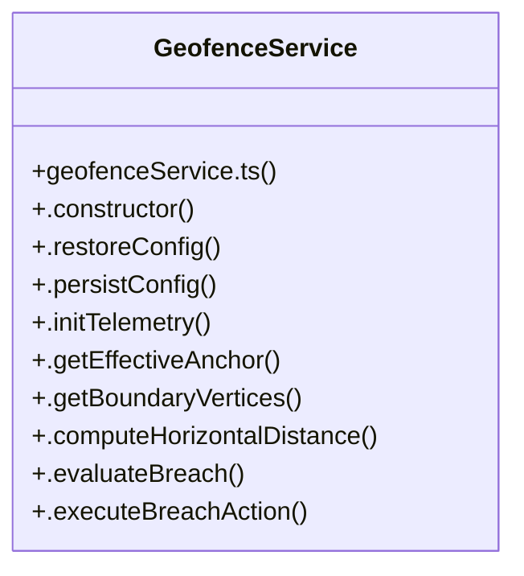

# Community 21

> 70 nodes · cohesion 0.05

## Key Concepts

- [GeofenceService](file:///C:/Antigravityyyyy/pydrone/Skycon_upgrade/frontend/src/services/geofenceService.ts#L326) (30 connections)
- [GeofenceControlModal.tsx](file:///C:/Antigravityyyyy/pydrone/Skycon_upgrade/frontend/src/components/GroundStation/GeofenceControlModal.tsx#L1) (19 connections)
- [geofenceService.ts](file:///C:/Antigravityyyyy/pydrone/Skycon_upgrade/frontend/src/services/geofenceService.ts#L1) (12 connections)
- [GeofencePanel.tsx](file:///C:/Antigravityyyyy/pydrone/Skycon_upgrade/frontend/src/features/dashboard/GeofencePanel.tsx#L1) (11 connections)
- [.notify()](file:///C:/Antigravityyyyy/pydrone/Skycon_upgrade/frontend/src/services/geofenceService.ts#L1068) (10 connections)
- [computeHaversine()](file:///C:/Antigravityyyyy/pydrone/Skycon_upgrade/frontend/src/services/geofenceService.ts#L299) (9 connections)
- [.getBoundaryVertices()](file:///C:/Antigravityyyyy/pydrone/Skycon_upgrade/frontend/src/services/geofenceService.ts#L405) (9 connections)
- [.isPointInsideGeofence()](file:///C:/Antigravityyyyy/pydrone/Skycon_upgrade/frontend/src/services/geofenceService.ts#L900) (8 connections)
- [.setEnabled()](file:///C:/Antigravityyyyy/pydrone/Skycon_upgrade/frontend/src/services/geofenceService.ts#L712) (8 connections)
- [.validateSearchBoundary()](file:///C:/Antigravityyyyy/pydrone/Skycon_upgrade/frontend/src/services/geofenceService.ts#L935) (8 connections)
- [.computeHorizontalDistance()](file:///C:/Antigravityyyyy/pydrone/Skycon_upgrade/frontend/src/services/geofenceService.ts#L444) (7 connections)
- [.getEffectiveAnchor()](file:///C:/Antigravityyyyy/pydrone/Skycon_upgrade/frontend/src/services/geofenceService.ts#L384) (7 connections)
- [.persistConfig()](file:///C:/Antigravityyyyy/pydrone/Skycon_upgrade/frontend/src/services/geofenceService.ts#L371) (7 connections)
- [.setCustomPolygon()](file:///C:/Antigravityyyyy/pydrone/Skycon_upgrade/frontend/src/services/geofenceService.ts#L730) (7 connections)
- [.resetToADDCDefaults()](file:///C:/Antigravityyyyy/pydrone/Skycon_upgrade/frontend/src/services/geofenceService.ts#L759) (6 connections)
- [showNotification()](file:///C:/Antigravityyyyy/pydrone/Skycon_upgrade/frontend/src/components/GroundStation/GeofenceControlModal.tsx#L57) (5 connections)
- [.clearGeofence()](file:///C:/Antigravityyyyy/pydrone/Skycon_upgrade/frontend/src/services/geofenceService.ts#L782) (5 connections)
- [.isInsideGeofence()](file:///C:/Antigravityyyyy/pydrone/Skycon_upgrade/frontend/src/services/geofenceService.ts#L816) (5 connections)
- [handleApplyADDCDefaults()](file:///C:/Antigravityyyyy/pydrone/Skycon_upgrade/frontend/src/components/GroundStation/GeofenceControlModal.tsx#L70) (4 connections)
- [handleClearGeofence()](file:///C:/Antigravityyyyy/pydrone/Skycon_upgrade/frontend/src/components/GroundStation/GeofenceControlModal.tsx#L100) (4 connections)
- [handleSaveConfig()](file:///C:/Antigravityyyyy/pydrone/Skycon_upgrade/frontend/src/components/GroundStation/GeofenceControlModal.tsx#L83) (4 connections)
- [handleToggleEnabled()](file:///C:/Antigravityyyyy/pydrone/Skycon_upgrade/frontend/src/components/GroundStation/GeofenceControlModal.tsx#L62) (4 connections)
- [handleToggleGeofence()](file:///C:/Antigravityyyyy/pydrone/Skycon_upgrade/frontend/src/features/dashboard/GeofencePanel.tsx#L51) (4 connections)
- [clampWaypointToGeofence()](file:///C:/Antigravityyyyy/pydrone/Skycon_upgrade/frontend/src/services/geofenceService.ts#L231) (4 connections)
- [.getState()](file:///C:/Antigravityyyyy/pydrone/Skycon_upgrade/frontend/src/services/geofenceService.ts#L1057) (4 connections)
- *... and 45 more nodes in this community*

## Class Diagram

## Relationships

- No strong cross-community connections detected

## Source Files

- [frontend\src\components\GroundStation\GeofenceControlModal.tsx](file:///C:/Antigravityyyyy/pydrone/Skycon_upgrade/frontend/src/components/GroundStation/GeofenceControlModal.tsx)
- [frontend\src\features\dashboard\GeofencePanel.tsx](file:///C:/Antigravityyyyy/pydrone/Skycon_upgrade/frontend/src/features/dashboard/GeofencePanel.tsx)
- [frontend\src\services\geofenceService.ts](file:///C:/Antigravityyyyy/pydrone/Skycon_upgrade/frontend/src/services/geofenceService.ts)

## Audit Trail

- EXTRACTED: 248 (89%)
- INFERRED: 32 (11%)
- AMBIGUOUS: 0 (0%)

---

*Part of the graphify knowledge wiki. See [[index]] to navigate.*