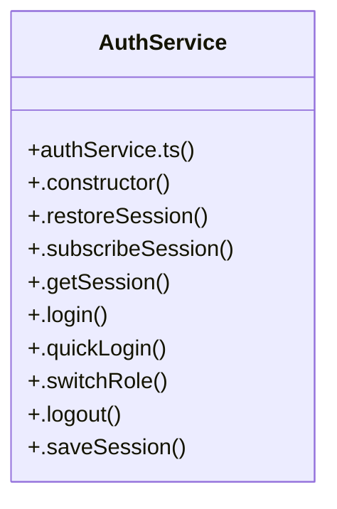

# Community 22

> 53 nodes · cohesion 0.04

## Key Concepts

- [App.tsx](file:///C:/Antigravityyyyy/pydrone/Skycon_upgrade/frontend/src/App.tsx#L1) (28 connections)
- [AuthService](file:///C:/Antigravityyyyy/pydrone/Skycon_upgrade/frontend/src/services/authService.ts#L48) (11 connections)
- [LoginScreen.tsx](file:///C:/Antigravityyyyy/pydrone/Skycon_upgrade/frontend/src/components/Auth/LoginScreen.tsx#L1) (11 connections)
- [.login()](file:///C:/Antigravityyyyy/pydrone/Skycon_upgrade/frontend/src/services/authService.ts#L78) (5 connections)
- [.logout()](file:///C:/Antigravityyyyy/pydrone/Skycon_upgrade/frontend/src/services/authService.ts#L136) (4 connections)
- [.notify()](file:///C:/Antigravityyyyy/pydrone/Skycon_upgrade/frontend/src/services/authService.ts#L152) (4 connections)
- [.saveSession()](file:///C:/Antigravityyyyy/pydrone/Skycon_upgrade/frontend/src/services/authService.ts#L144) (4 connections)
- [.switchRole()](file:///C:/Antigravityyyyy/pydrone/Skycon_upgrade/frontend/src/services/authService.ts#L123) (3 connections)
- [authService.ts](file:///C:/Antigravityyyyy/pydrone/Skycon_upgrade/frontend/src/services/authService.ts#L1) (3 connections)
- [handleEmergencyRTL()](file:///C:/Antigravityyyyy/pydrone/Skycon_upgrade/frontend/src/App.tsx#L114) (2 connections)
- [handleLogout()](file:///C:/Antigravityyyyy/pydrone/Skycon_upgrade/frontend/src/App.tsx#L129) (2 connections)
- [handleResetMission()](file:///C:/Antigravityyyyy/pydrone/Skycon_upgrade/frontend/src/App.tsx#L118) (2 connections)
- [handleStartMission()](file:///C:/Antigravityyyyy/pydrone/Skycon_upgrade/frontend/src/App.tsx#L110) (2 connections)
- [.constructor()](file:///C:/Antigravityyyyy/pydrone/Skycon_upgrade/frontend/src/services/authService.ts#L52) (2 connections)
- [.quickLogin()](file:///C:/Antigravityyyyy/pydrone/Skycon_upgrade/frontend/src/services/authService.ts#L112) (2 connections)
- [.restoreSession()](file:///C:/Antigravityyyyy/pydrone/Skycon_upgrade/frontend/src/services/authService.ts#L56) (2 connections)
- [handleLoginSubmit()](file:///C:/Antigravityyyyy/pydrone/Skycon_upgrade/frontend/src/components/Auth/LoginScreen.tsx#L46) (2 connections)
- [[decodedQR, setDecodedQR]](file:///C:/Antigravityyyyy/pydrone/Skycon_upgrade/frontend/src/App.tsx#L37) (1 connections)
- [[droneViewMode, setDroneViewMode]](file:///C:/Antigravityyyyy/pydrone/Skycon_upgrade/frontend/src/App.tsx#L27) (1 connections)
- [[elapsedSeconds, setElapsedSeconds]](file:///C:/Antigravityyyyy/pydrone/Skycon_upgrade/frontend/src/App.tsx#L36) (1 connections)
- [handleQRDetected()](file:///C:/Antigravityyyyy/pydrone/Skycon_upgrade/frontend/src/App.tsx#L124) (1 connections)
- [[historyOpen, setHistoryOpen]](file:///C:/Antigravityyyyy/pydrone/Skycon_upgrade/frontend/src/App.tsx#L26) (1 connections)
- [[homePoint, setHomePoint]](file:///C:/Antigravityyyyy/pydrone/Skycon_upgrade/frontend/src/App.tsx#L31) (1 connections)
- [isFixtureMode](file:///C:/Antigravityyyyy/pydrone/Skycon_upgrade/frontend/src/App.tsx#L134) (1 connections)
- [[missionState, setMissionState]](file:///C:/Antigravityyyyy/pydrone/Skycon_upgrade/frontend/src/App.tsx#L34) (1 connections)
- *... and 28 more nodes in this community*

## Class Diagram

## Relationships

- [[Community 2]] (1 shared connections)

## Source Files

- [frontend\src\App.tsx](file:///C:/Antigravityyyyy/pydrone/Skycon_upgrade/frontend/src/App.tsx)
- [frontend\src\components\Auth\LoginScreen.tsx](file:///C:/Antigravityyyyy/pydrone/Skycon_upgrade/frontend/src/components/Auth/LoginScreen.tsx)
- [frontend\src\services\authService.ts](file:///C:/Antigravityyyyy/pydrone/Skycon_upgrade/frontend/src/services/authService.ts)

## Audit Trail

- EXTRACTED: 114 (91%)
- INFERRED: 11 (9%)
- AMBIGUOUS: 0 (0%)

---

*Part of the graphify knowledge wiki. See [[index]] to navigate.*