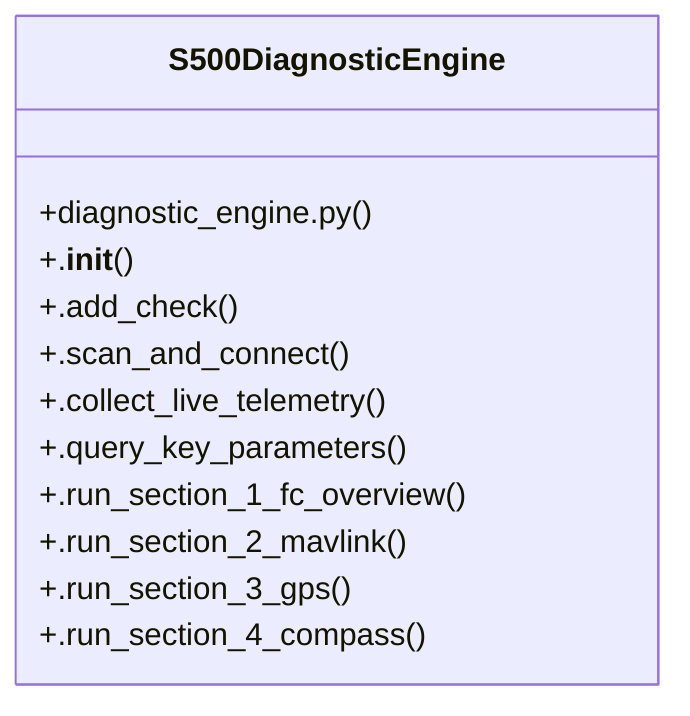

# Community 24

> 45 nodes · cohesion 0.07

## Key Concepts

- [S500DiagnosticEngine](file:///C:/Antigravityyyyy/pydrone/Skycon_upgrade/scripts/diagnostic_engine.py#L40) (24 connections)
- [.execute_complete_diagnostics()](file:///C:/Antigravityyyyy/pydrone/Skycon_upgrade/scripts/diagnostic_engine.py#L1002) (18 connections)
- [.add_check()](file:///C:/Antigravityyyyy/pydrone/Skycon_upgrade/scripts/diagnostic_engine.py#L112) (14 connections)
- [.run_section_7_arming()](file:///C:/Antigravityyyyy/pydrone/Skycon_upgrade/scripts/diagnostic_engine.py#L656) (5 connections)
- [.run_section_8_geofence()](file:///C:/Antigravityyyyy/pydrone/Skycon_upgrade/scripts/diagnostic_engine.py#L711) (5 connections)
- [.run_section_10_backend_frontend()](file:///C:/Antigravityyyyy/pydrone/Skycon_upgrade/scripts/diagnostic_engine.py#L856) (4 connections)
- [.run_section_11_error_logs()](file:///C:/Antigravityyyyy/pydrone/Skycon_upgrade/scripts/diagnostic_engine.py#L889) (4 connections)
- [.run_section_1_fc_overview()](file:///C:/Antigravityyyyy/pydrone/Skycon_upgrade/scripts/diagnostic_engine.py#L306) (4 connections)
- [.run_section_2_mavlink()](file:///C:/Antigravityyyyy/pydrone/Skycon_upgrade/scripts/diagnostic_engine.py#L365) (4 connections)
- [.run_section_3_gps()](file:///C:/Antigravityyyyy/pydrone/Skycon_upgrade/scripts/diagnostic_engine.py#L408) (4 connections)
- [.run_section_4_compass()](file:///C:/Antigravityyyyy/pydrone/Skycon_upgrade/scripts/diagnostic_engine.py#L482) (4 connections)
- [.run_section_5_imu_ekf()](file:///C:/Antigravityyyyy/pydrone/Skycon_upgrade/scripts/diagnostic_engine.py#L543) (4 connections)
- [.run_section_6_flight_mode()](file:///C:/Antigravityyyyy/pydrone/Skycon_upgrade/scripts/diagnostic_engine.py#L608) (4 connections)
- [.run_section_9_mission()](file:///C:/Antigravityyyyy/pydrone/Skycon_upgrade/scripts/diagnostic_engine.py#L811) (4 connections)
- [.scan_and_connect()](file:///C:/Antigravityyyyy/pydrone/Skycon_upgrade/scripts/diagnostic_engine.py#L160) (4 connections)
- [.collect_live_telemetry()](file:///C:/Antigravityyyyy/pydrone/Skycon_upgrade/scripts/diagnostic_engine.py#L204) (3 connections)
- [.compute_summary_health()](file:///C:/Antigravityyyyy/pydrone/Skycon_upgrade/scripts/diagnostic_engine.py#L984) (3 connections)
- [.export_csv()](file:///C:/Antigravityyyyy/pydrone/Skycon_upgrade/scripts/diagnostic_engine.py#L1054) (3 connections)
- [.query_key_parameters()](file:///C:/Antigravityyyyy/pydrone/Skycon_upgrade/scripts/diagnostic_engine.py#L269) (3 connections)
- [.synthesize_core_answers()](file:///C:/Antigravityyyyy/pydrone/Skycon_upgrade/scripts/diagnostic_engine.py#L906) (3 connections)
- [Export checks table to CSV.](file:///C:/Antigravityyyyy/pydrone/Skycon_upgrade/scripts/diagnostic_engine.py#L1055) (2 connections)
- [.export_json()](file:///C:/Antigravityyyyy/pydrone/Skycon_upgrade/scripts/diagnostic_engine.py#L1048) (2 connections)
- [diagnostic_engine.py](file:///C:/Antigravityyyyy/pydrone/Skycon_upgrade/backend/diagnostic_engine.py#L1) (1 connections)
- [Execute all 12 diagnostic sections and return the complete report.](file:///C:/Antigravityyyyy/pydrone/Skycon_upgrade/scripts/diagnostic_engine.py#L1003) (1 connections)
- [Export full diagnostic report to formatted JSON file.](file:///C:/Antigravityyyyy/pydrone/Skycon_upgrade/scripts/diagnostic_engine.py#L1049) (1 connections)
- *... and 20 more nodes in this community*

## Class Diagram

## Relationships

- [[Community 25]] (20 shared connections)
- [[Community 2]] (1 shared connections)
- [[Community 14]] (1 shared connections)

## Source Files

- [backend\diagnostic_engine.py](file:///C:/Antigravityyyyy/pydrone/Skycon_upgrade/backend/diagnostic_engine.py)
- [scripts\diagnostic_engine.py](file:///C:/Antigravityyyyy/pydrone/Skycon_upgrade/scripts/diagnostic_engine.py)

## Audit Trail

- EXTRACTED: 142 (96%)
- INFERRED: 6 (4%)
- AMBIGUOUS: 0 (0%)

---

*Part of the graphify knowledge wiki. See [[index]] to navigate.*