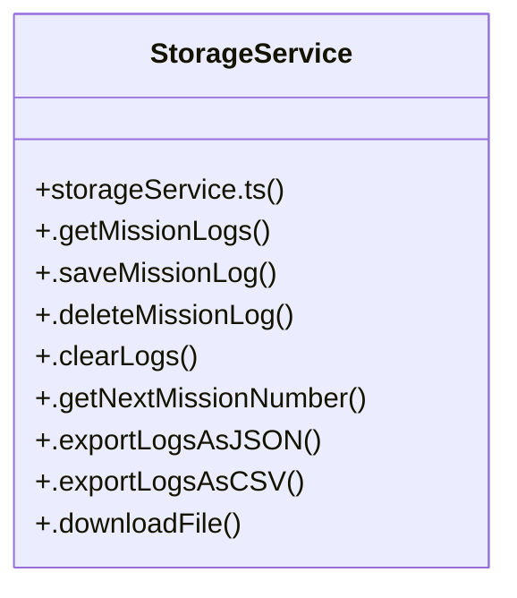

# Community 25

> 43 nodes · cohesion 0.06

## Key Concepts

- [MissionHistoryModal.tsx](file:///C:/Antigravityyyyy/pydrone/Skycon_upgrade/frontend/src/components/History/MissionHistoryModal.tsx#L1) (30 connections)
- [StorageService](file:///C:/Antigravityyyyy/pydrone/Skycon_upgrade/frontend/src/services/storageService.ts#L6) (9 connections)
- [.getMissionLogs()](file:///C:/Antigravityyyyy/pydrone/Skycon_upgrade/frontend/src/services/storageService.ts#L7) (6 connections)
- [handleExportCSV()](file:///C:/Antigravityyyyy/pydrone/Skycon_upgrade/frontend/src/components/History/MissionHistoryModal.tsx#L58) (4 connections)
- [handleExportJSON()](file:///C:/Antigravityyyyy/pydrone/Skycon_upgrade/frontend/src/components/History/MissionHistoryModal.tsx#L53) (4 connections)
- [.exportLogsAsCSV()](file:///C:/Antigravityyyyy/pydrone/Skycon_upgrade/frontend/src/services/storageService.ts#L67) (4 connections)
- [.getNextMissionNumber()](file:///C:/Antigravityyyyy/pydrone/Skycon_upgrade/frontend/src/services/storageService.ts#L54) (4 connections)
- [storageService.ts](file:///C:/Antigravityyyyy/pydrone/Skycon_upgrade/frontend/src/services/storageService.ts#L1) (3 connections)
- [.deleteMissionLog()](file:///C:/Antigravityyyyy/pydrone/Skycon_upgrade/frontend/src/services/storageService.ts#L35) (3 connections)
- [.downloadFile()](file:///C:/Antigravityyyyy/pydrone/Skycon_upgrade/frontend/src/services/storageService.ts#L106) (3 connections)
- [.exportLogsAsJSON()](file:///C:/Antigravityyyyy/pydrone/Skycon_upgrade/frontend/src/services/storageService.ts#L62) (3 connections)
- [.saveMissionLog()](file:///C:/Antigravityyyyy/pydrone/Skycon_upgrade/frontend/src/services/storageService.ts#L23) (3 connections)
- [handleClear()](file:///C:/Antigravityyyyy/pydrone/Skycon_upgrade/frontend/src/components/History/MissionHistoryModal.tsx#L63) (2 connections)
- [handleDeleteIndividual()](file:///C:/Antigravityyyyy/pydrone/Skycon_upgrade/frontend/src/components/History/MissionHistoryModal.tsx#L71) (2 connections)
- [.clearLogs()](file:///C:/Antigravityyyyy/pydrone/Skycon_upgrade/frontend/src/services/storageService.ts#L48) (2 connections)
- [allCoords](file:///C:/Antigravityyyyy/pydrone/Skycon_upgrade/frontend/src/components/History/MissionHistoryModal.tsx#L101) (1 connections)
- [end](file:///C:/Antigravityyyyy/pydrone/Skycon_upgrade/frontend/src/components/History/MissionHistoryModal.tsx#L255) (1 connections)
- [formatDuration()](file:///C:/Antigravityyyyy/pydrone/Skycon_upgrade/frontend/src/components/History/MissionHistoryModal.tsx#L82) (1 connections)
- [formatTimestamp()](file:///C:/Antigravityyyyy/pydrone/Skycon_upgrade/frontend/src/components/History/MissionHistoryModal.tsx#L88) (1 connections)
- [height](file:///C:/Antigravityyyyy/pydrone/Skycon_upgrade/frontend/src/components/History/MissionHistoryModal.tsx#L134) (1 connections)
- [home](file:///C:/Antigravityyyyy/pydrone/Skycon_upgrade/frontend/src/components/History/MissionHistoryModal.tsx#L98) (1 connections)
- [homePt](file:///C:/Antigravityyyyy/pydrone/Skycon_upgrade/frontend/src/components/History/MissionHistoryModal.tsx#L147) (1 connections)
- [lats](file:///C:/Antigravityyyyy/pydrone/Skycon_upgrade/frontend/src/components/History/MissionHistoryModal.tsx#L118) (1 connections)
- [latSpan](file:///C:/Antigravityyyyy/pydrone/Skycon_upgrade/frontend/src/components/History/MissionHistoryModal.tsx#L126) (1 connections)
- [lngs](file:///C:/Antigravityyyyy/pydrone/Skycon_upgrade/frontend/src/components/History/MissionHistoryModal.tsx#L119) (1 connections)
- *... and 18 more nodes in this community*

## Class Diagram

## Relationships

- No strong cross-community connections detected

## Source Files

- [frontend\src\components\History\MissionHistoryModal.tsx](file:///C:/Antigravityyyyy/pydrone/Skycon_upgrade/frontend/src/components/History/MissionHistoryModal.tsx)
- [frontend\src\services\storageService.ts](file:///C:/Antigravityyyyy/pydrone/Skycon_upgrade/frontend/src/services/storageService.ts)

## Audit Trail

- EXTRACTED: 92 (84%)
- INFERRED: 18 (16%)
- AMBIGUOUS: 0 (0%)

---

*Part of the graphify knowledge wiki. See [[index]] to navigate.*