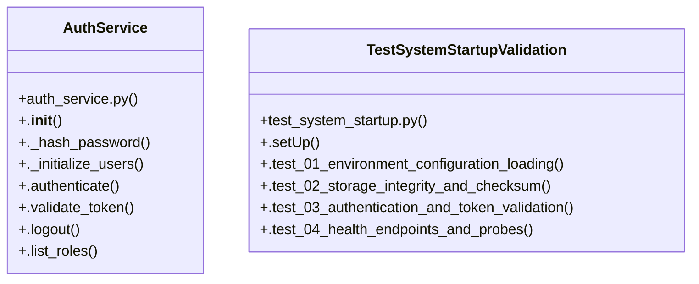

# Community 31

> 26 nodes · cohesion 0.09

## Key Concepts

- [AuthService](file:///C:/Antigravityyyyy/pydrone/Skycon_upgrade/backend/auth_service.py#L17) (9 connections)
- [TestSystemStartupValidation](file:///C:/Antigravityyyyy/pydrone/Skycon_upgrade/tests/validation/test_system_startup.py#L28) (7 connections)
- [.authenticate()](file:///C:/Antigravityyyyy/pydrone/Skycon_upgrade/backend/auth_service.py#L55) (5 connections)
- [._initialize_users()](file:///C:/Antigravityyyyy/pydrone/Skycon_upgrade/backend/auth_service.py#L44) (5 connections)
- [._hash_password()](file:///C:/Antigravityyyyy/pydrone/Skycon_upgrade/backend/auth_service.py#L34) (4 connections)
- [.validate_token()](file:///C:/Antigravityyyyy/pydrone/Skycon_upgrade/backend/auth_service.py#L76) (4 connections)
- [.test_03_authentication_and_token_validation()](file:///C:/Antigravityyyyy/pydrone/Skycon_upgrade/tests/validation/test_system_startup.py#L62) (4 connections)
- [Verify lightweight health probes and multi-subsystem diagnostics.](file:///C:/Antigravityyyyy/pydrone/Skycon_upgrade/tests/validation/test_system_startup.py#L78) (3 connections)
- [.test_04_health_endpoints_and_probes()](file:///C:/Antigravityyyyy/pydrone/Skycon_upgrade/tests/validation/test_system_startup.py#L77) (3 connections)
- [.__init__()](file:///C:/Antigravityyyyy/pydrone/Skycon_upgrade/backend/auth_service.py#L28) (2 connections)
- [.logout()](file:///C:/Antigravityyyyy/pydrone/Skycon_upgrade/backend/auth_service.py#L93) (2 connections)
- [auth_service.py](file:///C:/Antigravityyyyy/pydrone/Skycon_upgrade/backend/auth_service.py#L1) (2 connections)
- [.test_01_environment_configuration_loading()](file:///C:/Antigravityyyyy/pydrone/Skycon_upgrade/tests/validation/test_system_startup.py#L35) (2 connections)
- [test_system_startup.py](file:///C:/Antigravityyyyy/pydrone/Skycon_upgrade/tests/validation/test_system_startup.py#L1) (2 connections)
- [SKYCON System — Authentication & Access Control Service PBKDF2/SHA-256 Salted P](file:///C:/Antigravityyyyy/pydrone/Skycon_upgrade/backend/auth_service.py#L1) (1 connections)
- [Manages secure authentication, token generation, and role-based permissions.](file:///C:/Antigravityyyyy/pydrone/Skycon_upgrade/backend/auth_service.py#L18) (1 connections)
- [Derives a secure 256-bit key using PBKDF2 with 100,000 SHA-256 iterations.](file:///C:/Antigravityyyyy/pydrone/Skycon_upgrade/backend/auth_service.py#L35) (1 connections)
- [Initializes default hashed user credentials in memory.](file:///C:/Antigravityyyyy/pydrone/Skycon_upgrade/backend/auth_service.py#L45) (1 connections)
- [Verifies credentials and returns user profile if valid.](file:///C:/Antigravityyyyy/pydrone/Skycon_upgrade/backend/auth_service.py#L56) (1 connections)
- [Validates an active session token and checks expiration.](file:///C:/Antigravityyyyy/pydrone/Skycon_upgrade/backend/auth_service.py#L77) (1 connections)
- [Invalidates an active session token.](file:///C:/Antigravityyyyy/pydrone/Skycon_upgrade/backend/auth_service.py#L94) (1 connections)
- [================================================================================](file:///C:/Antigravityyyyy/pydrone/Skycon_upgrade/tests/validation/test_system_startup.py#L1) (1 connections)
- [Validates cold startup, configuration parameters, and health monitoring.](file:///C:/Antigravityyyyy/pydrone/Skycon_upgrade/tests/validation/test_system_startup.py#L29) (1 connections)
- [Verify settings load required base paths, ports, and safety defaults.](file:///C:/Antigravityyyyy/pydrone/Skycon_upgrade/tests/validation/test_system_startup.py#L36) (1 connections)
- [Verify authentication service issues and validates session tokens.](file:///C:/Antigravityyyyy/pydrone/Skycon_upgrade/tests/validation/test_system_startup.py#L63) (1 connections)
- *... and 1 more nodes in this community*

## Class Diagram

## Relationships

- [[Community 14]] (11 shared connections)
- [[Community 11]] (3 shared connections)

## Source Files

- [backend\auth_service.py](file:///C:/Antigravityyyyy/pydrone/Skycon_upgrade/backend/auth_service.py)
- [tests\validation\test_system_startup.py](file:///C:/Antigravityyyyy/pydrone/Skycon_upgrade/tests/validation/test_system_startup.py)

## Audit Trail

- EXTRACTED: 56 (85%)
- INFERRED: 10 (15%)
- AMBIGUOUS: 0 (0%)

---

*Part of the graphify knowledge wiki. See [[index]] to navigate.*