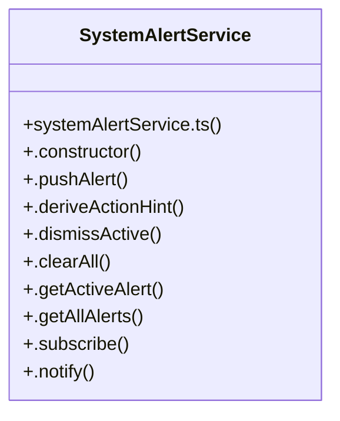

# Community 32

> 25 nodes · cohesion 0.09

## Key Concepts

- [GlobalErrorHUD.tsx](file:///C:/Antigravityyyyy/pydrone/Skycon_upgrade/frontend/src/components/common/GlobalErrorHUD.tsx#L1) (14 connections)
- [SystemAlertService](file:///C:/Antigravityyyyy/pydrone/Skycon_upgrade/frontend/src/services/systemAlertService.ts#L26) (10 connections)
- [.notify()](file:///C:/Antigravityyyyy/pydrone/Skycon_upgrade/frontend/src/services/systemAlertService.ts#L154) (4 connections)
- [.clearAll()](file:///C:/Antigravityyyyy/pydrone/Skycon_upgrade/frontend/src/services/systemAlertService.ts#L134) (3 connections)
- [.dismissActive()](file:///C:/Antigravityyyyy/pydrone/Skycon_upgrade/frontend/src/services/systemAlertService.ts#L124) (3 connections)
- [handleClearAll()](file:///C:/Antigravityyyyy/pydrone/Skycon_upgrade/frontend/src/components/common/GlobalErrorHUD.tsx#L86) (2 connections)
- [handleDismiss()](file:///C:/Antigravityyyyy/pydrone/Skycon_upgrade/frontend/src/components/common/GlobalErrorHUD.tsx#L82) (2 connections)
- [.deriveActionHint()](file:///C:/Antigravityyyyy/pydrone/Skycon_upgrade/frontend/src/services/systemAlertService.ts#L92) (2 connections)
- [systemAlertService.ts](file:///C:/Antigravityyyyy/pydrone/Skycon_upgrade/frontend/src/services/systemAlertService.ts#L1) (1 connections)
- [[activeAlert, setActiveAlert]](file:///C:/Antigravityyyyy/pydrone/Skycon_upgrade/frontend/src/components/common/GlobalErrorHUD.tsx#L29) (1 connections)
- [activeList](file:///C:/Antigravityyyyy/pydrone/Skycon_upgrade/frontend/src/components/common/GlobalErrorHUD.tsx#L55) (1 connections)
- [[alerts, setAlerts]](file:///C:/Antigravityyyyy/pydrone/Skycon_upgrade/frontend/src/components/common/GlobalErrorHUD.tsx#L28) (1 connections)
- [[currentIndex, setCurrentIndex]](file:///C:/Antigravityyyyy/pydrone/Skycon_upgrade/frontend/src/components/common/GlobalErrorHUD.tsx#L30) (1 connections)
- [currentItem](file:///C:/Antigravityyyyy/pydrone/Skycon_upgrade/frontend/src/components/common/GlobalErrorHUD.tsx#L56) (1 connections)
- [formatTime()](file:///C:/Antigravityyyyy/pydrone/Skycon_upgrade/frontend/src/components/common/GlobalErrorHUD.tsx#L65) (1 connections)
- [handleNext()](file:///C:/Antigravityyyyy/pydrone/Skycon_upgrade/frontend/src/components/common/GlobalErrorHUD.tsx#L70) (1 connections)
- [handlePrev()](file:///C:/Antigravityyyyy/pydrone/Skycon_upgrade/frontend/src/components/common/GlobalErrorHUD.tsx#L76) (1 connections)
- [isCritical](file:///C:/Antigravityyyyy/pydrone/Skycon_upgrade/frontend/src/components/common/GlobalErrorHUD.tsx#L62) (1 connections)
- [isWarning](file:///C:/Antigravityyyyy/pydrone/Skycon_upgrade/frontend/src/components/common/GlobalErrorHUD.tsx#L63) (1 connections)
- [[minimized, setMinimized]](file:///C:/Antigravityyyyy/pydrone/Skycon_upgrade/frontend/src/components/common/GlobalErrorHUD.tsx#L31) (1 connections)
- [unsub](file:///C:/Antigravityyyyy/pydrone/Skycon_upgrade/frontend/src/components/common/GlobalErrorHUD.tsx#L34) (1 connections)
- [.constructor()](file:///C:/Antigravityyyyy/pydrone/Skycon_upgrade/frontend/src/services/systemAlertService.ts#L32) (1 connections)
- [.getActiveAlert()](file:///C:/Antigravityyyyy/pydrone/Skycon_upgrade/frontend/src/services/systemAlertService.ts#L140) (1 connections)
- [.getAllAlerts()](file:///C:/Antigravityyyyy/pydrone/Skycon_upgrade/frontend/src/services/systemAlertService.ts#L144) (1 connections)
- [.subscribe()](file:///C:/Antigravityyyyy/pydrone/Skycon_upgrade/frontend/src/services/systemAlertService.ts#L148) (1 connections)

## Class Diagram

## Relationships

- No strong cross-community connections detected

## Source Files

- [frontend\src\components\common\GlobalErrorHUD.tsx](file:///C:/Antigravityyyyy/pydrone/Skycon_upgrade/frontend/src/components/common/GlobalErrorHUD.tsx)
- [frontend\src\services\systemAlertService.ts](file:///C:/Antigravityyyyy/pydrone/Skycon_upgrade/frontend/src/services/systemAlertService.ts)

## Audit Trail

- EXTRACTED: 53 (93%)
- INFERRED: 4 (7%)
- AMBIGUOUS: 0 (0%)

---

*Part of the graphify knowledge wiki. See [[index]] to navigate.*