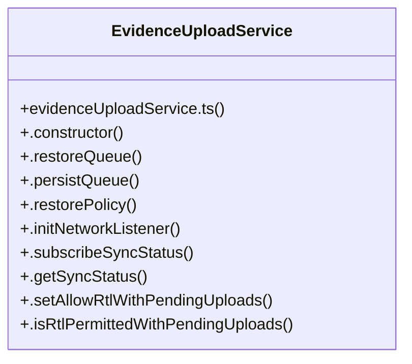

# Community 37

> 18 nodes · cohesion 0.20

## Key Concepts

- [EvidenceUploadService](file:///C:/Antigravityyyyy/pydrone/Skycon_upgrade/frontend/src/services/evidenceUploadService.ts#L47) (15 connections)
- [.uploadItem()](file:///C:/Antigravityyyyy/pydrone/Skycon_upgrade/frontend/src/services/evidenceUploadService.ts#L187) (8 connections)
- [.notify()](file:///C:/Antigravityyyyy/pydrone/Skycon_upgrade/frontend/src/services/evidenceUploadService.ts#L297) (6 connections)
- [.enqueueAndUpload()](file:///C:/Antigravityyyyy/pydrone/Skycon_upgrade/frontend/src/services/evidenceUploadService.ts#L161) (5 connections)
- [.constructor()](file:///C:/Antigravityyyyy/pydrone/Skycon_upgrade/frontend/src/services/evidenceUploadService.ts#L57) (4 connections)
- [.persistQueue()](file:///C:/Antigravityyyyy/pydrone/Skycon_upgrade/frontend/src/services/evidenceUploadService.ts#L78) (4 connections)
- [.flushQueue()](file:///C:/Antigravityyyyy/pydrone/Skycon_upgrade/frontend/src/services/evidenceUploadService.ts#L269) (3 connections)
- [.getSyncStatus()](file:///C:/Antigravityyyyy/pydrone/Skycon_upgrade/frontend/src/services/evidenceUploadService.ts#L118) (3 connections)
- [evidenceUploadService.ts](file:///C:/Antigravityyyyy/pydrone/Skycon_upgrade/frontend/src/services/evidenceUploadService.ts#L1) (3 connections)
- [.initNetworkListener()](file:///C:/Antigravityyyyy/pydrone/Skycon_upgrade/frontend/src/services/evidenceUploadService.ts#L104) (2 connections)
- [.restorePolicy()](file:///C:/Antigravityyyyy/pydrone/Skycon_upgrade/frontend/src/services/evidenceUploadService.ts#L94) (2 connections)
- [.restoreQueue()](file:///C:/Antigravityyyyy/pydrone/Skycon_upgrade/frontend/src/services/evidenceUploadService.ts#L63) (2 connections)
- [.setAllowRtlWithPendingUploads()](file:///C:/Antigravityyyyy/pydrone/Skycon_upgrade/frontend/src/services/evidenceUploadService.ts#L141) (2 connections)
- [.subscribeSyncStatus()](file:///C:/Antigravityyyyy/pydrone/Skycon_upgrade/frontend/src/services/evidenceUploadService.ts#L112) (2 connections)
- [.getQueue()](file:///C:/Antigravityyyyy/pydrone/Skycon_upgrade/frontend/src/services/evidenceUploadService.ts#L153) (1 connections)
- [.isRtlPermittedWithPendingUploads()](file:///C:/Antigravityyyyy/pydrone/Skycon_upgrade/frontend/src/services/evidenceUploadService.ts#L149) (1 connections)
- [STORAGE_KEY_POLICY](file:///C:/Antigravityyyyy/pydrone/Skycon_upgrade/frontend/src/services/evidenceUploadService.ts#L45) (1 connections)
- [STORAGE_KEY_QUEUE](file:///C:/Antigravityyyyy/pydrone/Skycon_upgrade/frontend/src/services/evidenceUploadService.ts#L44) (1 connections)

## Class Diagram

## Relationships

- No strong cross-community connections detected

## Source Files

- [frontend\src\services\evidenceUploadService.ts](file:///C:/Antigravityyyyy/pydrone/Skycon_upgrade/frontend/src/services/evidenceUploadService.ts)

## Audit Trail

- EXTRACTED: 60 (92%)
- INFERRED: 5 (8%)
- AMBIGUOUS: 0 (0%)

---

*Part of the graphify knowledge wiki. See [[index]] to navigate.*