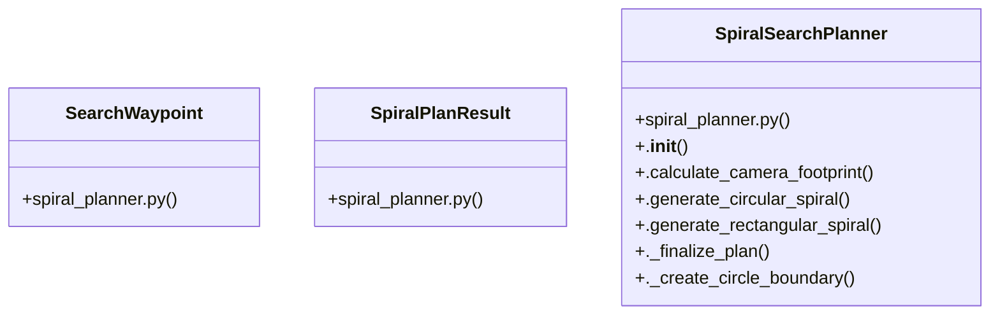

# Community 42

> 15 nodes · cohesion 0.23

## Key Concepts

- [SpiralSearchPlanner](file:///C:/Antigravityyyyy/pydrone/Skycon_upgrade/backend/spiral_planner.py#L63) (8 connections)
- [spiral_planner.py](file:///C:/Antigravityyyyy/pydrone/Skycon_upgrade/backend/spiral_planner.py#L1) (6 connections)
- [._finalize_plan()](file:///C:/Antigravityyyyy/pydrone/Skycon_upgrade/backend/spiral_planner.py#L233) (6 connections)
- [meters_to_lat_lon()](file:///C:/Antigravityyyyy/pydrone/Skycon_upgrade/backend/spiral_planner.py#L104) (4 connections)
- [.calculate_camera_footprint()](file:///C:/Antigravityyyyy/pydrone/Skycon_upgrade/backend/spiral_planner.py#L82) (4 connections)
- [.generate_circular_spiral()](file:///C:/Antigravityyyyy/pydrone/Skycon_upgrade/backend/spiral_planner.py#L122) (4 connections)
- [.generate_rectangular_spiral()](file:///C:/Antigravityyyyy/pydrone/Skycon_upgrade/backend/spiral_planner.py#L170) (4 connections)
- [._create_circle_boundary()](file:///C:/Antigravityyyyy/pydrone/Skycon_upgrade/backend/spiral_planner.py#L325) (3 connections)
- [haversine()](file:///C:/Antigravityyyyy/pydrone/Skycon_upgrade/backend/spiral_planner.py#L95) (2 connections)
- [SpiralPlanResult](file:///C:/Antigravityyyyy/pydrone/Skycon_upgrade/backend/spiral_planner.py#L44) (2 connections)
- [lat_lon_to_meters()](file:///C:/Antigravityyyyy/pydrone/Skycon_upgrade/backend/spiral_planner.py#L112) (1 connections)
- [Mathematical trajectory planner generating adaptive, geometry-aware spiral route](file:///C:/Antigravityyyyy/pydrone/Skycon_upgrade/backend/spiral_planner.py#L64) (1 connections)
- [Calculates ground footprint (width, height) and effective lane spacing in meters](file:///C:/Antigravityyyyy/pydrone/Skycon_upgrade/backend/spiral_planner.py#L83) (1 connections)
- [SearchWaypoint](file:///C:/Antigravityyyyy/pydrone/Skycon_upgrade/backend/spiral_planner.py#L31) (1 connections)
- [.__init__()](file:///C:/Antigravityyyyy/pydrone/Skycon_upgrade/backend/spiral_planner.py#L67) (1 connections)

## Class Diagram

## Relationships

- [[Community 43]] (2 shared connections)

## Source Files

- [backend\spiral_planner.py](file:///C:/Antigravityyyyy/pydrone/Skycon_upgrade/backend/spiral_planner.py)

## Audit Trail

- EXTRACTED: 48 (100%)
- INFERRED: 0 (0%)
- AMBIGUOUS: 0 (0%)

---

*Part of the graphify knowledge wiki. See [[index]] to navigate.*