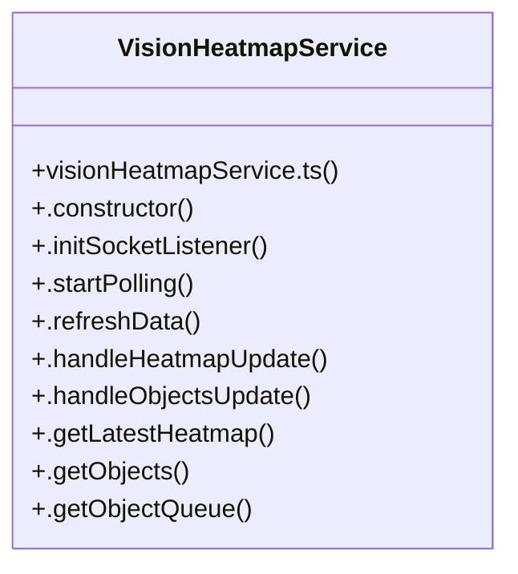

# Community 43

> 15 nodes · cohesion 0.20

## Key Concepts

- [VisionHeatmapService](file:///C:/Antigravityyyyy/pydrone/Skycon_upgrade/frontend/src/services/visionHeatmapService.ts#L49) (14 connections)
- [.refreshData()](file:///C:/Antigravityyyyy/pydrone/Skycon_upgrade/frontend/src/services/visionHeatmapService.ts#L125) (5 connections)
- [.handleHeatmapUpdate()](file:///C:/Antigravityyyyy/pydrone/Skycon_upgrade/frontend/src/services/visionHeatmapService.ts#L147) (4 connections)
- [.handleObjectsUpdate()](file:///C:/Antigravityyyyy/pydrone/Skycon_upgrade/frontend/src/services/visionHeatmapService.ts#L166) (4 connections)
- [.constructor()](file:///C:/Antigravityyyyy/pydrone/Skycon_upgrade/frontend/src/services/visionHeatmapService.ts#L58) (3 connections)
- [.startPolling()](file:///C:/Antigravityyyyy/pydrone/Skycon_upgrade/frontend/src/services/visionHeatmapService.ts#L113) (3 connections)
- [.initSocketListener()](file:///C:/Antigravityyyyy/pydrone/Skycon_upgrade/frontend/src/services/visionHeatmapService.ts#L63) (2 connections)
- [.notifyHeatmap()](file:///C:/Antigravityyyyy/pydrone/Skycon_upgrade/frontend/src/services/visionHeatmapService.ts#L220) (2 connections)
- [.notifyObjects()](file:///C:/Antigravityyyyy/pydrone/Skycon_upgrade/frontend/src/services/visionHeatmapService.ts#L226) (2 connections)
- [visionHeatmapService.ts](file:///C:/Antigravityyyyy/pydrone/Skycon_upgrade/frontend/src/services/visionHeatmapService.ts#L1) (1 connections)
- [.getLatestHeatmap()](file:///C:/Antigravityyyyy/pydrone/Skycon_upgrade/frontend/src/services/visionHeatmapService.ts#L196) (1 connections)
- [.getObjectQueue()](file:///C:/Antigravityyyyy/pydrone/Skycon_upgrade/frontend/src/services/visionHeatmapService.ts#L204) (1 connections)
- [.getObjects()](file:///C:/Antigravityyyyy/pydrone/Skycon_upgrade/frontend/src/services/visionHeatmapService.ts#L200) (1 connections)
- [.subscribeHeatmap()](file:///C:/Antigravityyyyy/pydrone/Skycon_upgrade/frontend/src/services/visionHeatmapService.ts#L208) (1 connections)
- [.subscribeObjects()](file:///C:/Antigravityyyyy/pydrone/Skycon_upgrade/frontend/src/services/visionHeatmapService.ts#L214) (1 connections)

## Class Diagram

## Relationships

- No strong cross-community connections detected

## Source Files

- [frontend\src\services\visionHeatmapService.ts](file:///C:/Antigravityyyyy/pydrone/Skycon_upgrade/frontend/src/services/visionHeatmapService.ts)

## Audit Trail

- EXTRACTED: 42 (93%)
- INFERRED: 3 (7%)
- AMBIGUOUS: 0 (0%)

---

*Part of the graphify knowledge wiki. See [[index]] to navigate.*