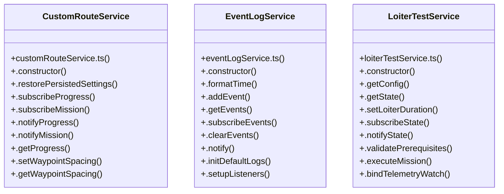

# Community 5

> 226 nodes · cohesion 0.01

## Key Concepts

- [AutonomousMissionConfigModal.tsx](file:///C:/Antigravityyyyy/pydrone/Skycon_upgrade/frontend/src/components/Mission/AutonomousMissionConfigModal.tsx#L1) (52 connections)
- [CustomRouteService](file:///C:/Antigravityyyyy/pydrone/Skycon_upgrade/frontend/src/services/customRouteService.ts#L37) (35 connections)
- [FlightParams.tsx](file:///C:/Antigravityyyyy/pydrone/Skycon_upgrade/frontend/src/features/dashboard/FlightParams.tsx#L1) (28 connections)
- [MissionConfigurationCard.tsx](file:///C:/Antigravityyyyy/pydrone/Skycon_upgrade/frontend/src/components/GroundStation/MissionConfigurationCard.tsx#L1) (27 connections)
- [LoiterTestService](file:///C:/Antigravityyyyy/pydrone/Skycon_upgrade/frontend/src/services/loiterTestService.ts#L15) (17 connections)
- [CircleTestMissionModal.tsx](file:///C:/Antigravityyyyy/pydrone/Skycon_upgrade/frontend/src/components/Mission/CircleTestMissionModal.tsx#L1) (16 connections)
- [.executeMission()](file:///C:/Antigravityyyyy/pydrone/Skycon_upgrade/frontend/src/services/loiterTestService.ts#L179) (16 connections)
- [.rebuildMission()](file:///C:/Antigravityyyyy/pydrone/Skycon_upgrade/frontend/src/services/customRouteService.ts#L262) (15 connections)
- [LoiterTestMissionModal.tsx](file:///C:/Antigravityyyyy/pydrone/Skycon_upgrade/frontend/src/components/Mission/LoiterTestMissionModal.tsx#L1) (14 connections)
- [.abort()](file:///C:/Antigravityyyyy/pydrone/Skycon_upgrade/frontend/src/services/loiterTestService.ts#L416) (13 connections)
- [.addEvent()](file:///C:/Antigravityyyyy/pydrone/Skycon_upgrade/frontend/src/services/eventLogService.ts#L49) (12 connections)
- [TelemetryLog.tsx](file:///C:/Antigravityyyyy/pydrone/Skycon_upgrade/frontend/src/features/dashboard/TelemetryLog.tsx#L1) (11 connections)
- [.setConfig()](file:///C:/Antigravityyyyy/pydrone/Skycon_upgrade/frontend/src/services/phoneDroneMissionService.ts#L382) (11 connections)
- [.setAltitude()](file:///C:/Antigravityyyyy/pydrone/Skycon_upgrade/frontend/src/services/circleTestService.ts#L124) (10 connections)
- [EventLogService](file:///C:/Antigravityyyyy/pydrone/Skycon_upgrade/frontend/src/services/eventLogService.ts#L17) (10 connections)
- [.notifyState()](file:///C:/Antigravityyyyy/pydrone/Skycon_upgrade/frontend/src/services/loiterTestService.ts#L90) (9 connections)
- [.resetState()](file:///C:/Antigravityyyyy/pydrone/Skycon_upgrade/frontend/src/services/loiterTestService.ts#L452) (8 connections)
- [.notifyProgress()](file:///C:/Antigravityyyyy/pydrone/Skycon_upgrade/frontend/src/services/customRouteService.ts#L94) (7 connections)
- [.startExecution()](file:///C:/Antigravityyyyy/pydrone/Skycon_upgrade/frontend/src/services/customRouteService.ts#L574) (7 connections)
- [.getConfig()](file:///C:/Antigravityyyyy/pydrone/Skycon_upgrade/frontend/src/services/searchEngine/SearchEngine.ts#L144) (7 connections)
- [.setDiameter()](file:///C:/Antigravityyyyy/pydrone/Skycon_upgrade/frontend/src/services/circleTestService.ts#L110) (6 connections)
- [.setLaps()](file:///C:/Antigravityyyyy/pydrone/Skycon_upgrade/frontend/src/services/circleTestService.ts#L137) (6 connections)
- [handleCircleToggle()](file:///C:/Antigravityyyyy/pydrone/Skycon_upgrade/frontend/src/components/GroundStation/MissionConfigurationCard.tsx#L109) (6 connections)
- [handleAltitudePreset()](file:///C:/Antigravityyyyy/pydrone/Skycon_upgrade/frontend/src/components/Mission/AutonomousMissionConfigModal.tsx#L178) (5 connections)
- [.getProgress()](file:///C:/Antigravityyyyy/pydrone/Skycon_upgrade/frontend/src/services/customRouteService.ts#L103) (5 connections)
- *... and 201 more nodes in this community*

## Class Diagram

## Relationships

- No strong cross-community connections detected

## Source Files

- [C:\Antigravityyyyy\pydrone\Skycon_upgrade\frontend\src\services\circleTestService.ts](file:///C:/Antigravityyyyy/pydrone/Skycon_upgrade/frontend/src/services/circleTestService.ts)
- [C:\Antigravityyyyy\pydrone\Skycon_upgrade\frontend\src\services\customRouteService.ts](file:///C:/Antigravityyyyy/pydrone/Skycon_upgrade/frontend/src/services/customRouteService.ts)
- [frontend\src\components\GroundStation\GoogleMapGroundStation.tsx](file:///C:/Antigravityyyyy/pydrone/Skycon_upgrade/frontend/src/components/GroundStation/GoogleMapGroundStation.tsx)
- [frontend\src\components\GroundStation\MissionConfigurationCard.tsx](file:///C:/Antigravityyyyy/pydrone/Skycon_upgrade/frontend/src/components/GroundStation/MissionConfigurationCard.tsx)
- [frontend\src\components\Mission\AutonomousMissionConfigModal.tsx](file:///C:/Antigravityyyyy/pydrone/Skycon_upgrade/frontend/src/components/Mission/AutonomousMissionConfigModal.tsx)
- [frontend\src\components\Mission\CircleTestMissionModal.tsx](file:///C:/Antigravityyyyy/pydrone/Skycon_upgrade/frontend/src/components/Mission/CircleTestMissionModal.tsx)
- [frontend\src\components\Mission\CircleTestPanel.tsx](file:///C:/Antigravityyyyy/pydrone/Skycon_upgrade/frontend/src/components/Mission/CircleTestPanel.tsx)
- [frontend\src\components\Mission\LoiterTestMissionModal.tsx](file:///C:/Antigravityyyyy/pydrone/Skycon_upgrade/frontend/src/components/Mission/LoiterTestMissionModal.tsx)
- [frontend\src\features\dashboard\FlightParams.tsx](file:///C:/Antigravityyyyy/pydrone/Skycon_upgrade/frontend/src/features/dashboard/FlightParams.tsx)
- [frontend\src\features\dashboard\ManualMissionControlCard.tsx](file:///C:/Antigravityyyyy/pydrone/Skycon_upgrade/frontend/src/features/dashboard/ManualMissionControlCard.tsx)
- [frontend\src\features\dashboard\TelemetryLog.tsx](file:///C:/Antigravityyyyy/pydrone/Skycon_upgrade/frontend/src/features/dashboard/TelemetryLog.tsx)
- [frontend\src\services\eventLogService.ts](file:///C:/Antigravityyyyy/pydrone/Skycon_upgrade/frontend/src/services/eventLogService.ts)
- [frontend\src\services\loiterTestService.ts](file:///C:/Antigravityyyyy/pydrone/Skycon_upgrade/frontend/src/services/loiterTestService.ts)
- [frontend\src\services\phoneDroneMissionService.ts](file:///C:/Antigravityyyyy/pydrone/Skycon_upgrade/frontend/src/services/phoneDroneMissionService.ts)
- [frontend\src\services\searchEngine\SearchEngine.ts](file:///C:/Antigravityyyyy/pydrone/Skycon_upgrade/frontend/src/services/searchEngine/SearchEngine.ts)

## Audit Trail

- EXTRACTED: 531 (76%)
- INFERRED: 165 (24%)
- AMBIGUOUS: 0 (0%)

---

*Part of the graphify knowledge wiki. See [[index]] to navigate.*