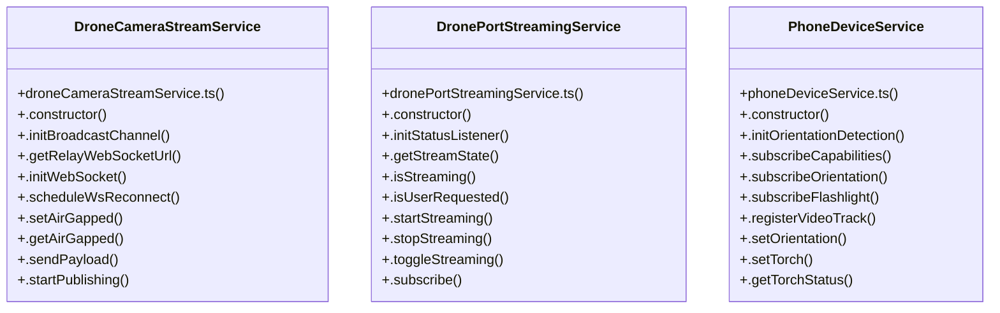

# Community 6

> 183 nodes · cohesion 0.01

## Key Concepts

- [UnifiedDroneCoreView.tsx](file:///C:/Antigravityyyyy/pydrone/Skycon_upgrade/frontend/src/components/Drone/UnifiedDroneCoreView.tsx#L1) (47 connections)
- [DroneCameraStreamService](file:///C:/Antigravityyyyy/pydrone/Skycon_upgrade/frontend/src/services/droneCameraStreamService.ts#L63) (35 connections)
- [PhoneCameraNode.tsx](file:///C:/Antigravityyyyy/pydrone/Skycon_upgrade/frontend/src/components/PhoneMission/PhoneCameraNode.tsx#L1) (27 connections)
- [UnifiedCameraIntelligenceModal.tsx](file:///C:/Antigravityyyyy/pydrone/Skycon_upgrade/frontend/src/components/Mission/UnifiedCameraIntelligenceModal.tsx#L1) (23 connections)
- [PhoneDeviceService](file:///C:/Antigravityyyyy/pydrone/Skycon_upgrade/frontend/src/services/phoneDeviceService.ts#L40) (17 connections)
- [LiveVideoFeed.tsx](file:///C:/Antigravityyyyy/pydrone/Skycon_upgrade/frontend/src/components/GroundStation/LiveVideoFeed.tsx#L1) (14 connections)
- [DronePortStreamingService](file:///C:/Antigravityyyyy/pydrone/Skycon_upgrade/frontend/src/services/dronePortStreamingService.ts#L26) (12 connections)
- [.handleIncomingPayload()](file:///C:/Antigravityyyyy/pydrone/Skycon_upgrade/frontend/src/services/droneCameraStreamService.ts#L494) (9 connections)
- [.setTorch()](file:///C:/Antigravityyyyy/pydrone/Skycon_upgrade/frontend/src/services/phoneDeviceService.ts#L206) (9 connections)
- [.sendPayload()](file:///C:/Antigravityyyyy/pydrone/Skycon_upgrade/frontend/src/services/droneCameraStreamService.ts#L235) (8 connections)
- [.startPublishing()](file:///C:/Antigravityyyyy/pydrone/Skycon_upgrade/frontend/src/services/droneCameraStreamService.ts#L261) (8 connections)
- [.startStreaming()](file:///C:/Antigravityyyyy/pydrone/Skycon_upgrade/frontend/src/services/dronePortStreamingService.ts#L96) (8 connections)
- [.startSubscribing()](file:///C:/Antigravityyyyy/pydrone/Skycon_upgrade/frontend/src/services/droneCameraStreamService.ts#L462) (7 connections)
- [.stopStreaming()](file:///C:/Antigravityyyyy/pydrone/Skycon_upgrade/frontend/src/services/dronePortStreamingService.ts#L119) (7 connections)
- [toggleBroadcast()](file:///C:/Antigravityyyyy/pydrone/Skycon_upgrade/frontend/src/components/Drone/UnifiedDroneCoreView.tsx#L216) (6 connections)
- [.initWebSocket()](file:///C:/Antigravityyyyy/pydrone/Skycon_upgrade/frontend/src/services/droneCameraStreamService.ts#L160) (5 connections)
- [.reconnect()](file:///C:/Antigravityyyyy/pydrone/Skycon_upgrade/frontend/src/services/droneCameraStreamService.ts#L758) (5 connections)
- [.stopPublishing()](file:///C:/Antigravityyyyy/pydrone/Skycon_upgrade/frontend/src/services/droneCameraStreamService.ts#L302) (5 connections)
- [.updateStatus()](file:///C:/Antigravityyyyy/pydrone/Skycon_upgrade/frontend/src/services/droneCameraStreamService.ts#L671) (5 connections)
- [droneCameraStreamService.ts](file:///C:/Antigravityyyyy/pydrone/Skycon_upgrade/frontend/src/services/droneCameraStreamService.ts#L1) (5 connections)
- [.captureAndSendSingleFrame()](file:///C:/Antigravityyyyy/pydrone/Skycon_upgrade/frontend/src/services/droneCameraStreamService.ts#L434) (4 connections)
- [.checkSubscriberLiveness()](file:///C:/Antigravityyyyy/pydrone/Skycon_upgrade/frontend/src/services/droneCameraStreamService.ts#L637) (4 connections)
- [.getMetrics()](file:///C:/Antigravityyyyy/pydrone/Skycon_upgrade/frontend/src/services/droneCameraStreamService.ts#L725) (4 connections)
- [.handleWebRTCSignal()](file:///C:/Antigravityyyyy/pydrone/Skycon_upgrade/frontend/src/services/droneCameraStreamService.ts#L575) (4 connections)
- [.notifyMetrics()](file:///C:/Antigravityyyyy/pydrone/Skycon_upgrade/frontend/src/services/droneCameraStreamService.ts#L720) (4 connections)
- *... and 158 more nodes in this community*

## Class Diagram

## Relationships

- [[Community 2]] (1 shared connections)

## Source Files

- [frontend\src\components\Drone\UnifiedDroneCoreView.tsx](file:///C:/Antigravityyyyy/pydrone/Skycon_upgrade/frontend/src/components/Drone/UnifiedDroneCoreView.tsx)
- [frontend\src\components\GroundStation\LiveVideoFeed.tsx](file:///C:/Antigravityyyyy/pydrone/Skycon_upgrade/frontend/src/components/GroundStation/LiveVideoFeed.tsx)
- [frontend\src\components\Mission\UnifiedCameraIntelligenceModal.tsx](file:///C:/Antigravityyyyy/pydrone/Skycon_upgrade/frontend/src/components/Mission/UnifiedCameraIntelligenceModal.tsx)
- [frontend\src\components\PhoneMission\PhoneCameraNode.tsx](file:///C:/Antigravityyyyy/pydrone/Skycon_upgrade/frontend/src/components/PhoneMission/PhoneCameraNode.tsx)
- [frontend\src\services\droneCameraStreamService.ts](file:///C:/Antigravityyyyy/pydrone/Skycon_upgrade/frontend/src/services/droneCameraStreamService.ts)
- [frontend\src\services\dronePortStreamingService.ts](file:///C:/Antigravityyyyy/pydrone/Skycon_upgrade/frontend/src/services/dronePortStreamingService.ts)
- [frontend\src\services\phoneDeviceService.ts](file:///C:/Antigravityyyyy/pydrone/Skycon_upgrade/frontend/src/services/phoneDeviceService.ts)
- [frontend\src\services\reconDetectionService.ts](file:///C:/Antigravityyyyy/pydrone/Skycon_upgrade/frontend/src/services/reconDetectionService.ts)

## Audit Trail

- EXTRACTED: 443 (88%)
- INFERRED: 59 (12%)
- AMBIGUOUS: 0 (0%)

---

*Part of the graphify knowledge wiki. See [[index]] to navigate.*