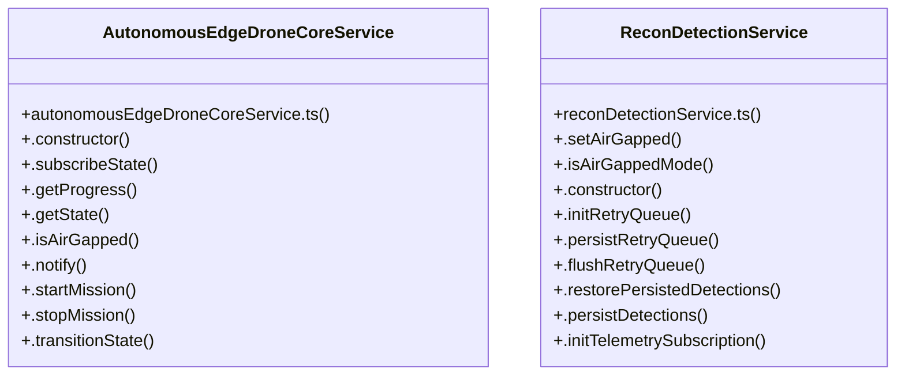

# Community 9

> 157 nodes · cohesion 0.02

## Key Concepts

- [CameraFeed.tsx](file:///C:/Antigravityyyyy/pydrone/Skycon_upgrade/frontend/src/features/dashboard/CameraFeed.tsx#L1) (56 connections)
- [ReconDetectionService](file:///C:/Antigravityyyyy/pydrone/Skycon_upgrade/frontend/src/services/reconDetectionService.ts#L63) (34 connections)
- [DroneDashboard.tsx](file:///C:/Antigravityyyyy/pydrone/Skycon_upgrade/frontend/src/components/Drone/DroneDashboard.tsx#L1) (27 connections)
- [AutonomousEdgeDroneCoreService](file:///C:/Antigravityyyyy/pydrone/Skycon_upgrade/frontend/src/services/autonomousEdgeDroneCoreService.ts#L62) (26 connections)
- [.handleRawDetectionEvent()](file:///C:/Antigravityyyyy/pydrone/Skycon_upgrade/frontend/src/services/reconDetectionService.ts#L275) (26 connections)
- [.setDroneCoreStatus()](file:///C:/Antigravityyyyy/pydrone/Skycon_upgrade/frontend/src/services/reconDetectionService.ts#L849) (15 connections)
- [.triggerAutomaticRTL()](file:///C:/Antigravityyyyy/pydrone/Skycon_upgrade/frontend/src/services/reconDetectionService.ts#L458) (11 connections)
- [.handleSuccessfulDecode()](file:///C:/Antigravityyyyy/pydrone/Skycon_upgrade/frontend/src/services/autonomousEdgeDroneCoreService.ts#L586) (10 connections)
- [.recordDetection()](file:///C:/Antigravityyyyy/pydrone/Skycon_upgrade/frontend/src/services/reconDetectionService.ts#L699) (10 connections)
- [.startMission()](file:///C:/Antigravityyyyy/pydrone/Skycon_upgrade/frontend/src/services/autonomousEdgeDroneCoreService.ts#L162) (9 connections)
- [.transitionState()](file:///C:/Antigravityyyyy/pydrone/Skycon_upgrade/frontend/src/services/autonomousEdgeDroneCoreService.ts#L232) (9 connections)
- [.retryRecordDecode()](file:///C:/Antigravityyyyy/pydrone/Skycon_upgrade/frontend/src/services/reconDetectionService.ts#L621) (9 connections)
- [.stepApproachingState()](file:///C:/Antigravityyyyy/pydrone/Skycon_upgrade/frontend/src/services/autonomousEdgeDroneCoreService.ts#L474) (8 connections)
- [.stepDecodingState()](file:///C:/Antigravityyyyy/pydrone/Skycon_upgrade/frontend/src/services/autonomousEdgeDroneCoreService.ts#L516) (8 connections)
- [qrDecoderService.ts](file:///C:/Antigravityyyyy/pydrone/Skycon_upgrade/frontend/src/services/qrDecoderService.ts#L1) (8 connections)
- [decodeQRFromImageData()](file:///C:/Antigravityyyyy/pydrone/Skycon_upgrade/frontend/src/services/qrDecoderService.ts#L192) (8 connections)
- [extractTwoDigits()](file:///C:/Antigravityyyyy/pydrone/Skycon_upgrade/frontend/src/services/qrDecoderService.ts#L44) (8 connections)
- [.handleCandidateIdentified()](file:///C:/Antigravityyyyy/pydrone/Skycon_upgrade/frontend/src/services/autonomousEdgeDroneCoreService.ts#L397) (7 connections)
- [calculateGeodesicDistance()](file:///C:/Antigravityyyyy/pydrone/Skycon_upgrade/frontend/src/services/reconDetectionService.ts#L40) (7 connections)
- [.clearAllDetections()](file:///C:/Antigravityyyyy/pydrone/Skycon_upgrade/frontend/src/services/reconDetectionService.ts#L676) (7 connections)
- [.persistDetections()](file:///C:/Antigravityyyyy/pydrone/Skycon_upgrade/frontend/src/services/reconDetectionService.ts#L183) (7 connections)
- [.stepSearchingState()](file:///C:/Antigravityyyyy/pydrone/Skycon_upgrade/frontend/src/services/autonomousEdgeDroneCoreService.ts#L370) (6 connections)
- [.stepTargetDetectedState()](file:///C:/Antigravityyyyy/pydrone/Skycon_upgrade/frontend/src/services/autonomousEdgeDroneCoreService.ts#L442) (6 connections)
- [classifyPayload()](file:///C:/Antigravityyyyy/pydrone/Skycon_upgrade/frontend/src/services/qrDecoderService.ts#L153) (6 connections)
- [.notifyDetectionListeners()](file:///C:/Antigravityyyyy/pydrone/Skycon_upgrade/frontend/src/services/reconDetectionService.ts#L893) (6 connections)
- *... and 132 more nodes in this community*

## Class Diagram

## Relationships

- No strong cross-community connections detected

## Source Files

- [frontend\src\components\Drone\DroneDashboard.tsx](file:///C:/Antigravityyyyy/pydrone/Skycon_upgrade/frontend/src/components/Drone/DroneDashboard.tsx)
- [frontend\src\features\dashboard\CameraFeed.tsx](file:///C:/Antigravityyyyy/pydrone/Skycon_upgrade/frontend/src/features/dashboard/CameraFeed.tsx)
- [frontend\src\services\autonomousEdgeDroneCoreService.ts](file:///C:/Antigravityyyyy/pydrone/Skycon_upgrade/frontend/src/services/autonomousEdgeDroneCoreService.ts)
- [frontend\src\services\qrDecoderService.ts](file:///C:/Antigravityyyyy/pydrone/Skycon_upgrade/frontend/src/services/qrDecoderService.ts)
- [frontend\src\services\reconDetectionService.ts](file:///C:/Antigravityyyyy/pydrone/Skycon_upgrade/frontend/src/services/reconDetectionService.ts)

## Audit Trail

- EXTRACTED: 469 (82%)
- INFERRED: 105 (18%)
- AMBIGUOUS: 0 (0%)

---

*Part of the graphify knowledge wiki. See [[index]] to navigate.*