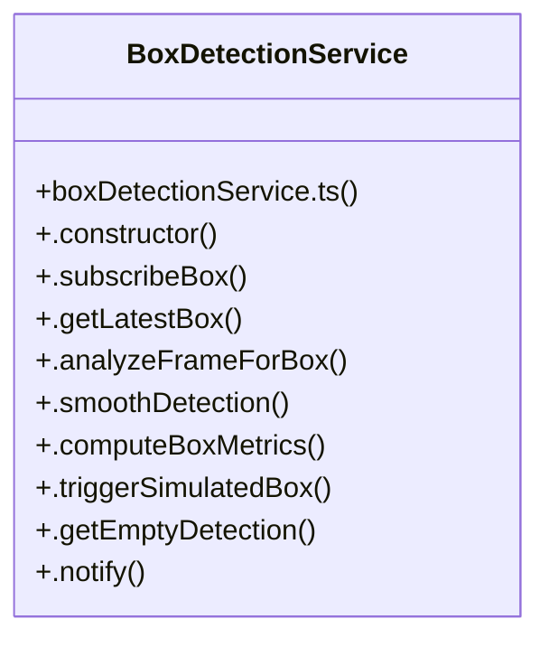

# Computer Vision & QR Detection

> 20 nodes

## Key Concepts

- [SAE India Autonomous Drone Mission & Telemetry System — Project Rules & Context](file:///C:/Antigravityyyyy/pydrone/Skycon_upgrade/GEMINI.md#L1) (14 connections)
- [BoxDetectionService](file:///C:/Antigravityyyyy/pydrone/Skycon_upgrade/frontend/src/services/boxDetectionService.ts#L10) (10 connections)
- [.analyzeFrameForBox()](file:///C:/Antigravityyyyy/pydrone/Skycon_upgrade/frontend/src/services/boxDetectionService.ts#L44) (6 connections)
- [.computeBoxMetrics()](file:///C:/Antigravityyyyy/pydrone/Skycon_upgrade/frontend/src/services/boxDetectionService.ts#L283) (4 connections)
- [.triggerSimulatedBox()](file:///C:/Antigravityyyyy/pydrone/Skycon_upgrade/frontend/src/services/boxDetectionService.ts#L369) (4 connections)
- [.notify()](file:///C:/Antigravityyyyy/pydrone/Skycon_upgrade/frontend/src/services/boxDetectionService.ts#L425) (4 connections)
- [.smoothDetection()](file:///C:/Antigravityyyyy/pydrone/Skycon_upgrade/frontend/src/services/boxDetectionService.ts#L266) (3 connections)
- [.getEmptyDetection()](file:///C:/Antigravityyyyy/pydrone/Skycon_upgrade/frontend/src/services/boxDetectionService.ts#L396) (3 connections)
- [boxDetectionService.ts](file:///C:/Antigravityyyyy/pydrone/Skycon_upgrade/frontend/src/services/boxDetectionService.ts#L1) (1 connections)
- [.constructor()](file:///C:/Antigravityyyyy/pydrone/Skycon_upgrade/frontend/src/services/boxDetectionService.ts#L28) (1 connections)
- [.getLatestBox()](file:///C:/Antigravityyyyy/pydrone/Skycon_upgrade/frontend/src/services/boxDetectionService.ts#L36) (1 connections)
- [Project Mission & Overview](file:///C:/Antigravityyyyy/pydrone/Skycon_upgrade/GEMINI.md#L3) (1 connections)
- [Architecture & Codebase Guidelines](file:///C:/Antigravityyyyy/pydrone/Skycon_upgrade/GEMINI.md#L13) (1 connections)
- [1. Flight Controller & MAVLink Standards (mavlinkService.ts)](file:///C:/Antigravityyyyy/pydrone/Skycon_upgrade/GEMINI.md#L15) (1 connections)
- [2. Autonomous State Machine (missionEngine.ts, circleTestSer](file:///C:/Antigravityyyyy/pydrone/Skycon_upgrade/GEMINI.md#L28) (1 connections)
- [3. Vision & Detection Pipeline (boxDetectionService.ts, visi](file:///C:/Antigravityyyyy/pydrone/Skycon_upgrade/GEMINI.md#L33) (1 connections)
- [4. Telemetry Transports (frontend/src/services/transports/)](file:///C:/Antigravityyyyy/pydrone/Skycon_upgrade/GEMINI.md#L39) (1 connections)
- [5. Frontend & UI Conventions (frontend/)](file:///C:/Antigravityyyyy/pydrone/Skycon_upgrade/GEMINI.md#L47) (1 connections)
- [6. Deployment Architecture](file:///C:/Antigravityyyyy/pydrone/Skycon_upgrade/GEMINI.md#L52) (1 connections)
- [7. Token-Efficient Codebase Analysis (Graphify-First)](file:///C:/Antigravityyyyy/pydrone/Skycon_upgrade/GEMINI.md#L58) (1 connections)

## Class Diagram

## Relationships

- [[Autonomous Mission & Flight Engine]] (6 shared connections)
- [[Computer Vision & QR Detection]] (2 shared connections)

## Source Files

- [GEMINI.md](file:///C:/Antigravityyyyy/pydrone/Skycon_upgrade/GEMINI.md)
- [frontend\src\services\boxDetectionService.ts](file:///C:/Antigravityyyyy/pydrone/Skycon_upgrade/frontend/src/services/boxDetectionService.ts)

## Audit Trail

- EXTRACTED: 51 (85%)
- INFERRED: 9 (15%)
- AMBIGUOUS: 0 (0%)

---

*Part of the graphify knowledge wiki. See [[index]] to navigate.*