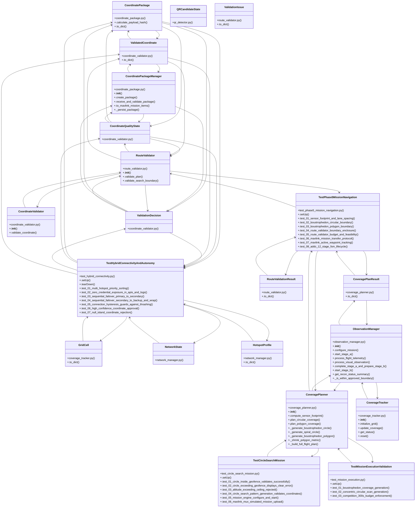

# Coordinate Validator Coverage

> 293 nodes

## Key Concepts

- [CoveragePlanner](file:///C:/Antigravityyyyy/pydrone/Skycon_upgrade/backend/coverage_planner.py#L100) (107 connections)
- [QRCandidateState](file:///C:/Antigravityyyyy/pydrone/Skycon_upgrade/backend/qr_detector.py#L42) (81 connections)
- [CoordinateQualityState](file:///C:/Antigravityyyyy/pydrone/Skycon_upgrade/backend/coordinate_validator.py#L41) (78 connections)
- [ValidatedCoordinate](file:///C:/Antigravityyyyy/pydrone/Skycon_upgrade/backend/coordinate_validator.py#L58) (78 connections)
- [NetworkState](file:///C:/Antigravityyyyy/pydrone/Skycon_upgrade/backend/network_manager.py#L41) (77 connections)
- [CoordinatePackage](file:///C:/Antigravityyyyy/pydrone/Skycon_upgrade/backend/coordinate_package.py#L34) (72 connections)
- [server.py](file:///C:/Antigravityyyyy/pydrone/Skycon_upgrade/backend/server.py#L1) (69 connections)
- [ValidationDecision](file:///C:/Antigravityyyyy/pydrone/Skycon_upgrade/backend/coordinate_validator.py#L50) (38 connections)
- [TestHybridConnectivityAndAutonomy](file:///C:/Antigravityyyyy/pydrone/Skycon_upgrade/tests/test_hybrid_connectivity.py#L64) (31 connections)
- [HotspotProfile](file:///C:/Antigravityyyyy/pydrone/Skycon_upgrade/backend/network_manager.py#L50) (28 connections)
- [GridCell](file:///C:/Antigravityyyyy/pydrone/Skycon_upgrade/backend/coverage_tracker.py#L29) (26 connections)
- [Resets local cell coverage tracker for a new sortie.](file:///C:/Antigravityyyyy/pydrone/Skycon_upgrade/backend/server.py#L1123) (23 connections)
- [TestPhase5MissionNavigation](file:///C:/Antigravityyyyy/pydrone/Skycon_upgrade/tests/test_phase5_mission_navigation.py#L57) (21 connections)
- [CoverageTracker](file:///C:/Antigravityyyyy/pydrone/Skycon_upgrade/backend/coverage_tracker.py#L44) (20 connections)
- [CoveragePlanResult](file:///C:/Antigravityyyyy/pydrone/Skycon_upgrade/backend/coverage_planner.py#L76) (18 connections)
- [RouteValidator](file:///C:/Antigravityyyyy/pydrone/Skycon_upgrade/backend/route_validator.py#L92) (18 connections)
- [.validate_plan()](file:///C:/Antigravityyyyy/pydrone/Skycon_upgrade/backend/route_validator.py#L118) (18 connections)
- [.validate_coordinate()](file:///C:/Antigravityyyyy/pydrone/Skycon_upgrade/backend/coordinate_validator.py#L121) (17 connections)
- [.plan_circular_coverage()](file:///C:/Antigravityyyyy/pydrone/Skycon_upgrade/backend/coverage_planner.py#L129) (16 connections)
- [.plan_polygon_coverage()](file:///C:/Antigravityyyyy/pydrone/Skycon_upgrade/backend/coverage_planner.py#L201) (16 connections)
- [ObservationManager](file:///C:/Antigravityyyyy/pydrone/Skycon_upgrade/backend/observation_manager.py#L45) (16 connections)
- [haversine_distance()](file:///C:/Antigravityyyyy/pydrone/Skycon_upgrade/backend/route_validator.py#L23) (11 connections)
- [Verifies Flask endpoints (PythonAnywhere WSGI compatibility) respond cleanly.](file:///C:/Antigravityyyyy/pydrone/Skycon_upgrade/tests/test_hybrid_connectivity.py#L419) (11 connections)
- [CoordinatePackageManager](file:///C:/Antigravityyyyy/pydrone/Skycon_upgrade/backend/coordinate_package.py#L66) (10 connections)
- [.receive_and_validate_package()](file:///C:/Antigravityyyyy/pydrone/Skycon_upgrade/backend/coordinate_package.py#L103) (10 connections)
- *... and 268 more nodes in this community*

## Class Diagram

## Relationships

- [[Test Suites & MAVLink Simulation]] (104 shared connections)
- [[Get Status Sync]] (85 shared connections)
- [[Currentrole List Roles]] (38 shared connections)
- [[Sync Cloud Hardware]] (27 shared connections)
- [[Command Rtl Position]] (16 shared connections)
- [[Autonomous Mission & Flight Engine]] (4 shared connections)
- [[256 Token Pbkdf2]] (3 shared connections)
- [[Flight Phase Boundaries]] (3 shared connections)
- [[Diagnostic Section Report]] (2 shared connections)
- [[Repository Connect Intelligence]] (1 shared connections)
- [[Prearm Pre Arm]] (1 shared connections)

## Source Files

- [backend\coordinate_package.py](file:///C:/Antigravityyyyy/pydrone/Skycon_upgrade/backend/coordinate_package.py)
- [backend\coordinate_validator.py](file:///C:/Antigravityyyyy/pydrone/Skycon_upgrade/backend/coordinate_validator.py)
- [backend\coverage_planner.py](file:///C:/Antigravityyyyy/pydrone/Skycon_upgrade/backend/coverage_planner.py)
- [backend\coverage_tracker.py](file:///C:/Antigravityyyyy/pydrone/Skycon_upgrade/backend/coverage_tracker.py)
- [backend\network_manager.py](file:///C:/Antigravityyyyy/pydrone/Skycon_upgrade/backend/network_manager.py)
- [backend\observation_manager.py](file:///C:/Antigravityyyyy/pydrone/Skycon_upgrade/backend/observation_manager.py)
- [backend\qr_detector.py](file:///C:/Antigravityyyyy/pydrone/Skycon_upgrade/backend/qr_detector.py)
- [backend\route_validator.py](file:///C:/Antigravityyyyy/pydrone/Skycon_upgrade/backend/route_validator.py)
- [backend\server.py](file:///C:/Antigravityyyyy/pydrone/Skycon_upgrade/backend/server.py)
- [frontend\src\components\common\ControlModePanel.tsx](file:///C:/Antigravityyyyy/pydrone/Skycon_upgrade/frontend/src/components/common/ControlModePanel.tsx)
- [tests\test_circle_search_mission.py](file:///C:/Antigravityyyyy/pydrone/Skycon_upgrade/tests/test_circle_search_mission.py)
- [tests\test_hybrid_connectivity.py](file:///C:/Antigravityyyyy/pydrone/Skycon_upgrade/tests/test_hybrid_connectivity.py)
- [tests\test_phase5_mission_navigation.py](file:///C:/Antigravityyyyy/pydrone/Skycon_upgrade/tests/test_phase5_mission_navigation.py)
- [tests\validation\test_mission_execution.py](file:///C:/Antigravityyyyy/pydrone/Skycon_upgrade/tests/validation/test_mission_execution.py)
- [vision_brain\vision_brain.py](file:///C:/Antigravityyyyy/pydrone/Skycon_upgrade/vision_brain/vision_brain.py)

## Audit Trail

- EXTRACTED: 684 (34%)
- INFERRED: 1332 (66%)
- AMBIGUOUS: 0 (0%)

---

*Part of the graphify knowledge wiki. See [[index]] to navigate.*