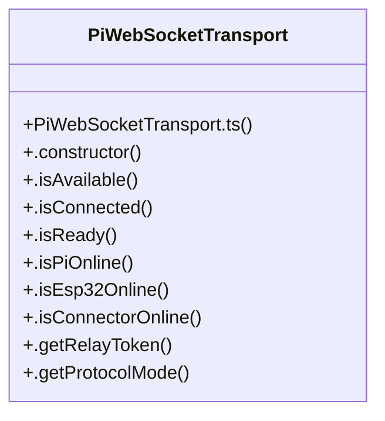

# Flight Control Systems

> 74 nodes · cohesion 0.03

## Key Concepts

- [SKYCON Phase 3 Completion Report](file:///C:/Antigravityyyyy/pydrone/Skycon_upgrade/docs/reports/PHASE_3_COMPLETION_REPORT.md#L1) (50 connections)
- [PiWebSocketTransport](file:///C:/Antigravityyyyy/pydrone/Skycon_upgrade/frontend/src/services/transports/PiWebSocketTransport.ts#L41) (26 connections)
- [PiWebSocketTransport.ts](file:///C:/Antigravityyyyy/pydrone/Skycon_upgrade/frontend/src/services/transports/PiWebSocketTransport.ts#L1) (8 connections)
- [.connect()](file:///C:/Antigravityyyyy/pydrone/Skycon_upgrade/frontend/src/services/transports/PiWebSocketTransport.ts#L145) (5 connections)
- [.isConnected()](file:///C:/Antigravityyyyy/pydrone/Skycon_upgrade/frontend/src/services/transports/PiWebSocketTransport.ts#L85) (5 connections)
- [.isPiOnline()](file:///C:/Antigravityyyyy/pydrone/Skycon_upgrade/frontend/src/services/transports/PiWebSocketTransport.ts#L93) (5 connections)
- [.notifyState()](file:///C:/Antigravityyyyy/pydrone/Skycon_upgrade/frontend/src/services/transports/PiWebSocketTransport.ts#L284) (4 connections)
- [.cleanupSocket()](file:///C:/Antigravityyyyy/pydrone/Skycon_upgrade/frontend/src/services/transports/PiWebSocketTransport.ts#L298) (3 connections)
- [.disconnect()](file:///C:/Antigravityyyyy/pydrone/Skycon_upgrade/frontend/src/services/transports/PiWebSocketTransport.ts#L241) (3 connections)
- [.getDiagnostics()](file:///C:/Antigravityyyyy/pydrone/Skycon_upgrade/frontend/src/services/transports/PiWebSocketTransport.ts#L270) (3 connections)
- [.getResolvedUrl()](file:///C:/Antigravityyyyy/pydrone/Skycon_upgrade/frontend/src/services/transports/PiWebSocketTransport.ts#L134) (3 connections)
- [transport.ts](file:///C:/Antigravityyyyy/pydrone/Skycon_upgrade/frontend/src/types/transport.ts#L1) (2 connections)
- [.isConnectorOnline()](file:///C:/Antigravityyyyy/pydrone/Skycon_upgrade/frontend/src/services/transports/PiWebSocketTransport.ts#L102) (2 connections)
- [.isEsp32Online()](file:///C:/Antigravityyyyy/pydrone/Skycon_upgrade/frontend/src/services/transports/PiWebSocketTransport.ts#L98) (2 connections)
- [.isReady()](file:///C:/Antigravityyyyy/pydrone/Skycon_upgrade/frontend/src/services/transports/PiWebSocketTransport.ts#L89) (2 connections)
- [.scheduleReconnect()](file:///C:/Antigravityyyyy/pydrone/Skycon_upgrade/frontend/src/services/transports/PiWebSocketTransport.ts#L319) (2 connections)
- [.send()](file:///C:/Antigravityyyyy/pydrone/Skycon_upgrade/frontend/src/services/transports/PiWebSocketTransport.ts#L248) (2 connections)
- [.startHeartbeat()](file:///C:/Antigravityyyyy/pydrone/Skycon_upgrade/frontend/src/services/transports/PiWebSocketTransport.ts#L328) (2 connections)
- [10. Takeoff, Land, RTL & Air-Gapped Emergency RTL](file:///C:/Antigravityyyyy/pydrone/Skycon_upgrade/docs/reports/PHASE_3_COMPLETION_REPORT.md#L271) (1 connections)
- [11. RC Receiver Integration (MultiLink V1.0)](file:///C:/Antigravityyyyy/pydrone/Skycon_upgrade/docs/reports/PHASE_3_COMPLETION_REPORT.md#L293) (1 connections)
- [12. Manual Override Monitoring & Stick Takeover Detection](file:///C:/Antigravityyyyy/pydrone/Skycon_upgrade/docs/reports/PHASE_3_COMPLETION_REPORT.md#L307) (1 connections)
- [13. Failsafe Monitoring & Decision Matrix](file:///C:/Antigravityyyyy/pydrone/Skycon_upgrade/docs/reports/PHASE_3_COMPLETION_REPORT.md#L320) (1 connections)
- [14. API Modifications](file:///C:/Antigravityyyyy/pydrone/Skycon_upgrade/docs/reports/PHASE_3_COMPLETION_REPORT.md#L333) (1 connections)
- [15. Frontend Telemetry Integration](file:///C:/Antigravityyyyy/pydrone/Skycon_upgrade/docs/reports/PHASE_3_COMPLETION_REPORT.md#L347) (1 connections)
- [16. Files Created](file:///C:/Antigravityyyyy/pydrone/Skycon_upgrade/docs/reports/PHASE_3_COMPLETION_REPORT.md#L361) (1 connections)
- *... and 49 more nodes in this community*

## Class Diagram

## Relationships

- [[Community 17]] (78 shared connections)
- [[Community 2]] (3 shared connections)
- [[Community 5]] (2 shared connections)
- [[Community 1]] (2 shared connections)
- [[Community 4]] (1 shared connections)
- [[Community 3]] (1 shared connections)
- [[Community 9]] (1 shared connections)

## Source Files

- [docs\reports\PHASE_3_COMPLETION_REPORT.md](file:///C:/Antigravityyyyy/pydrone/Skycon_upgrade/docs/reports/PHASE_3_COMPLETION_REPORT.md)
- [frontend\src\services\transports\PiWebSocketTransport.ts](file:///C:/Antigravityyyyy/pydrone/Skycon_upgrade/frontend/src/services/transports/PiWebSocketTransport.ts)
- [frontend\src\types\transport.ts](file:///C:/Antigravityyyyy/pydrone/Skycon_upgrade/frontend/src/types/transport.ts)

## Audit Trail

- EXTRACTED: 168 (91%)
- INFERRED: 17 (9%)
- AMBIGUOUS: 0 (0%)

---

*Part of the graphify knowledge wiki. See [[index]] to navigate.*