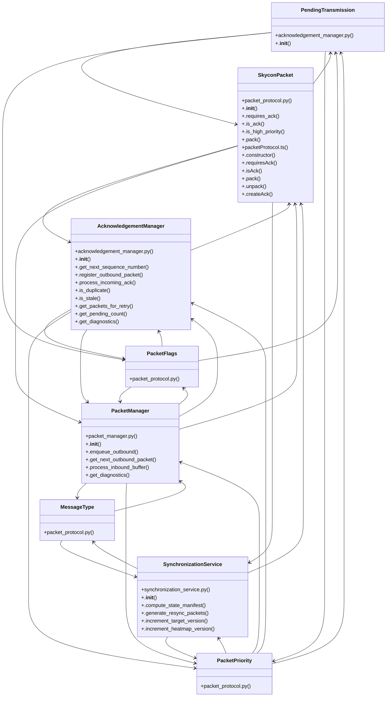

# Get Acknowledgementmanager Diagnostics

> 80 nodes

## Key Concepts

- [SkyconPacket](file:///C:/Antigravityyyyy/pydrone/Skycon_upgrade/backend/packet_protocol.py#L89) (30 connections)
- [PacketPriority](file:///C:/Antigravityyyyy/pydrone/Skycon_upgrade/backend/packet_protocol.py#L48) (24 connections)
- [AcknowledgementManager](file:///C:/Antigravityyyyy/pydrone/Skycon_upgrade/backend/acknowledgement_manager.py#L46) (21 connections)
- [PacketFlags](file:///C:/Antigravityyyyy/pydrone/Skycon_upgrade/backend/packet_protocol.py#L53) (19 connections)
- [MessageType](file:///C:/Antigravityyyyy/pydrone/Skycon_upgrade/backend/packet_protocol.py#L32) (15 connections)
- [packet_protocol.py](file:///C:/Antigravityyyyy/pydrone/Skycon_upgrade/backend/packet_protocol.py#L1) (13 connections)
- [PacketManager](file:///C:/Antigravityyyyy/pydrone/Skycon_upgrade/backend/packet_manager.py#L32) (12 connections)
- [.process_inbound_buffer()](file:///C:/Antigravityyyyy/pydrone/Skycon_upgrade/backend/packet_manager.py#L156) (10 connections)
- [SynchronizationService](file:///C:/Antigravityyyyy/pydrone/Skycon_upgrade/backend/synchronization_service.py#L25) (10 connections)
- [packetProtocol.ts](file:///C:/Antigravityyyyy/pydrone/Skycon_upgrade/frontend/src/services/packetProtocol.ts#L1) (8 connections)
- [SkyconPacket](file:///C:/Antigravityyyyy/pydrone/Skycon_upgrade/frontend/src/services/packetProtocol.ts#L83) (8 connections)
- [PendingTransmission](file:///C:/Antigravityyyyy/pydrone/Skycon_upgrade/backend/acknowledgement_manager.py#L24) (7 connections)
- [================================================================================](file:///C:/Antigravityyyyy/pydrone/Skycon_upgrade/backend/packet_manager.py#L1) (6 connections)
- [Manages dual-priority outbound queues, decimation of routine telemetry,     and](file:///C:/Antigravityyyyy/pydrone/Skycon_upgrade/backend/packet_manager.py#L33) (6 connections)
- [Constructs and enqueues a packet into the appropriate priority queue.         A](file:///C:/Antigravityyyyy/pydrone/Skycon_upgrade/backend/packet_manager.py#L73) (6 connections)
- [Retrieves the next packet to transmit:         1. Checks for ACK retry retransm](file:///C:/Antigravityyyyy/pydrone/Skycon_upgrade/backend/packet_manager.py#L125) (6 connections)
- [Parses inbound buffer.         Returns: (received_packet, optional_ack_packet_t](file:///C:/Antigravityyyyy/pydrone/Skycon_upgrade/backend/packet_manager.py#L157) (6 connections)
- [acknowledgement_manager.py](file:///C:/Antigravityyyyy/pydrone/Skycon_upgrade/backend/acknowledgement_manager.py#L1) (5 connections)
- [.register_outbound_packet()](file:///C:/Antigravityyyyy/pydrone/Skycon_upgrade/backend/acknowledgement_manager.py#L92) (5 connections)
- [.enqueue_outbound()](file:///C:/Antigravityyyyy/pydrone/Skycon_upgrade/backend/packet_manager.py#L66) (5 connections)
- [.get_next_sequence_number()](file:///C:/Antigravityyyyy/pydrone/Skycon_upgrade/backend/acknowledgement_manager.py#L84) (4 connections)
- [.get_packets_for_retry()](file:///C:/Antigravityyyyy/pydrone/Skycon_upgrade/backend/acknowledgement_manager.py#L148) (4 connections)
- [================================================================================](file:///C:/Antigravityyyyy/pydrone/Skycon_upgrade/backend/acknowledgement_manager.py#L1) (4 connections)
- [Represents a high-priority packet waiting for peer ACK.](file:///C:/Antigravityyyyy/pydrone/Skycon_upgrade/backend/acknowledgement_manager.py#L25) (4 connections)
- [Manages reliable transmission state:       - Tracks outbound unacknowledged pac](file:///C:/Antigravityyyyy/pydrone/Skycon_upgrade/backend/acknowledgement_manager.py#L47) (4 connections)
- *... and 55 more nodes in this community*

## Class Diagram

## Relationships

- [[Command Rtl Position]] (3 shared connections)
- [[Get Status Sync]] (2 shared connections)
- [[Autonomous Mission & Flight Engine]] (2 shared connections)
- [[256 Token Pbkdf2]] (1 shared connections)
- [[Test Suites & MAVLink Simulation]] (1 shared connections)

## Source Files

- [backend\acknowledgement_manager.py](file:///C:/Antigravityyyyy/pydrone/Skycon_upgrade/backend/acknowledgement_manager.py)
- [backend\packet_manager.py](file:///C:/Antigravityyyyy/pydrone/Skycon_upgrade/backend/packet_manager.py)
- [backend\packet_protocol.py](file:///C:/Antigravityyyyy/pydrone/Skycon_upgrade/backend/packet_protocol.py)
- [backend\synchronization_service.py](file:///C:/Antigravityyyyy/pydrone/Skycon_upgrade/backend/synchronization_service.py)
- [frontend\src\services\packetProtocol.ts](file:///C:/Antigravityyyyy/pydrone/Skycon_upgrade/frontend/src/services/packetProtocol.ts)

## Audit Trail

- EXTRACTED: 177 (48%)
- INFERRED: 190 (52%)
- AMBIGUOUS: 0 (0%)

---

*Part of the graphify knowledge wiki. See [[index]] to navigate.*