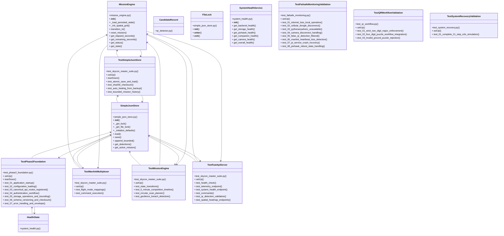

# Get Status Sync

> 371 nodes

## Key Concepts

- [main.py](file:///C:/Antigravityyyyy/pydrone/Skycon_upgrade/backend/main.py#L1) (101 connections)
- [api_response()](file:///C:/Antigravityyyyy/pydrone/Skycon_upgrade/backend/main.py#L74) (89 connections)
- [.load()](file:///C:/Antigravityyyyy/pydrone/Skycon_upgrade/backend/simple_json_store.py#L128) (56 connections)
- **str** (48 connections)
- [.save()](file:///C:/Antigravityyyyy/pydrone/Skycon_upgrade/backend/simple_json_store.py#L165) (39 connections)
- [.get_status()](file:///C:/Antigravityyyyy/pydrone/Skycon_upgrade/backend/network_manager.py#L269) (35 connections)
- [MissionEngine](file:///C:/Antigravityyyyy/pydrone/Skycon_upgrade/backend/mission_engine.py#L121) (34 connections)
- [SimpleJsonStore](file:///C:/Antigravityyyyy/pydrone/Skycon_upgrade/backend/simple_json_store.py#L50) (33 connections)
- [.log_event()](file:///C:/Antigravityyyyy/pydrone/Skycon_upgrade/backend/simple_json_store.py#L269) (27 connections)
- [.transition_to()](file:///C:/Antigravityyyyy/pydrone/Skycon_upgrade/backend/mission_engine.py#L220) (19 connections)
- [.to_dict()](file:///C:/Antigravityyyyy/pydrone/Skycon_upgrade/backend/telemetry_sync.py#L61) (18 connections)
- [.get_state()](file:///C:/Antigravityyyyy/pydrone/Skycon_upgrade/backend/mission_engine.py#L340) (17 connections)
- [TestFailsafeMonitoringValidation](file:///C:/Antigravityyyyy/pydrone/Skycon_upgrade/tests/validation/test_failsafe_monitoring.py#L25) (17 connections)
- [.handle_qr_detected()](file:///C:/Antigravityyyyy/pydrone/Skycon_upgrade/backend/mission_engine.py#L569) (15 connections)
- [HealthState](file:///C:/Antigravityyyyy/pydrone/Skycon_upgrade/backend/system_health.py#L19) (15 connections)
- [TestPhase2Foundation](file:///C:/Antigravityyyyy/pydrone/Skycon_upgrade/tests/test_phase2_foundation.py#L33) (15 connections)
- [.update()](file:///C:/Antigravityyyyy/pydrone/Skycon_upgrade/backend/qr_detector.py#L120) (14 connections)
- [validate_strict_two_digit()](file:///C:/Antigravityyyyy/pydrone/Skycon_upgrade/backend/qr_detector.py#L84) (13 connections)
- [compute_sha256()](file:///C:/Antigravityyyyy/pydrone/Skycon_upgrade/backend/simple_json_store.py#L35) (13 connections)
- [.test_01_complete_21_step_e2e_simulation()](file:///C:/Antigravityyyyy/pydrone/Skycon_upgrade/tests/validation/test_system_recovery.py#L34) (13 connections)
- [.get_stats()](file:///C:/Antigravityyyyy/pydrone/Skycon_upgrade/backend/v4l2_capture.py#L263) (12 connections)
- [SKYCON System — Master Python Test Suite Verifies: 1. SimpleJsonStore atomic p](file:///C:/Antigravityyyyy/pydrone/Skycon_upgrade/tests/test_skycon_master_suite.py#L1) (12 connections)
- [.set_mode()](file:///C:/Antigravityyyyy/pydrone/Skycon_upgrade/vision_brain/vision_brain.py#L298) (12 connections)
- [._perform_sync_cycle()](file:///C:/Antigravityyyyy/pydrone/Skycon_upgrade/backend/cloud_sync.py#L132) (11 connections)
- [queue_cloud_command()](file:///C:/Antigravityyyyy/pydrone/Skycon_upgrade/backend/main.py#L195) (11 connections)
- *... and 346 more nodes in this community*

## Class Diagram

## Relationships

- [[Coordinate Validator Coverage]] (85 shared connections)
- [[Test Suites & MAVLink Simulation]] (80 shared connections)
- [[Command Rtl Position]] (49 shared connections)
- [[Sync Cloud Hardware]] (45 shared connections)
- [[Currentrole List Roles]] (18 shared connections)
- [[Flight Phase Boundaries]] (14 shared connections)
- [[Autonomous Mission & Flight Engine]] (12 shared connections)
- [[256 Token Pbkdf2]] (8 shared connections)
- [[Diagnostic Section Report]] (2 shared connections)
- [[Get Acknowledgementmanager Diagnostics]] (2 shared connections)
- [[Computer Vision & QR Detection]] (2 shared connections)
- [[Repository Connect Intelligence]] (1 shared connections)

## Source Files

- [backend\cloud_sync.py](file:///C:/Antigravityyyyy/pydrone/Skycon_upgrade/backend/cloud_sync.py)
- [backend\georeferencing.py](file:///C:/Antigravityyyyy/pydrone/Skycon_upgrade/backend/georeferencing.py)
- [backend\heatmap_engine.py](file:///C:/Antigravityyyyy/pydrone/Skycon_upgrade/backend/heatmap_engine.py)
- [backend\main.py](file:///C:/Antigravityyyyy/pydrone/Skycon_upgrade/backend/main.py)
- [backend\mavlink_multiplexer.py](file:///C:/Antigravityyyyy/pydrone/Skycon_upgrade/backend/mavlink_multiplexer.py)
- [backend\mission_engine.py](file:///C:/Antigravityyyyy/pydrone/Skycon_upgrade/backend/mission_engine.py)
- [backend\network_manager.py](file:///C:/Antigravityyyyy/pydrone/Skycon_upgrade/backend/network_manager.py)
- [backend\object_manager.py](file:///C:/Antigravityyyyy/pydrone/Skycon_upgrade/backend/object_manager.py)
- [backend\qr_detector.py](file:///C:/Antigravityyyyy/pydrone/Skycon_upgrade/backend/qr_detector.py)
- [backend\server.py](file:///C:/Antigravityyyyy/pydrone/Skycon_upgrade/backend/server.py)
- [backend\simple_json_store.py](file:///C:/Antigravityyyyy/pydrone/Skycon_upgrade/backend/simple_json_store.py)
- [backend\spatial_grid.py](file:///C:/Antigravityyyyy/pydrone/Skycon_upgrade/backend/spatial_grid.py)
- [backend\system_health.py](file:///C:/Antigravityyyyy/pydrone/Skycon_upgrade/backend/system_health.py)
- [backend\telemetry_sync.py](file:///C:/Antigravityyyyy/pydrone/Skycon_upgrade/backend/telemetry_sync.py)
- [backend\v4l2_capture.py](file:///C:/Antigravityyyyy/pydrone/Skycon_upgrade/backend/v4l2_capture.py)
- [scripts\agent_status.py](file:///C:/Antigravityyyyy/pydrone/Skycon_upgrade/scripts/agent_status.py)
- [tests\test_hybrid_connectivity.py](file:///C:/Antigravityyyyy/pydrone/Skycon_upgrade/tests/test_hybrid_connectivity.py)
- [tests\test_phase2_foundation.py](file:///C:/Antigravityyyyy/pydrone/Skycon_upgrade/tests/test_phase2_foundation.py)
- [tests\test_phase5_mission_navigation.py](file:///C:/Antigravityyyyy/pydrone/Skycon_upgrade/tests/test_phase5_mission_navigation.py)
- [tests\test_phase6_system_integration.py](file:///C:/Antigravityyyyy/pydrone/Skycon_upgrade/tests/test_phase6_system_integration.py)

## Audit Trail

- EXTRACTED: 1113 (59%)
- INFERRED: 769 (41%)
- AMBIGUOUS: 0 (0%)

---

*Part of the graphify knowledge wiki. See [[index]] to navigate.*