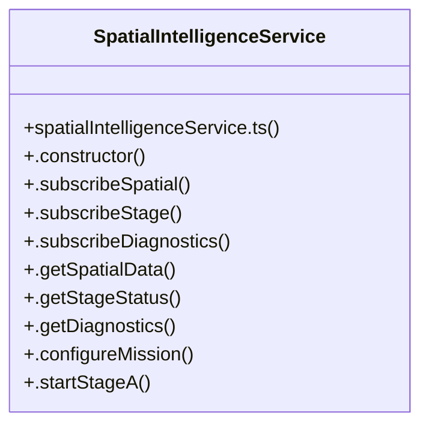

# Handlemanualreconnect Spatialintelligenceservice Spatialintelligenceservice

> 28 nodes

## Key Concepts

- [SpatialIntelligenceService](file:///C:/Antigravityyyyy/pydrone/Skycon_upgrade/frontend/src/services/spatialIntelligenceService.ts#L184) (26 connections)
- [.notifyStage()](file:///C:/Antigravityyyyy/pydrone/Skycon_upgrade/frontend/src/services/spatialIntelligenceService.ts#L491) (5 connections)
- [.notifyDiagnostics()](file:///C:/Antigravityyyyy/pydrone/Skycon_upgrade/frontend/src/services/spatialIntelligenceService.ts#L497) (5 connections)
- [.configureMission()](file:///C:/Antigravityyyyy/pydrone/Skycon_upgrade/frontend/src/services/spatialIntelligenceService.ts#L270) (4 connections)
- [.fetchStatus()](file:///C:/Antigravityyyyy/pydrone/Skycon_upgrade/frontend/src/services/spatialIntelligenceService.ts#L334) (4 connections)
- [.fetchHeatmap()](file:///C:/Antigravityyyyy/pydrone/Skycon_upgrade/frontend/src/services/spatialIntelligenceService.ts#L345) (4 connections)
- [.fetchDiagnostics()](file:///C:/Antigravityyyyy/pydrone/Skycon_upgrade/frontend/src/services/spatialIntelligenceService.ts#L361) (4 connections)
- [.handleInboundSkyconPacket()](file:///C:/Antigravityyyyy/pydrone/Skycon_upgrade/frontend/src/services/spatialIntelligenceService.ts#L398) (4 connections)
- [.constructor()](file:///C:/Antigravityyyyy/pydrone/Skycon_upgrade/frontend/src/services/spatialIntelligenceService.ts#L235) (3 connections)
- [.startStageA()](file:///C:/Antigravityyyyy/pydrone/Skycon_upgrade/frontend/src/services/spatialIntelligenceService.ts#L298) (3 connections)
- [.startStageB()](file:///C:/Antigravityyyyy/pydrone/Skycon_upgrade/frontend/src/services/spatialIntelligenceService.ts#L316) (3 connections)
- [.fetchNetworkDiagnostics()](file:///C:/Antigravityyyyy/pydrone/Skycon_upgrade/frontend/src/services/spatialIntelligenceService.ts#L356) (3 connections)
- [.notifySpatial()](file:///C:/Antigravityyyyy/pydrone/Skycon_upgrade/frontend/src/services/spatialIntelligenceService.ts#L485) (3 connections)
- [handleManualReconnect()](file:///C:/Antigravityyyyy/pydrone/Skycon_upgrade/frontend/src/components/GroundStation/CommunicationDiagnosticsPanel.tsx#L54) (2 connections)
- [.startPolling()](file:///C:/Antigravityyyyy/pydrone/Skycon_upgrade/frontend/src/services/spatialIntelligenceService.ts#L372) (2 connections)
- [.initSocketListener()](file:///C:/Antigravityyyyy/pydrone/Skycon_upgrade/frontend/src/services/spatialIntelligenceService.ts#L380) (2 connections)
- [spatialIntelligenceService.ts](file:///C:/Antigravityyyyy/pydrone/Skycon_upgrade/frontend/src/services/spatialIntelligenceService.ts#L1) (1 connections)
- [.subscribeSpatial()](file:///C:/Antigravityyyyy/pydrone/Skycon_upgrade/frontend/src/services/spatialIntelligenceService.ts#L240) (1 connections)
- [.subscribeStage()](file:///C:/Antigravityyyyy/pydrone/Skycon_upgrade/frontend/src/services/spatialIntelligenceService.ts#L246) (1 connections)
- [.subscribeDiagnostics()](file:///C:/Antigravityyyyy/pydrone/Skycon_upgrade/frontend/src/services/spatialIntelligenceService.ts#L252) (1 connections)
- [.getSpatialData()](file:///C:/Antigravityyyyy/pydrone/Skycon_upgrade/frontend/src/services/spatialIntelligenceService.ts#L258) (1 connections)
- [.getStageStatus()](file:///C:/Antigravityyyyy/pydrone/Skycon_upgrade/frontend/src/services/spatialIntelligenceService.ts#L262) (1 connections)
- [.getDiagnostics()](file:///C:/Antigravityyyyy/pydrone/Skycon_upgrade/frontend/src/services/spatialIntelligenceService.ts#L266) (1 connections)
- [.fetchHotspots()](file:///C:/Antigravityyyyy/pydrone/Skycon_upgrade/frontend/src/services/spatialIntelligenceService.ts#L426) (1 connections)
- [.configureHotspot()](file:///C:/Antigravityyyyy/pydrone/Skycon_upgrade/frontend/src/services/spatialIntelligenceService.ts#L437) (1 connections)
- *... and 3 more nodes in this community*

## Class Diagram

## Relationships

- [[Autonomous Mission & Flight Engine]] (6 shared connections)
- [[Currentrole List Roles]] (3 shared connections)

## Source Files

- [frontend\src\components\GroundStation\CommunicationDiagnosticsPanel.tsx](file:///C:/Antigravityyyyy/pydrone/Skycon_upgrade/frontend/src/components/GroundStation/CommunicationDiagnosticsPanel.tsx)
- [frontend\src\services\spatialIntelligenceService.ts](file:///C:/Antigravityyyyy/pydrone/Skycon_upgrade/frontend/src/services/spatialIntelligenceService.ts)

## Audit Trail

- EXTRACTED: 79 (89%)
- INFERRED: 10 (11%)
- AMBIGUOUS: 0 (0%)

---

*Part of the graphify knowledge wiki. See [[index]] to navigate.*