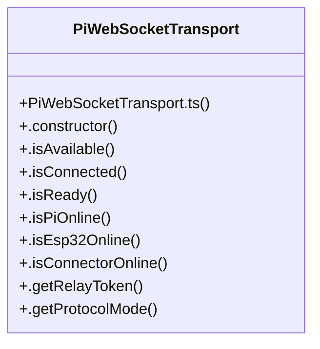

# Prearm Pre Arm

> 87 nodes

## Key Concepts

- [SKYCON Phase 3 Completion Report](file:///C:/Antigravityyyyy/pydrone/Skycon_upgrade/docs/reports/PHASE_3_COMPLETION_REPORT.md#L1) (50 connections)
- [PiWebSocketTransport](file:///C:/Antigravityyyyy/pydrone/Skycon_upgrade/frontend/src/services/transports/PiWebSocketTransport.ts#L41) (26 connections)
- [Pixhawk 2.4.8 & ArduCopter Pre-Arm Safety Checks & Diagnostic Matrix](file:///C:/Antigravityyyyy/pydrone/Skycon_upgrade/docs/hardware/PRE_ARM_SAFETY_CHECKS.md#L1) (10 connections)
- [PiWebSocketTransport.ts](file:///C:/Antigravityyyyy/pydrone/Skycon_upgrade/frontend/src/services/transports/PiWebSocketTransport.ts#L1) (8 connections)
- [main()](file:///C:/Antigravityyyyy/pydrone/Skycon_upgrade/scripts/load_params_to_pixhawk.py#L37) (7 connections)
- [.isConnected()](file:///C:/Antigravityyyyy/pydrone/Skycon_upgrade/frontend/src/services/transports/PiWebSocketTransport.ts#L85) (5 connections)
- [.isPiOnline()](file:///C:/Antigravityyyyy/pydrone/Skycon_upgrade/frontend/src/services/transports/PiWebSocketTransport.ts#L93) (5 connections)
- [.connect()](file:///C:/Antigravityyyyy/pydrone/Skycon_upgrade/frontend/src/services/transports/PiWebSocketTransport.ts#L145) (5 connections)
- [.notifyState()](file:///C:/Antigravityyyyy/pydrone/Skycon_upgrade/frontend/src/services/transports/PiWebSocketTransport.ts#L284) (4 connections)
- [.getResolvedUrl()](file:///C:/Antigravityyyyy/pydrone/Skycon_upgrade/frontend/src/services/transports/PiWebSocketTransport.ts#L134) (3 connections)
- [.disconnect()](file:///C:/Antigravityyyyy/pydrone/Skycon_upgrade/frontend/src/services/transports/PiWebSocketTransport.ts#L241) (3 connections)
- [.getDiagnostics()](file:///C:/Antigravityyyyy/pydrone/Skycon_upgrade/frontend/src/services/transports/PiWebSocketTransport.ts#L270) (3 connections)
- [.cleanupSocket()](file:///C:/Antigravityyyyy/pydrone/Skycon_upgrade/frontend/src/services/transports/PiWebSocketTransport.ts#L298) (3 connections)
- [.isReady()](file:///C:/Antigravityyyyy/pydrone/Skycon_upgrade/frontend/src/services/transports/PiWebSocketTransport.ts#L89) (2 connections)
- [.isEsp32Online()](file:///C:/Antigravityyyyy/pydrone/Skycon_upgrade/frontend/src/services/transports/PiWebSocketTransport.ts#L98) (2 connections)
- [.isConnectorOnline()](file:///C:/Antigravityyyyy/pydrone/Skycon_upgrade/frontend/src/services/transports/PiWebSocketTransport.ts#L102) (2 connections)
- [.send()](file:///C:/Antigravityyyyy/pydrone/Skycon_upgrade/frontend/src/services/transports/PiWebSocketTransport.ts#L248) (2 connections)
- [.scheduleReconnect()](file:///C:/Antigravityyyyy/pydrone/Skycon_upgrade/frontend/src/services/transports/PiWebSocketTransport.ts#L319) (2 connections)
- [.startHeartbeat()](file:///C:/Antigravityyyyy/pydrone/Skycon_upgrade/frontend/src/services/transports/PiWebSocketTransport.ts#L328) (2 connections)
- [transport.ts](file:///C:/Antigravityyyyy/pydrone/Skycon_upgrade/frontend/src/types/transport.ts#L1) (2 connections)
- [load_params_to_pixhawk.py](file:///C:/Antigravityyyyy/pydrone/Skycon_upgrade/scripts/load_params_to_pixhawk.py#L1) (2 connections)
- [load_params_file()](file:///C:/Antigravityyyyy/pydrone/Skycon_upgrade/scripts/load_params_to_pixhawk.py#L20) (2 connections)
- [isLocalhostOrigin](file:///C:/Antigravityyyyy/pydrone/Skycon_upgrade/frontend/src/services/transports/PiWebSocketTransport.ts#L32) (1 connections)
- [companionHost](file:///C:/Antigravityyyyy/pydrone/Skycon_upgrade/frontend/src/services/transports/PiWebSocketTransport.ts#L33) (1 connections)
- [isPythonAnywhereHost](file:///C:/Antigravityyyyy/pydrone/Skycon_upgrade/frontend/src/services/transports/PiWebSocketTransport.ts#L34) (1 connections)
- *... and 62 more nodes in this community*

## Class Diagram

## Relationships

- [[Currentrole List Roles]] (5 shared connections)
- [[Autonomous Mission & Flight Engine]] (2 shared connections)
- [[Command Rtl Position]] (2 shared connections)
- [[Test Suites & MAVLink Simulation]] (2 shared connections)
- [[Community Autonomous Telemetry]] (1 shared connections)
- [[256 Token Pbkdf2]] (1 shared connections)
- [[Coordinate Validator Coverage]] (1 shared connections)
- [[Get Status Sync]] (1 shared connections)

## Source Files

- [docs\hardware\PRE_ARM_SAFETY_CHECKS.md](file:///C:/Antigravityyyyy/pydrone/Skycon_upgrade/docs/hardware/PRE_ARM_SAFETY_CHECKS.md)
- [docs\reports\PHASE_3_COMPLETION_REPORT.md](file:///C:/Antigravityyyyy/pydrone/Skycon_upgrade/docs/reports/PHASE_3_COMPLETION_REPORT.md)
- [frontend\src\services\transports\PiWebSocketTransport.ts](file:///C:/Antigravityyyyy/pydrone/Skycon_upgrade/frontend/src/services/transports/PiWebSocketTransport.ts)
- [frontend\src\types\transport.ts](file:///C:/Antigravityyyyy/pydrone/Skycon_upgrade/frontend/src/types/transport.ts)
- [scripts\load_params_to_pixhawk.py](file:///C:/Antigravityyyyy/pydrone/Skycon_upgrade/scripts/load_params_to_pixhawk.py)

## Audit Trail

- EXTRACTED: 192 (89%)
- INFERRED: 23 (11%)
- AMBIGUOUS: 0 (0%)

---

*Part of the graphify knowledge wiki. See [[index]] to navigate.*