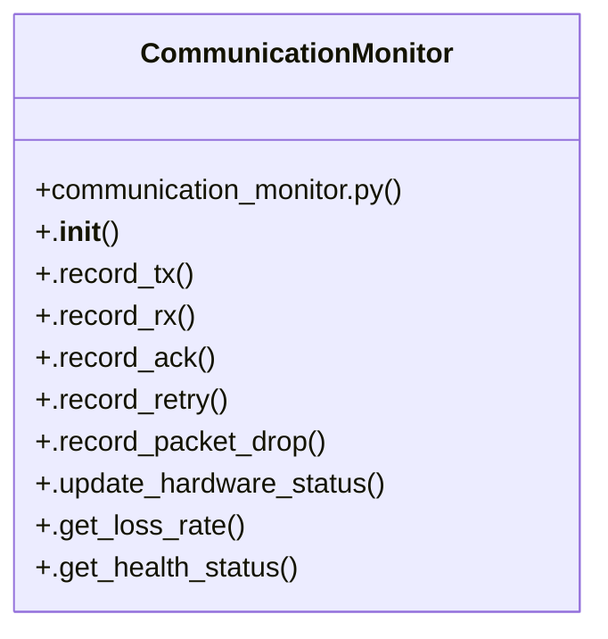

# Record Get Communication

> 16 nodes

## Key Concepts

- [CommunicationMonitor](file:///C:/Antigravityyyyy/pydrone/Skycon_upgrade/backend/communication_monitor.py#L20) (12 connections)
- [.get_health_status()](file:///C:/Antigravityyyyy/pydrone/Skycon_upgrade/backend/communication_monitor.py#L104) (4 connections)
- [.get_diagnostic_report()](file:///C:/Antigravityyyyy/pydrone/Skycon_upgrade/backend/communication_monitor.py#L125) (4 connections)
- [.get_loss_rate()](file:///C:/Antigravityyyyy/pydrone/Skycon_upgrade/backend/communication_monitor.py#L98) (3 connections)
- [communication_monitor.py](file:///C:/Antigravityyyyy/pydrone/Skycon_upgrade/backend/communication_monitor.py#L1) (2 connections)
- [.__init__()](file:///C:/Antigravityyyyy/pydrone/Skycon_upgrade/backend/communication_monitor.py#L25) (1 connections)
- [.record_tx()](file:///C:/Antigravityyyyy/pydrone/Skycon_upgrade/backend/communication_monitor.py#L60) (1 connections)
- [.record_rx()](file:///C:/Antigravityyyyy/pydrone/Skycon_upgrade/backend/communication_monitor.py#L64) (1 connections)
- [.record_ack()](file:///C:/Antigravityyyyy/pydrone/Skycon_upgrade/backend/communication_monitor.py#L68) (1 connections)
- [.record_retry()](file:///C:/Antigravityyyyy/pydrone/Skycon_upgrade/backend/communication_monitor.py#L79) (1 connections)
- [.record_packet_drop()](file:///C:/Antigravityyyyy/pydrone/Skycon_upgrade/backend/communication_monitor.py#L82) (1 connections)
- [.update_hardware_status()](file:///C:/Antigravityyyyy/pydrone/Skycon_upgrade/backend/communication_monitor.py#L85) (1 connections)
- [================================================================================](file:///C:/Antigravityyyyy/pydrone/Skycon_upgrade/backend/communication_monitor.py#L1) (1 connections)
- [Monitors bidirectional wireless link performance between companion computer,](file:///C:/Antigravityyyyy/pydrone/Skycon_upgrade/backend/communication_monitor.py#L21) (1 connections)
- [Determines qualitative connection health state:         HEALTHY, DEGRADED, CRIT](file:///C:/Antigravityyyyy/pydrone/Skycon_upgrade/backend/communication_monitor.py#L105) (1 connections)
- [Produces full diagnostic payload matching Frontend Diagnostics Panel.](file:///C:/Antigravityyyyy/pydrone/Skycon_upgrade/backend/communication_monitor.py#L126) (1 connections)

## Class Diagram

## Relationships

- No strong cross-community connections detected

## Source Files

- [backend\communication_monitor.py](file:///C:/Antigravityyyyy/pydrone/Skycon_upgrade/backend/communication_monitor.py)

## Audit Trail

- EXTRACTED: 36 (100%)
- INFERRED: 0 (0%)
- AMBIGUOUS: 0 (0%)

---

*Part of the graphify knowledge wiki. See [[index]] to navigate.*