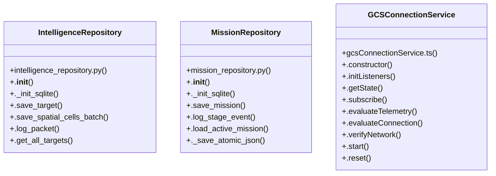

# Repository Connect Intelligence

> 84 nodes

## Key Concepts

- [Header.tsx](file:///C:/Antigravityyyyy/pydrone/Skycon_upgrade/frontend/src/features/dashboard/Header.tsx#L1) (24 connections)
- [.connect()](file:///C:/Antigravityyyyy/pydrone/Skycon_upgrade/frontend/src/services/transports/WebUsbTransport.ts#L20) (24 connections)
- [.start()](file:///C:/Antigravityyyyy/pydrone/Skycon_upgrade/frontend/src/services/gcsConnectionService.ts#L255) (23 connections)
- [QrVisionTelemetryCard.tsx](file:///C:/Antigravityyyyy/pydrone/Skycon_upgrade/frontend/src/features/dashboard/QrVisionTelemetryCard.tsx#L1) (21 connections)
- [GCSConnectionService](file:///C:/Antigravityyyyy/pydrone/Skycon_upgrade/frontend/src/services/gcsConnectionService.ts#L36) (11 connections)
- [IntelligenceRepository](file:///C:/Antigravityyyyy/pydrone/Skycon_upgrade/backend/intelligence_repository.py#L27) (8 connections)
- [MissionRepository](file:///C:/Antigravityyyyy/pydrone/Skycon_upgrade/backend/mission_repository.py#L25) (8 connections)
- [.notify()](file:///C:/Antigravityyyyy/pydrone/Skycon_upgrade/frontend/src/services/gcsConnectionService.ts#L327) (7 connections)
- [playDualToneChime()](file:///C:/Antigravityyyyy/pydrone/Skycon_upgrade/frontend/src/features/dashboard/QrVisionTelemetryCard.tsx#L82) (6 connections)
- [.log_mission_event()](file:///C:/Antigravityyyyy/pydrone/Skycon_upgrade/backend/persistence.py#L394) (5 connections)
- [.evaluateTelemetry()](file:///C:/Antigravityyyyy/pydrone/Skycon_upgrade/frontend/src/services/gcsConnectionService.ts#L106) (5 connections)
- [.verifyNetwork()](file:///C:/Antigravityyyyy/pydrone/Skycon_upgrade/frontend/src/services/gcsConnectionService.ts#L199) (5 connections)
- [.load_active_mission()](file:///C:/Antigravityyyyy/pydrone/Skycon_upgrade/backend/mission_repository.py#L132) (4 connections)
- [registerDetection()](file:///C:/Antigravityyyyy/pydrone/Skycon_upgrade/frontend/src/features/dashboard/QrVisionTelemetryCard.tsx#L115) (4 connections)
- [.initListeners()](file:///C:/Antigravityyyyy/pydrone/Skycon_upgrade/frontend/src/services/gcsConnectionService.ts#L60) (4 connections)
- [.getState()](file:///C:/Antigravityyyyy/pydrone/Skycon_upgrade/frontend/src/services/gcsConnectionService.ts#L93) (4 connections)
- [.evaluateConnection()](file:///C:/Antigravityyyyy/pydrone/Skycon_upgrade/frontend/src/services/gcsConnectionService.ts#L168) (4 connections)
- [._init_sqlite()](file:///C:/Antigravityyyyy/pydrone/Skycon_upgrade/backend/intelligence_repository.py#L43) (3 connections)
- [._init_sqlite()](file:///C:/Antigravityyyyy/pydrone/Skycon_upgrade/backend/mission_repository.py#L41) (3 connections)
- [.save_mission()](file:///C:/Antigravityyyyy/pydrone/Skycon_upgrade/backend/mission_repository.py#L73) (3 connections)
- [.connect()](file:///C:/Antigravityyyyy/pydrone/Skycon_upgrade/backend/autopilot.py#L129) (2 connections)
- [intelligence_repository.py](file:///C:/Antigravityyyyy/pydrone/Skycon_upgrade/backend/intelligence_repository.py#L1) (2 connections)
- [.__init__()](file:///C:/Antigravityyyyy/pydrone/Skycon_upgrade/backend/intelligence_repository.py#L32) (2 connections)
- [.save_target()](file:///C:/Antigravityyyyy/pydrone/Skycon_upgrade/backend/intelligence_repository.py#L105) (2 connections)
- [.save_spatial_cells_batch()](file:///C:/Antigravityyyyy/pydrone/Skycon_upgrade/backend/intelligence_repository.py#L150) (2 connections)
- *... and 59 more nodes in this community*

## Class Diagram

## Relationships

- [[Autonomous Mission & Flight Engine]] (22 shared connections)
- [[Test Suites & MAVLink Simulation]] (12 shared connections)
- [[Command Rtl Position]] (4 shared connections)
- [[Android USB Serial OTG Hardware]] (2 shared connections)
- [[Sync Cloud Hardware]] (2 shared connections)
- [[Get Status Sync]] (1 shared connections)
- [[Currentrole List Roles]] (1 shared connections)
- [[Coordinate Validator Coverage]] (1 shared connections)

## Source Files

- [backend\autopilot.py](file:///C:/Antigravityyyyy/pydrone/Skycon_upgrade/backend/autopilot.py)
- [backend\intelligence_repository.py](file:///C:/Antigravityyyyy/pydrone/Skycon_upgrade/backend/intelligence_repository.py)
- [backend\mission_repository.py](file:///C:/Antigravityyyyy/pydrone/Skycon_upgrade/backend/mission_repository.py)
- [backend\persistence.py](file:///C:/Antigravityyyyy/pydrone/Skycon_upgrade/backend/persistence.py)
- [frontend\src\features\dashboard\Header.tsx](file:///C:/Antigravityyyyy/pydrone/Skycon_upgrade/frontend/src/features/dashboard/Header.tsx)
- [frontend\src\features\dashboard\QrVisionTelemetryCard.tsx](file:///C:/Antigravityyyyy/pydrone/Skycon_upgrade/frontend/src/features/dashboard/QrVisionTelemetryCard.tsx)
- [frontend\src\services\gcsConnectionService.ts](file:///C:/Antigravityyyyy/pydrone/Skycon_upgrade/frontend/src/services/gcsConnectionService.ts)
- [frontend\src\services\transports\WebUsbTransport.ts](file:///C:/Antigravityyyyy/pydrone/Skycon_upgrade/frontend/src/services/transports/WebUsbTransport.ts)

## Audit Trail

- EXTRACTED: 192 (74%)
- INFERRED: 67 (26%)
- AMBIGUOUS: 0 (0%)

---

*Part of the graphify knowledge wiki. See [[index]] to navigate.*