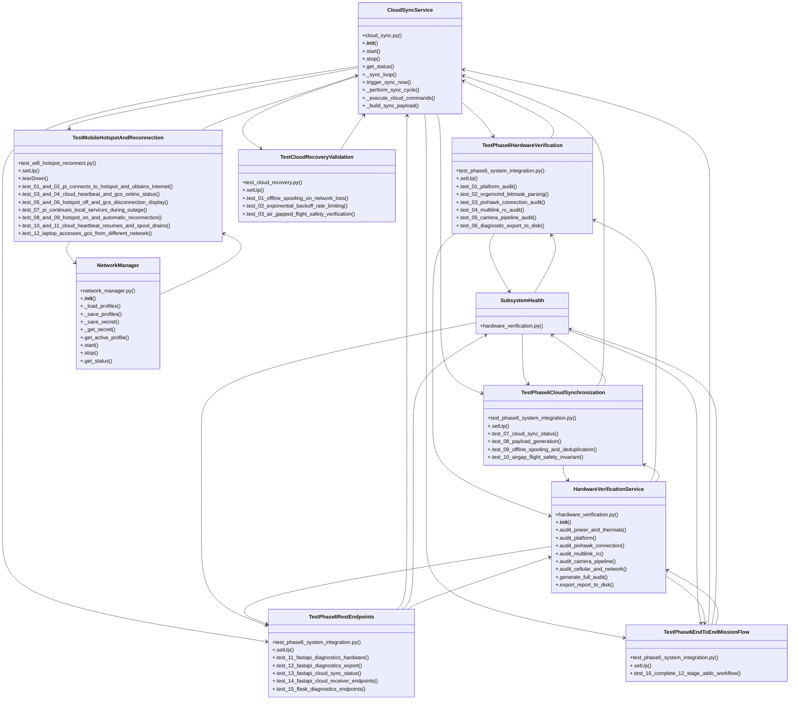

# Sync Cloud Hardware

> 157 nodes

## Key Concepts

- [CloudSyncService](file:///C:/Antigravityyyyy/pydrone/Skycon_upgrade/backend/cloud_sync.py#L35) (59 connections)
- [NetworkManager](file:///C:/Antigravityyyyy/pydrone/Skycon_upgrade/backend/network_manager.py#L65) (39 connections)
- [HardwareVerificationService](file:///C:/Antigravityyyyy/pydrone/Skycon_upgrade/backend/hardware_verification.py#L48) (37 connections)
- [SubsystemHealth](file:///C:/Antigravityyyyy/pydrone/Skycon_upgrade/backend/hardware_verification.py#L40) (28 connections)
- [.probe_network()](file:///C:/Antigravityyyyy/pydrone/Skycon_upgrade/backend/network_manager.py#L347) (15 connections)
- [TestMobileHotspotAndReconnection](file:///C:/Antigravityyyyy/pydrone/Skycon_upgrade/tests/test_wifi_hotspot_reconnect.py#L23) (15 connections)
- [.generate_full_audit()](file:///C:/Antigravityyyyy/pydrone/Skycon_upgrade/backend/hardware_verification.py#L403) (12 connections)
- [TestPhase6HardwareVerification](file:///C:/Antigravityyyyy/pydrone/Skycon_upgrade/tests/test_phase6_system_integration.py#L36) (12 connections)
- [TestPhase6RestEndpoints](file:///C:/Antigravityyyyy/pydrone/Skycon_upgrade/tests/test_phase6_system_integration.py#L165) (11 connections)
- [.configure_hotspot_profile()](file:///C:/Antigravityyyyy/pydrone/Skycon_upgrade/backend/network_manager.py#L653) (10 connections)
- [TestPhase6CloudSynchronization](file:///C:/Antigravityyyyy/pydrone/Skycon_upgrade/tests/test_phase6_system_integration.py#L114) (10 connections)
- [._save_profiles()](file:///C:/Antigravityyyyy/pydrone/Skycon_upgrade/backend/network_manager.py#L186) (8 connections)
- [._trigger_multi_hotspot_failover()](file:///C:/Antigravityyyyy/pydrone/Skycon_upgrade/backend/network_manager.py#L424) (8 connections)
- [._check_wifi_interface()](file:///C:/Antigravityyyyy/pydrone/Skycon_upgrade/backend/network_manager.py#L506) (8 connections)
- [.export_report_to_disk()](file:///C:/Antigravityyyyy/pydrone/Skycon_upgrade/backend/hardware_verification.py#L446) (7 connections)
- [.get_active_profile()](file:///C:/Antigravityyyyy/pydrone/Skycon_upgrade/backend/network_manager.py#L231) (7 connections)
- [TestPhase6EndToEndMissionFlow](file:///C:/Antigravityyyyy/pydrone/Skycon_upgrade/tests/test_phase6_system_integration.py#L233) (7 connections)
- [Execute full ADDC 2026 12-stage mission cycle.](file:///C:/Antigravityyyyy/pydrone/Skycon_upgrade/tests/test_phase6_system_integration.py#L240) (7 connections)
- [Verify hotspot configuration sanitizes input, never exposes password, and sets c](file:///C:/Antigravityyyyy/pydrone/Skycon_upgrade/tests/test_wifi_hotspot_reconnect.py#L221) (7 connections)
- [TestCloudRecoveryValidation](file:///C:/Antigravityyyyy/pydrone/Skycon_upgrade/tests/validation/test_cloud_recovery.py#L21) (7 connections)
- [.audit_pixhawk_connection()](file:///C:/Antigravityyyyy/pydrone/Skycon_upgrade/backend/hardware_verification.py#L219) (6 connections)
- [._load_profiles()](file:///C:/Antigravityyyyy/pydrone/Skycon_upgrade/backend/network_manager.py#L141) (6 connections)
- [._evaluate_hysteresis_switch()](file:///C:/Antigravityyyyy/pydrone/Skycon_upgrade/backend/network_manager.py#L456) (6 connections)
- [Removes a configured hotspot profile.](file:///C:/Antigravityyyyy/pydrone/Skycon_upgrade/backend/network_manager.py#L734) (6 connections)
- [hardware_verification.py](file:///C:/Antigravityyyyy/pydrone/Skycon_upgrade/backend/hardware_verification.py#L1) (5 connections)
- *... and 132 more nodes in this community*

## Class Diagram

## Relationships

- [[Get Status Sync]] (45 shared connections)
- [[Coordinate Validator Coverage]] (27 shared connections)
- [[Currentrole List Roles]] (12 shared connections)
- [[Autonomous Mission & Flight Engine]] (6 shared connections)
- [[256 Token Pbkdf2]] (6 shared connections)
- [[Test Suites & MAVLink Simulation]] (4 shared connections)
- [[Command Rtl Position]] (3 shared connections)
- [[Flight Phase Boundaries]] (2 shared connections)
- [[Repository Connect Intelligence]] (2 shared connections)

## Source Files

- [backend\cloud_sync.py](file:///C:/Antigravityyyyy/pydrone/Skycon_upgrade/backend/cloud_sync.py)
- [backend\hardware_verification.py](file:///C:/Antigravityyyyy/pydrone/Skycon_upgrade/backend/hardware_verification.py)
- [backend\network_manager.py](file:///C:/Antigravityyyyy/pydrone/Skycon_upgrade/backend/network_manager.py)
- [backend\server.py](file:///C:/Antigravityyyyy/pydrone/Skycon_upgrade/backend/server.py)
- [tests\test_phase6_system_integration.py](file:///C:/Antigravityyyyy/pydrone/Skycon_upgrade/tests/test_phase6_system_integration.py)
- [tests\test_wifi_hotspot_reconnect.py](file:///C:/Antigravityyyyy/pydrone/Skycon_upgrade/tests/test_wifi_hotspot_reconnect.py)
- [tests\validation\test_cloud_recovery.py](file:///C:/Antigravityyyyy/pydrone/Skycon_upgrade/tests/validation/test_cloud_recovery.py)

## Audit Trail

- EXTRACTED: 392 (56%)
- INFERRED: 307 (44%)
- AMBIGUOUS: 0 (0%)

---

*Part of the graphify knowledge wiki. See [[index]] to navigate.*