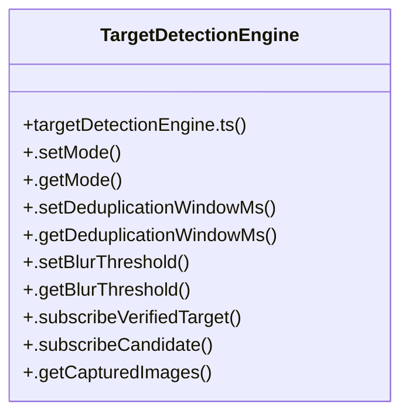

# Targetdetectionengine Inittargetdetectionsubscription Getzxingbarcodereader

> 36 nodes

## Key Concepts

- [TargetDetectionEngine](file:///C:/Antigravityyyyy/pydrone/Skycon_upgrade/frontend/src/services/targetDetectionEngine.ts#L163) (30 connections)
- [.processFrame()](file:///C:/Antigravityyyyy/pydrone/Skycon_upgrade/frontend/src/services/targetDetectionEngine.ts#L1054) (13 connections)
- [.captureAreaSnapshot()](file:///C:/Antigravityyyyy/pydrone/Skycon_upgrade/frontend/src/services/targetDetectionEngine.ts#L641) (7 connections)
- [getZxingBarcodeReader()](file:///C:/Antigravityyyyy/pydrone/Skycon_upgrade/frontend/src/services/targetDetectionEngine.ts#L143) (5 connections)
- [.notifyCapturedImages()](file:///C:/Antigravityyyyy/pydrone/Skycon_upgrade/frontend/src/services/targetDetectionEngine.ts#L243) (5 connections)
- [.scanCapturedImagesForQR()](file:///C:/Antigravityyyyy/pydrone/Skycon_upgrade/frontend/src/services/targetDetectionEngine.ts#L735) (5 connections)
- [.initTargetDetectionSubscription()](file:///C:/Antigravityyyyy/pydrone/Skycon_upgrade/frontend/src/services/phoneDroneMissionService.ts#L209) (4 connections)
- [targetDetectionEngine.ts](file:///C:/Antigravityyyyy/pydrone/Skycon_upgrade/frontend/src/services/targetDetectionEngine.ts#L1) (4 connections)
- [.detectCuboidBoxAndQRContour()](file:///C:/Antigravityyyyy/pydrone/Skycon_upgrade/frontend/src/services/targetDetectionEngine.ts#L315) (4 connections)
- [.decodeTwoDigitQR()](file:///C:/Antigravityyyyy/pydrone/Skycon_upgrade/frontend/src/services/targetDetectionEngine.ts#L490) (4 connections)
- [.computeQualityMetrics()](file:///C:/Antigravityyyyy/pydrone/Skycon_upgrade/frontend/src/services/targetDetectionEngine.ts#L869) (4 connections)
- [.estimateTargetGroundLocation()](file:///C:/Antigravityyyyy/pydrone/Skycon_upgrade/frontend/src/services/targetDetectionEngine.ts#L952) (4 connections)
- [.getCapturedImages()](file:///C:/Antigravityyyyy/pydrone/Skycon_upgrade/frontend/src/services/targetDetectionEngine.ts#L223) (3 connections)
- [.clearCapturedImages()](file:///C:/Antigravityyyyy/pydrone/Skycon_upgrade/frontend/src/services/targetDetectionEngine.ts#L227) (3 connections)
- [.detectQRCode()](file:///C:/Antigravityyyyy/pydrone/Skycon_upgrade/frontend/src/services/targetDetectionEngine.ts#L1242) (3 connections)
- [.detectBarcode()](file:///C:/Antigravityyyyy/pydrone/Skycon_upgrade/frontend/src/services/targetDetectionEngine.ts#L1297) (3 connections)
- [.notifyCandidate()](file:///C:/Antigravityyyyy/pydrone/Skycon_upgrade/frontend/src/services/targetDetectionEngine.ts#L1402) (3 connections)
- [handleManualCapture()](file:///C:/Antigravityyyyy/pydrone/Skycon_upgrade/frontend/src/components/Mission/UnifiedCameraIntelligenceModal.tsx#L105) (2 connections)
- [.setMode()](file:///C:/Antigravityyyyy/pydrone/Skycon_upgrade/frontend/src/services/targetDetectionEngine.ts#L186) (2 connections)
- [.subscribeVerifiedTarget()](file:///C:/Antigravityyyyy/pydrone/Skycon_upgrade/frontend/src/services/targetDetectionEngine.ts#L212) (2 connections)
- [.subscribeCapturedImages()](file:///C:/Antigravityyyyy/pydrone/Skycon_upgrade/frontend/src/services/targetDetectionEngine.ts#L232) (2 connections)
- [.subscribeQueueTargetDetected()](file:///C:/Antigravityyyyy/pydrone/Skycon_upgrade/frontend/src/services/targetDetectionEngine.ts#L238) (2 connections)
- [.haversineMeters()](file:///C:/Antigravityyyyy/pydrone/Skycon_upgrade/frontend/src/services/targetDetectionEngine.ts#L248) (2 connections)
- [.assessFrameQuality()](file:///C:/Antigravityyyyy/pydrone/Skycon_upgrade/frontend/src/services/targetDetectionEngine.ts#L865) (2 connections)
- [.detectSquareMarker()](file:///C:/Antigravityyyyy/pydrone/Skycon_upgrade/frontend/src/services/targetDetectionEngine.ts#L1331) (2 connections)
- *... and 11 more nodes in this community*

## Class Diagram

## Relationships

- [[Autonomous Mission & Flight Engine]] (5 shared connections)
- [[Computer Vision & QR Detection]] (3 shared connections)
- [[Broadcast Channel Name]] (1 shared connections)

## Source Files

- [frontend\src\components\Mission\UnifiedCameraIntelligenceModal.tsx](file:///C:/Antigravityyyyy/pydrone/Skycon_upgrade/frontend/src/components/Mission/UnifiedCameraIntelligenceModal.tsx)
- [frontend\src\services\phoneDroneMissionService.ts](file:///C:/Antigravityyyyy/pydrone/Skycon_upgrade/frontend/src/services/phoneDroneMissionService.ts)
- [frontend\src\services\targetDetectionEngine.ts](file:///C:/Antigravityyyyy/pydrone/Skycon_upgrade/frontend/src/services/targetDetectionEngine.ts)

## Audit Trail

- EXTRACTED: 121 (91%)
- INFERRED: 12 (9%)
- AMBIGUOUS: 0 (0%)

---

*Part of the graphify knowledge wiki. See [[index]] to navigate.*