# Knowledge Graph Index

> Auto-generated by graphify. Start here — read community articles for context, then drill into god nodes for detail.

**5266 nodes · 10728 edges · 160 communities**

---

## System Architecture Flowchart

```mermaid
flowchart TD
    C0["Flight Control & Georeferencing (539 nodes)"]
    C1["Community 1 (474 nodes)"]
    C2["Community 2 (472 nodes)"]
    C3["Community 3 (425 nodes)"]
    C4["Community 4 (256 nodes)"]
    C5["Community 5 (226 nodes)"]
    C6["Community 6 (183 nodes)"]
    C7["Community 7 (160 nodes)"]
    C8["Community 8 (158 nodes)"]
    C9["Community 9 (157 nodes)"]
    C10["Community 10 (131 nodes)"]
    C11["Community 11 (129 nodes)"]
    C12["Community 12 (120 nodes)"]
    C13["Community 13 (109 nodes)"]
    C14["Community 14 (105 nodes)"]
    C15["Community 15 (92 nodes)"]
    C16["Community 16 (92 nodes)"]
    C17["Community 17 (84 nodes)"]
    C18["Community 18 (81 nodes)"]
    C19["Community 19 (76 nodes)"]
    C20["Flight Control Systems (74 nodes)"]
    C21["Community 21 (70 nodes)"]
    C22["Community 22 (53 nodes)"]
    C23["Community 23 (46 nodes)"]
    C24["Community 24 (45 nodes)"]
    C25["Community 25 (43 nodes)"]
    C26["Community 26 (36 nodes)"]
    C27["Barcode Scanning (35 nodes)"]
    C28["Community 28 (30 nodes)"]
    C29["Community 29 (28 nodes)"]
    C30["Community 30 (26 nodes)"]
    C31["Community 31 (26 nodes)"]
    C32["Community 32 (25 nodes)"]
    C33["Community 33 (25 nodes)"]
    C34["Community 34 (23 nodes)"]
    C35["Community 35 (19 nodes)"]
    C36["Community 36 (19 nodes)"]
    C37["Community 37 (18 nodes)"]
    C38["Community 38 (18 nodes)"]
    C39["Community 39 (16 nodes)"]
    C40["Community 40 (16 nodes)"]
    C41["Community 41 (16 nodes)"]
    C42["Community 42 (15 nodes)"]
    C43["Community 43 (15 nodes)"]
    C44["Community 44 (15 nodes)"]
    C45["Community 45 (15 nodes)"]
    C46["Community 46 (14 nodes)"]
    C47["Community 47 (13 nodes)"]
    C48["Flight Control (13 nodes)"]
    C49["Community 49 (13 nodes)"]
    C50["Community 50 (12 nodes)"]
    C51["Community 51 (12 nodes)"]
    C52["Community 52 (12 nodes)"]
    C53["Community 53 (12 nodes)"]
    C54["Community 54 (12 nodes)"]
    C55["Community 55 (12 nodes)"]
    C56["Community 56 (11 nodes)"]
    C57["Community 57 (11 nodes)"]
    C58["Community 58 (11 nodes)"]
    C59["Community 59 (10 nodes)"]
    C60["Community 60 (10 nodes)"]
    C61["Community 61 (9 nodes)"]
    C62["Community 62 (9 nodes)"]
    C63["Community 63 (9 nodes)"]
    C64["Community 64 (8 nodes)"]
    C65["Community 65 (8 nodes)"]
    C66["Community 66 (7 nodes)"]
    C67["Community 67 (7 nodes)"]
    C68["Community 68 (7 nodes)"]
    C69["Geodesic Math (6 nodes)"]
    C70["Community 70 (6 nodes)"]
    C71["Community 71 (6 nodes)"]
    C72["Community 72 (6 nodes)"]
    C73["Community 73 (6 nodes)"]
    C74["Community 74 (6 nodes)"]
    C75["Community 75 (5 nodes)"]
    C76["Community 76 (5 nodes)"]
    C77["Community 77 (5 nodes)"]
    C78["Community 78 (5 nodes)"]
    C79["Community 79 (5 nodes)"]
    C80["Community 80 (5 nodes)"]
    C81["Community 81 (5 nodes)"]
    C82["Community 82 (5 nodes)"]
    C83["Community 83 (5 nodes)"]
    C84["Community 84 (5 nodes)"]
    C85["Community 85 (5 nodes)"]
    C86["Community 86 (4 nodes)"]
    C87["Community 87 (4 nodes)"]
    C88["Community 88 (3 nodes)"]
    C89["Community 89 (3 nodes)"]
    C90["Community 90 (3 nodes)"]
    C91["Community 91 (3 nodes)"]
    C92["Community 92 (3 nodes)"]
    C93["Community 93 (2 nodes)"]
    C94["unknown (2 nodes)"]
    C95["unknown (2 nodes)"]
    C96["unknown (2 nodes)"]
    C97["Community 97 (2 nodes)"]
    C98["Community 98 (2 nodes)"]
    C99["Community 99 (2 nodes)"]
    C100["Community 100 (1 nodes)"]
    C101["Community 101 (1 nodes)"]
    C102["Community 102 (1 nodes)"]
    C103["Community 103 (1 nodes)"]
    C104["Packet Decoder (1 nodes)"]
    C105["Community 105 (1 nodes)"]
    C106["Community 106 (1 nodes)"]
    C107["Community 107 (1 nodes)"]
    C108["Community 108 (1 nodes)"]
    C109["Community 109 (1 nodes)"]
    C110["Community 110 (1 nodes)"]
    C111["Community 111 (1 nodes)"]
    C112["Community 112 (1 nodes)"]
    C113["Community 113 (1 nodes)"]
    C114["Community 114 (1 nodes)"]
    C115["Community 115 (1 nodes)"]
    C116["Community 116 (1 nodes)"]
    C117["Community 117 (1 nodes)"]
    C118["Community 118 (1 nodes)"]
    C119["Community 119 (1 nodes)"]
    C120["Community 120 (1 nodes)"]
    C121["Community 121 (1 nodes)"]
    C122["Community 122 (1 nodes)"]
    C123["Community 123 (1 nodes)"]
    C124["Community 124 (1 nodes)"]
    C125["Community 125 (1 nodes)"]
    C126["Community 126 (1 nodes)"]
    C127["Community 127 (1 nodes)"]
    C128["Community 128 (1 nodes)"]
    C129["Community 129 (1 nodes)"]
    C130["Community 130 (1 nodes)"]
    C131["Community 131 (1 nodes)"]
    C132["Community 132 (1 nodes)"]
    C133["Community 133 (1 nodes)"]
    C134["Community 134 (1 nodes)"]
    C135["Motor Safety (1 nodes)"]
    C136["Community 136 (1 nodes)"]
    C137["Community 137 (1 nodes)"]
    C138["Community 138 (1 nodes)"]
    C139["Community 139 (1 nodes)"]
    C140["Community 140 (1 nodes)"]
    C141["Community 141 (1 nodes)"]
    C142["Community 142 (1 nodes)"]
    C143["Community 143 (1 nodes)"]
    C144["Community 144 (1 nodes)"]
    C145["Community 145 (1 nodes)"]
    C146["Community 146 (1 nodes)"]
    C147["Community 147 (1 nodes)"]
    C148["Community 148 (1 nodes)"]
    C149["Community 149 (1 nodes)"]
    C150["Community 150 (1 nodes)"]
    C151["Community 151 (1 nodes)"]
    C152["Community 152 (1 nodes)"]
    C153["Community 153 (1 nodes)"]
    C154["Community 154 (1 nodes)"]
    C155["Community 155 (1 nodes)"]
    C156["unknown (1 nodes)"]
    C157["unknown (1 nodes)"]
    C158["unknown (1 nodes)"]
    C159["unknown (1 nodes)"]
    C0 -->|60 edges| C1
    C0 -->|60 edges| C3
    C4 -->|60 edges| C0
    C3 -->|59 edges| C4
    C3 -->|48 edges| C0
    C0 -->|47 edges| C4
    C5 -->|45 edges| C2
    C4 -->|42 edges| C1
    C2 -->|39 edges| C10
    C8 -->|29 edges| C3
    C2 -->|29 edges| C9
    C12 -->|26 edges| C3
    C12 -->|22 edges| C0
    C21 -->|22 edges| C2
    C4 -->|21 edges| C3
    C2 -->|21 edges| C5
    C3 -->|20 edges| C8
    C3 -->|17 edges| C1
    C4 -->|15 edges| C8
    C0 -->|15 edges| C11
    C17 -->|13 edges| C2
    C0 -->|12 edges| C12
    C8 -->|12 edges| C1
    C15 -->|12 edges| C2
    C3 -->|11 edges| C2
    C3 -->|11 edges| C11
    C9 -->|11 edges| C10
    C9 -->|11 edges| C2
    C2 -->|11 edges| C6
    C2 -->|9 edges| C17
    C0 -->|8 edges| C17
    C1 -->|8 edges| C11
    C8 -->|8 edges| C4
    C10 -->|8 edges| C2
    C17 -->|8 edges| C0
    C12 -->|7 edges| C4
    C8 -->|7 edges| C19
    C2 -->|7 edges| C1
    C0 -->|6 edges| C8
    C6 -->|6 edges| C2
    C2 -->|6 edges| C21
    C13 -->|6 edges| C2
    C0 -->|5 edges| C18
    C3 -->|5 edges| C12
    C3 -->|5 edges| C19
    C0 -->|5 edges| C19
    C33 -->|5 edges| C2
    C14 -->|5 edges| C2
    C23 -->|5 edges| C2
    C2 -->|5 edges| C27
    C11 -->|5 edges| C1
    C1 -->|4 edges| C20
    C8 -->|4 edges| C2
    C22 -->|4 edges| C2
    C2 -->|4 edges| C37
    C2 -->|4 edges| C25
    C2 -->|4 edges| C14
    C31 -->|3 edges| C3
    C0 -->|3 edges| C20
    C1 -->|3 edges| C0
    C0 -->|3 edges| C2
    C4 -->|3 edges| C12
    C48 -->|3 edges| C2
    C16 -->|3 edges| C2
    C29 -->|3 edges| C2
    C2 -->|3 edges| C43
    C57 -->|3 edges| C2
    C9 -->|3 edges| C27
    C31 -->|2 edges| C1
    C1 -->|2 edges| C3
    C8 -->|2 edges| C11
    C24 -->|2 edges| C4
    C8 -->|2 edges| C0
    C3 -->|2 edges| C10
    C8 -->|2 edges| C17
    C19 -->|2 edges| C3
    C19 -->|2 edges| C18
    C18 -->|2 edges| C12
    C22 -->|2 edges| C1
    C25 -->|2 edges| C2
    C35 -->|2 edges| C2
    C36 -->|2 edges| C1
    C6 -->|2 edges| C1
    C9 -->|2 edges| C6
    C2 -->|2 edges| C60
    C2 -->|2 edges| C22
    C2 -->|2 edges| C12
    C2 -->|2 edges| C20
    C2 -->|2 edges| C8
    C2 -->|2 edges| C7
    C2 -->|2 edges| C32
    C18 -->|2 edges| C1
    C11 -->|2 edges| C3
    C12 -->|2 edges| C1
    C12 -->|2 edges| C11
    C31 -->|1 edges| C18
    C0 -->|1 edges| C24
    C4 -->|1 edges| C18
    C24 -->|1 edges| C3
    C24 -->|1 edges| C18
    C24 -->|1 edges| C1
    C3 -->|1 edges| C22
    C1 -->|1 edges| C4
    C17 -->|1 edges| C3
    C4 -->|1 edges| C17
    C4 -->|1 edges| C20
    C3 -->|1 edges| C18
    C3 -->|1 edges| C35
    C3 -->|1 edges| C31
    C19 -->|1 edges| C0
    C1 -->|1 edges| C7
    C4 -->|1 edges| C2
    C47 -->|1 edges| C2
    C77 -->|1 edges| C2
    C21 -->|1 edges| C10
    C15 -->|1 edges| C5
    C15 -->|1 edges| C16
    C15 -->|1 edges| C0
    C18 -->|1 edges| C7
    C46 -->|1 edges| C2
    C29 -->|1 edges| C10
    C6 -->|1 edges| C27
    C30 -->|1 edges| C2
    C64 -->|1 edges| C2
    C2 -->|1 edges| C19
    C17 -->|1 edges| C1
    C2 -->|1 edges| C13
    C13 -->|1 edges| C21
    C26 -->|1 edges| C2
    C16 -->|1 edges| C19
    C2 -->|1 edges| C16
    C2 -->|1 edges| C33
    C82 -->|1 edges| C2
    C2 -->|1 edges| C66
    C37 -->|1 edges| C2
    C17 -->|1 edges| C14
    C2 -->|1 edges| C4
    C2 -->|1 edges| C3
    C32 -->|1 edges| C2
    C10 -->|1 edges| C5
    C10 -->|1 edges| C12
    C14 -->|1 edges| C17
    C20 -->|1 edges| C7
    C18 -->|1 edges| C20
    C4 -->|1 edges| C19
    C0 -->|1 edges| C55
    C3 -->|1 edges| C20
    C4 -->|1 edges| C11
    C31 -->|1 edges| C11
```

## Communities
(sorted by size, largest first)

- [[Flight Control & Georeferencing]] — 539 nodes
- [[Community 1]] — 474 nodes
- [[Community 2]] — 472 nodes
- [[Community 3]] — 425 nodes
- [[Community 4]] — 256 nodes
- [[Community 5]] — 226 nodes
- [[Community 6]] — 183 nodes
- [[Community 7]] — 160 nodes
- [[Community 8]] — 158 nodes
- [[Community 9]] — 157 nodes
- [[Community 10]] — 131 nodes
- [[Community 11]] — 129 nodes
- [[Community 12]] — 120 nodes
- [[Community 13]] — 109 nodes
- [[Community 14]] — 105 nodes
- [[Community 15]] — 92 nodes
- [[Community 16]] — 92 nodes
- [[Community 17]] — 84 nodes
- [[Community 18]] — 81 nodes
- [[Community 19]] — 76 nodes
- [[Flight Control Systems]] — 74 nodes
- [[Community 21]] — 70 nodes
- [[Community 22]] — 53 nodes
- [[Community 23]] — 46 nodes
- [[Community 24]] — 45 nodes
- [[Community 25]] — 43 nodes
- [[Community 26]] — 36 nodes
- [[Barcode Scanning]] — 35 nodes
- [[Community 28]] — 30 nodes
- [[Community 29]] — 28 nodes
- [[Community 30]] — 26 nodes
- [[Community 31]] — 26 nodes
- [[Community 32]] — 25 nodes
- [[Community 33]] — 25 nodes
- [[Community 34]] — 23 nodes
- [[Community 35]] — 19 nodes
- [[Community 36]] — 19 nodes
- [[Community 37]] — 18 nodes
- [[Community 38]] — 18 nodes
- [[Community 39]] — 16 nodes
- [[Community 40]] — 16 nodes
- [[Community 41]] — 16 nodes
- [[Community 42]] — 15 nodes
- [[Community 43]] — 15 nodes
- [[Community 44]] — 15 nodes
- [[Community 45]] — 15 nodes
- [[Community 46]] — 14 nodes
- [[Community 47]] — 13 nodes
- [[Flight Control]] — 13 nodes
- [[Community 49]] — 13 nodes
- [[Community 50]] — 12 nodes
- [[Community 51]] — 12 nodes
- [[Community 52]] — 12 nodes
- [[Community 53]] — 12 nodes
- [[Community 54]] — 12 nodes
- [[Community 55]] — 12 nodes
- [[Community 56]] — 11 nodes
- [[Community 57]] — 11 nodes
- [[Community 58]] — 11 nodes
- [[Community 59]] — 10 nodes
- [[Community 60]] — 10 nodes
- [[Community 61]] — 9 nodes
- [[Community 62]] — 9 nodes
- [[Community 63]] — 9 nodes
- [[Community 64]] — 8 nodes
- [[Community 65]] — 8 nodes
- [[Community 66]] — 7 nodes
- [[Community 67]] — 7 nodes
- [[Community 68]] — 7 nodes
- [[Geodesic Math]] — 6 nodes
- [[Community 70]] — 6 nodes
- [[Community 71]] — 6 nodes
- [[Community 72]] — 6 nodes
- [[Community 73]] — 6 nodes
- [[Community 74]] — 6 nodes
- [[Community 75]] — 5 nodes
- [[Community 76]] — 5 nodes
- [[Community 77]] — 5 nodes
- [[Community 78]] — 5 nodes
- [[Community 79]] — 5 nodes
- [[Community 80]] — 5 nodes
- [[Community 81]] — 5 nodes
- [[Community 82]] — 5 nodes
- [[Community 83]] — 5 nodes
- [[Community 84]] — 5 nodes
- [[Community 85]] — 5 nodes
- [[Community 86]] — 4 nodes
- [[Community 87]] — 4 nodes
- [[Community 88]] — 3 nodes
- [[Community 89]] — 3 nodes
- [[Community 90]] — 3 nodes
- [[Community 91]] — 3 nodes
- [[Community 92]] — 3 nodes
- [[Community 93]] — 2 nodes
- [[unknown]] — 2 nodes
- [[unknown]] — 2 nodes
- [[unknown]] — 2 nodes
- [[Community 97]] — 2 nodes
- [[Community 98]] — 2 nodes
- [[Community 99]] — 2 nodes
- [[Community 100]] — 1 nodes
- [[Community 101]] — 1 nodes
- [[Community 102]] — 1 nodes
- [[Community 103]] — 1 nodes
- [[Packet Decoder]] — 1 nodes
- [[Community 105]] — 1 nodes
- [[Community 106]] — 1 nodes
- [[Community 107]] — 1 nodes
- [[Community 108]] — 1 nodes
- [[Community 109]] — 1 nodes
- [[Community 110]] — 1 nodes
- [[Community 111]] — 1 nodes
- [[Community 112]] — 1 nodes
- [[Community 113]] — 1 nodes
- [[Community 114]] — 1 nodes
- [[Community 115]] — 1 nodes
- [[Community 116]] — 1 nodes
- [[Community 117]] — 1 nodes
- [[Community 118]] — 1 nodes
- [[Community 119]] — 1 nodes
- [[Community 120]] — 1 nodes
- [[Community 121]] — 1 nodes
- [[Community 122]] — 1 nodes
- [[Community 123]] — 1 nodes
- [[Community 124]] — 1 nodes
- [[Community 125]] — 1 nodes
- [[Community 126]] — 1 nodes
- [[Community 127]] — 1 nodes
- [[Community 128]] — 1 nodes
- [[Community 129]] — 1 nodes
- [[Community 130]] — 1 nodes
- [[Community 131]] — 1 nodes
- [[Community 132]] — 1 nodes
- [[Community 133]] — 1 nodes
- [[Community 134]] — 1 nodes
- [[Motor Safety]] — 1 nodes
- [[Community 136]] — 1 nodes
- [[Community 137]] — 1 nodes
- [[Community 138]] — 1 nodes
- [[Community 139]] — 1 nodes
- [[Community 140]] — 1 nodes
- [[Community 141]] — 1 nodes
- [[Community 142]] — 1 nodes
- [[Community 143]] — 1 nodes
- [[Community 144]] — 1 nodes
- [[Community 145]] — 1 nodes
- [[Community 146]] — 1 nodes
- [[Community 147]] — 1 nodes
- [[Community 148]] — 1 nodes
- [[Community 149]] — 1 nodes
- [[Community 150]] — 1 nodes
- [[Community 151]] — 1 nodes
- [[Community 152]] — 1 nodes
- [[Community 153]] — 1 nodes
- [[Community 154]] — 1 nodes
- [[Community 155]] — 1 nodes
- [[unknown]] — 1 nodes
- [[unknown]] — 1 nodes
- [[unknown]] — 1 nodes
- [[unknown]] — 1 nodes

## God Nodes
(most connected concepts — the load-bearing abstractions)

- [[Graph Report - .  (2026-10-26)]] — 146 connections
- [[now]] — 137 connections
- [[MAVLinkService]] — 108 connections
- [[CoveragePlanner]] — 107 connections
- [[api_response()]] — 89 connections
- [[Georeferencer]] — 83 connections
- [[CameraIntrinsics3D]] — 82 connections
- [[QRCandidateState]] — 81 connections
- [[CoordinateQualityState]] — 78 connections
- [[ValidatedCoordinate]] — 78 connections

---

*Generated by [graphify](https://github.com/safishamsi/graphify)*